# Material 3 UI Library for Godot 4

A GDScript UI library that brings Google's Material Design 3 (including the 2025 M3 Expressive updates) to Godot 4. Every control is written as a `@tool` script, so you can build and style scenes visually right inside the Godot editor without needing external plugins or C#.

- [Visual Wiki](wiki/Home.md) - Screenshots, animated GIFs, and code examples for all 67 components and tokens.
- [Godot 4 Editor Guide](wiki/IDE-Integration-and-Editor-Guide.md) - How to add nodes, edit properties in the Inspector, and connect signals.
- [Test Coverage Report](artifacts/gss/M3_GSS_COVERAGE.md) - Snapshot and test results across all 67 items.

---

## Quick Look

| Expressive Components | Live Editor Tweaking | Showcase App Tour |
|---|---|---|
| 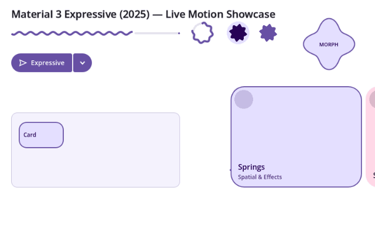 | 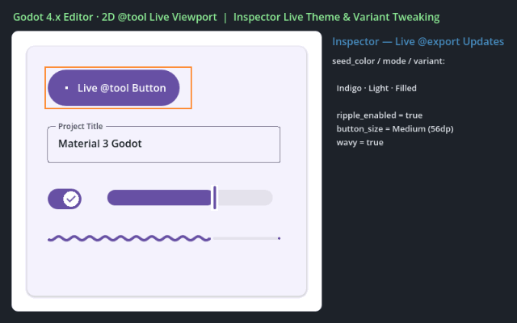 | 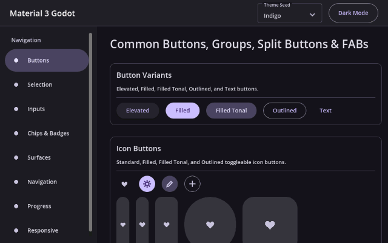 |

---

## Using It in the Godot 4 Editor

All components register their own `class_name` and run as `@tool` scripts. Shapes, shadows, floating labels, and colors update live in the 2D viewport as you change properties in the Inspector.

### 1. Live 2D Viewport and Inspector

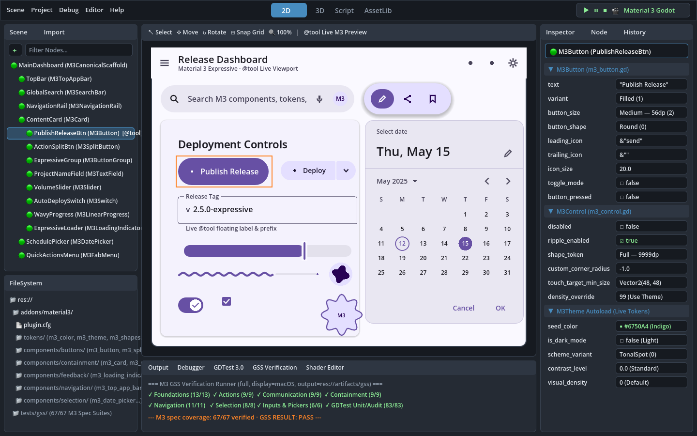

- **Scene Tree (Left)**: Build UI trees with `M3*` nodes just like regular Godot controls.
- **2D Viewport (Center)**: Move, resize, and anchor components with Godot's normal handles while seeing real-time Material 3 styling.
- **Inspector (Right)**: Change component options (`variant`, `button_size`, `button_shape`, `ripple_enabled`) or update global theme settings on `M3Theme` (`seed_color`, `is_dark_mode`, `scheme_variant`, `contrast_level`, `visual_density`).

### 2. Adding Nodes (`Create New Node`)

Press `Cmd+A` / `Ctrl+A` in the Scene dock and type `M3` to see all available components:

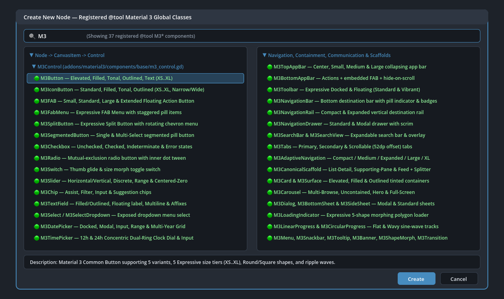

### 3. Editing Properties and Connecting Signals

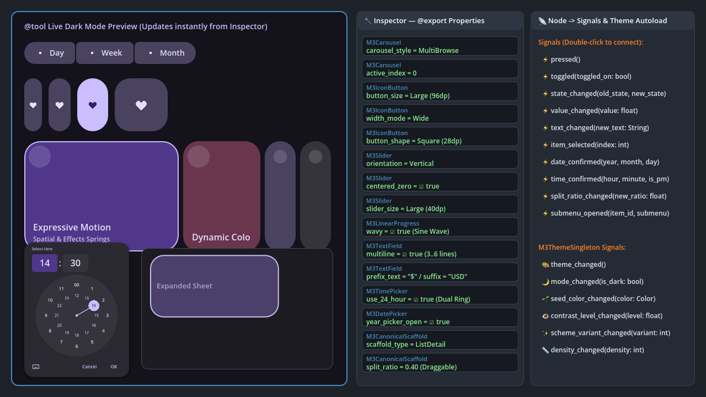

### 4. Built-in Showcase App

Press `F5` in Godot (or run `godot --path .`) to try out all the components, swap color presets, toggle light/dark mode, and test responsive layouts:

| Dark Mode | Light Mode |
|---|---|
| 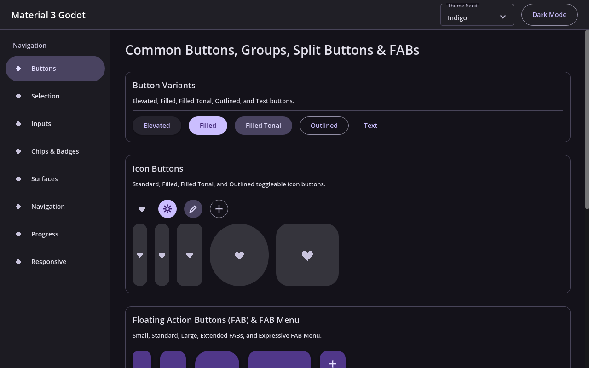 | 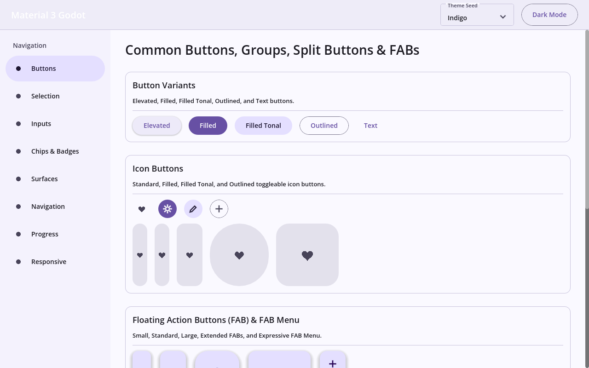 |

---

## Component Walkthrough

Each row below links to its page in the [Wiki](wiki/Home.md) with larger screenshots, animated GIFs, and GDScript examples.

### [Foundations (17)](wiki/Foundations.md)

Core theme tokens and helpers: dynamic color schemes from a single seed color, light/dark modes, contrast levels, text styles, rounded/cut/morphing shapes, elevation shadows, spring animations, hover/press ripples, responsive layouts, and UI density.

| Dynamic color palettes (light and dark) | Color scheme variants and contrast levels |
|---|---|
| 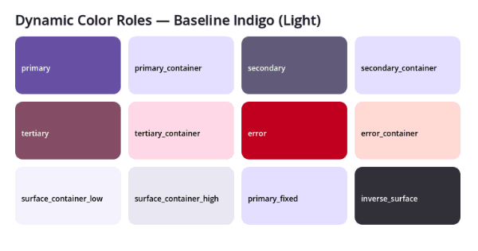 | 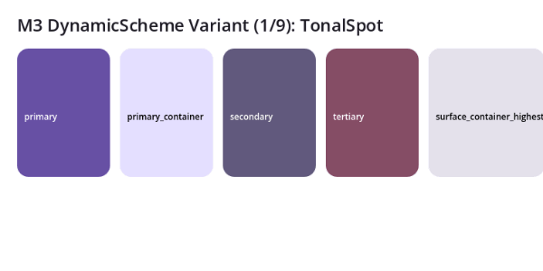 |

| Shape morphing loop | Spring motion curves |
|---|---|
| 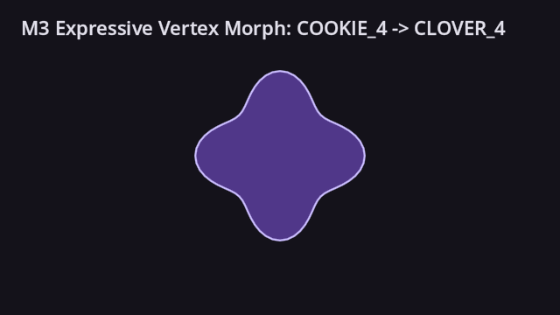 | 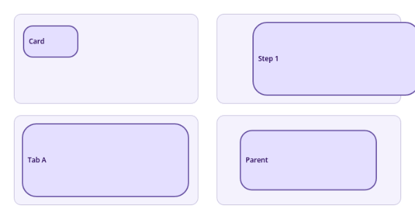 |

| Elevation levels 0 to 5 | Corner radius scale |
|---|---|
| 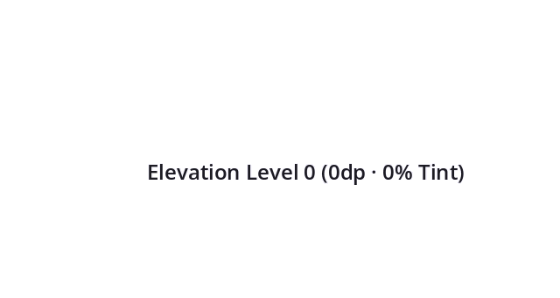 | 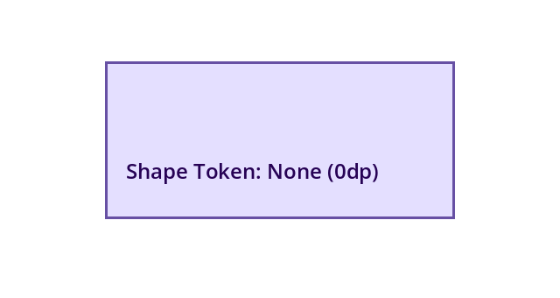 |

**Regular and emphasized typography**

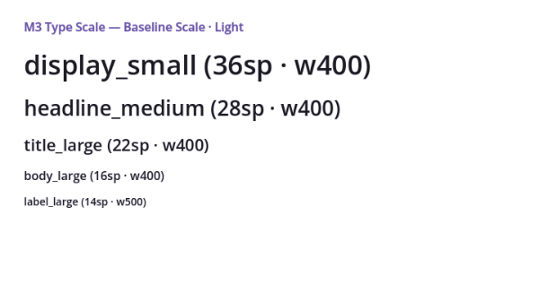

| Preview | Component & Script | Variants & Details |
|---|---|---|
| [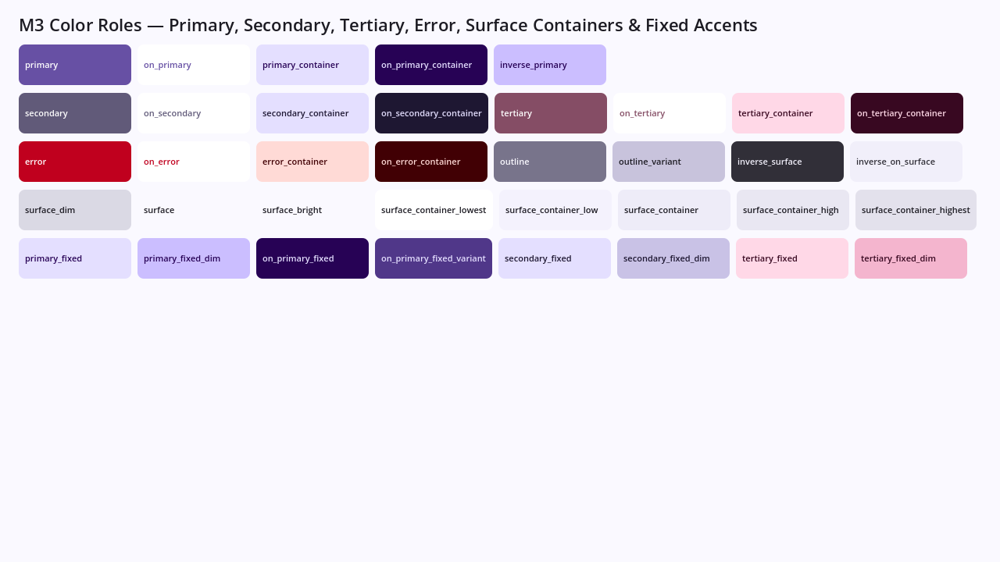](wiki/Foundations.md#foundationscolorroles)<br>[](wiki/Foundations.md#foundationscolorroles) | **[Color roles](wiki/Foundations.md#foundationscolorroles)**<br>`foundations.color.roles`<br> | **Variants:** `primary/secondary/tertiary/error families`, `surface + surface containers`, `outline/inverse/scrim/shadow`, `fixed accents`<br>All 49 M3 semantic & fixed color roles ([More in Wiki](wiki/Foundations.md#foundationscolorroles)) |
| [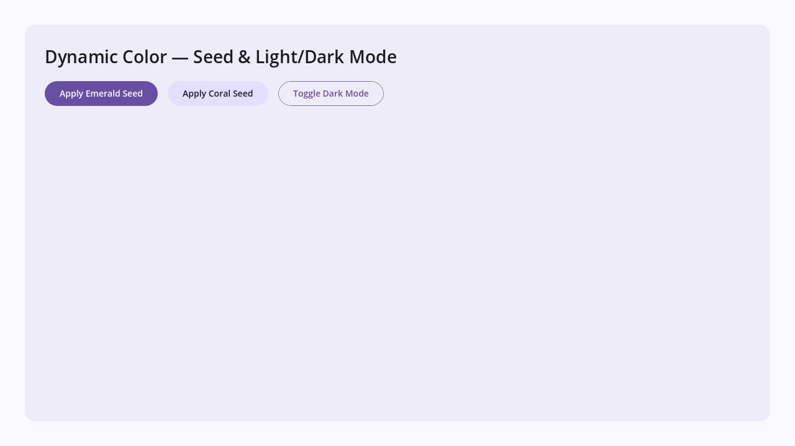](wiki/Foundations.md#foundationscolordynamic)<br>[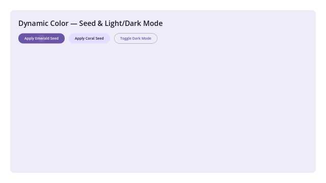](wiki/Foundations.md#foundationscolordynamic) | **[Dynamic color (seed + light/dark)](wiki/Foundations.md#foundationscolordynamic)**<br>`foundations.color.dynamic`<br> | **Variants:** `light scheme`, `dark scheme`, `seed change`<br>Dynamic color light scheme / Live seed color + light/dark mode switch ([More in Wiki](wiki/Foundations.md#foundationscolordynamic)) |
| [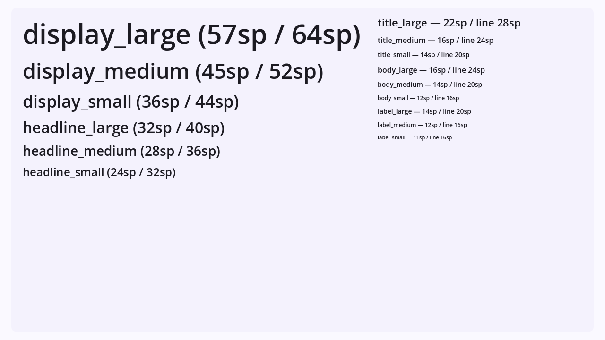](wiki/Foundations.md#foundationstypography)<br>[](wiki/Foundations.md#foundationstypography) | **[Type scale (15 roles)](wiki/Foundations.md#foundationstypography)**<br>`foundations.typography`<br> | **Variants:** `display L/M/S`, `headline L/M/S`, `title L/M/S`, `body L/M/S`, `label L/M/S`<br>All 15 M3 type scale roles ([More in Wiki](wiki/Foundations.md#foundationstypography)) |
| [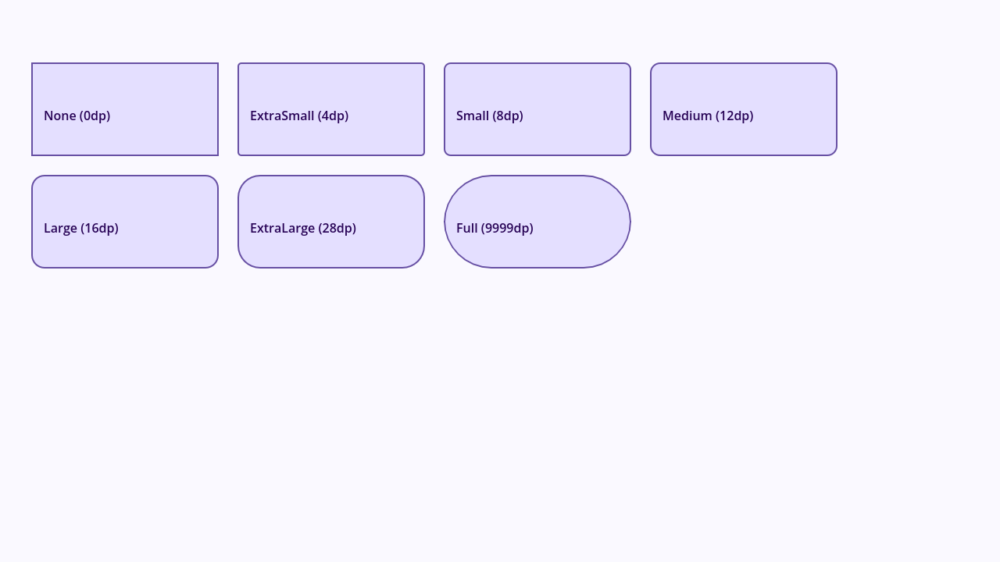](wiki/Foundations.md#foundationsshape)<br>[](wiki/Foundations.md#foundationsshape) | **[Shape scale](wiki/Foundations.md#foundationsshape)**<br>`foundations.shape`<br> | **Variants:** `none 0`, `extra-small 4`, `small 8`, `medium 12`, `large 16`, `extra-large 28`, `full`<br>7 M3 corner radius shape scale tokens ([More in Wiki](wiki/Foundations.md#foundationsshape)) |
| [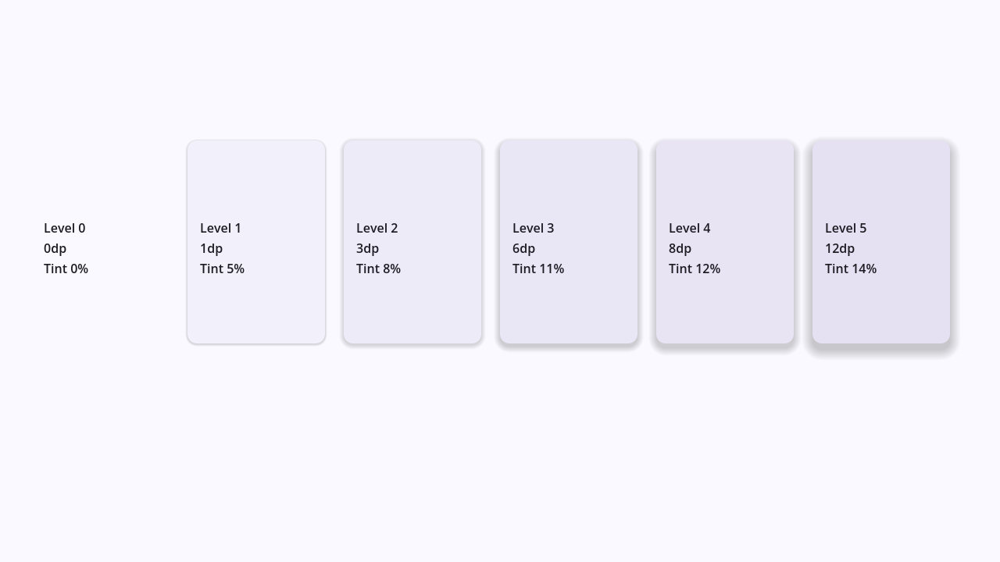](wiki/Foundations.md#foundationselevation)<br>[](wiki/Foundations.md#foundationselevation) | **[Elevation levels 0-5](wiki/Foundations.md#foundationselevation)**<br>`foundations.elevation`<br> | **Variants:** `level0 0dp`, `level1 1dp`, `level2 3dp`, `level3 6dp`, `level4 8dp`, `level5 12dp`<br>Elevation levels 0..5 with tonal tinting and shadows ([More in Wiki](wiki/Foundations.md#foundationselevation)) |
| [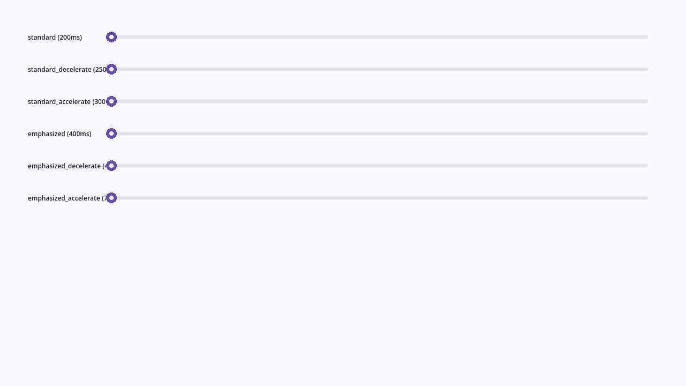](wiki/Foundations.md#foundationsmotion)<br>[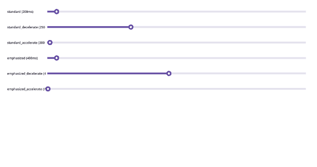](wiki/Foundations.md#foundationsmotion) | **[Motion easing & duration tokens](wiki/Foundations.md#foundationsmotion)**<br>`foundations.motion`<br> | **Variants:** `standard`, `standard accelerate/decelerate`, `emphasized`, `emphasized accelerate/decelerate`, `short/medium/long/extra-long durations`<br>6 M3 easing curves & duration tokens / Live easing curve evaluation across frames ([More in Wiki](wiki/Foundations.md#foundationsmotion)) |
| [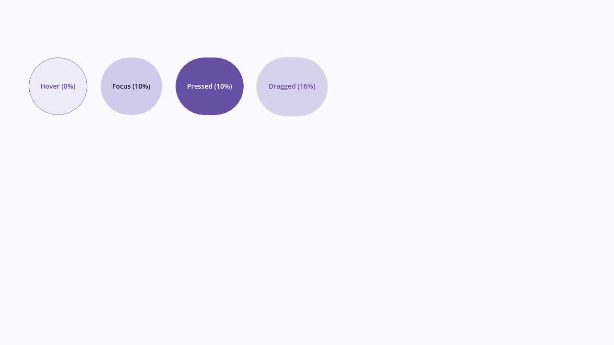](wiki/Foundations.md#foundationsstateslayers)<br>[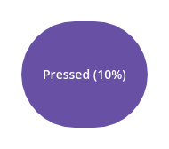](wiki/Foundations.md#foundationsstateslayers) | **[State layers](wiki/Foundations.md#foundationsstateslayers)**<br>`foundations.states.layers`<br> | **Variants:** `hover 0.08`, `focus 0.10`, `pressed 0.10`, `dragged 0.16`<br>Hover, focus, pressed, and dragged state layer opacities / Hover, press, and release state layer & ripple ([More in Wiki](wiki/Foundations.md#foundationsstateslayers)) |
| [](wiki/Foundations.md#foundationsstatesripple)<br>[](wiki/Foundations.md#foundationsstatesripple) | **[Ripple (pressed feedback)](wiki/Foundations.md#foundationsstatesripple)**<br>`foundations.states.ripple`<br> | **Variants:** `press spawn`, `expand`, `release fade`<br>Hover, press, and release state layer & ripple / State layer alpha tween and ripple wave radius expansion ([More in Wiki](wiki/Foundations.md#foundationsstatesripple)) |
| [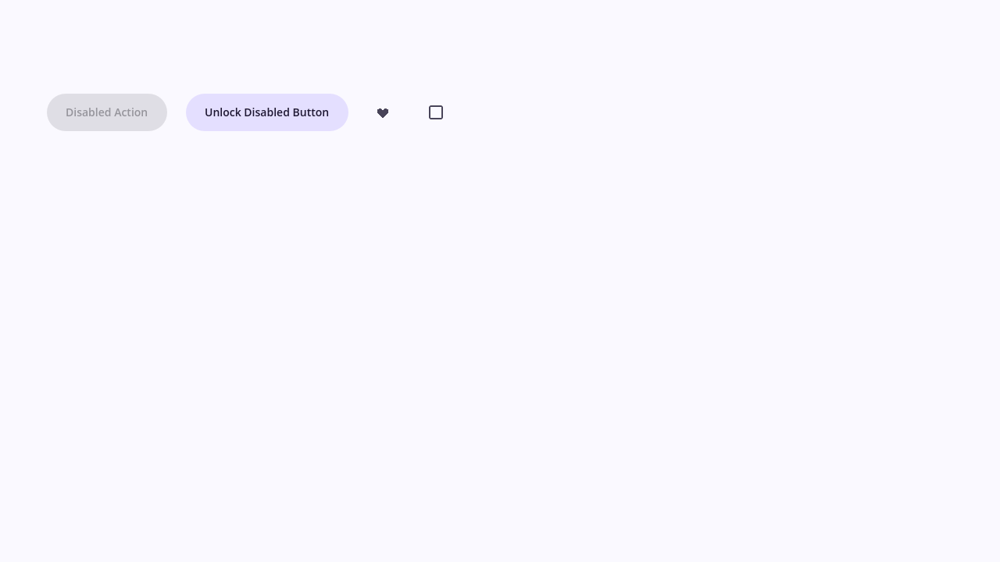](wiki/Foundations.md#foundationsstatesdisabled)<br>[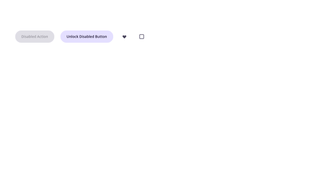](wiki/Foundations.md#foundationsstatesdisabled) | **[Disabled state opacities](wiki/Foundations.md#foundationsstatesdisabled)**<br>`foundations.states.disabled`<br> | **Variants:** `content 38%`, `container 12%`<br>Disabled 38%/12% opacities and >=48x48dp touch targets / Disabled button blocks click until unlocked ([More in Wiki](wiki/Foundations.md#foundationsstatesdisabled)) |
| [](wiki/Foundations.md#foundationsaccessibilitytargets) | **[Minimum touch targets (48dp)](wiki/Foundations.md#foundationsaccessibilitytargets)**<br>`foundations.accessibility.targets`<br> | **Variants:** `48x48 target`<br>Disabled 38%/12% opacities and >=48x48dp touch targets ([More in Wiki](wiki/Foundations.md#foundationsaccessibilitytargets)) |
| [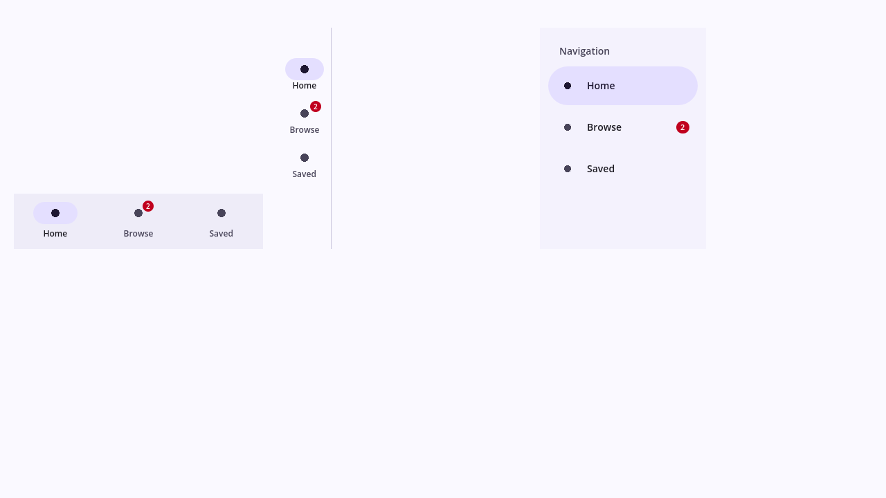](wiki/Foundations.md#foundationslayoutwindow_classes)<br>[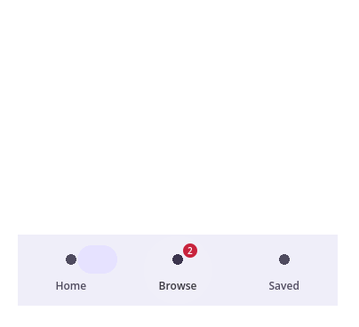](wiki/Foundations.md#foundationslayoutwindow_classes) | **[Window size classes](wiki/Foundations.md#foundationslayoutwindow_classes)**<br>`foundations.layout.window_classes`<br> | **Variants:** `compact <600`, `medium 600-839`, `expanded >=840`<br> ([More in Wiki](wiki/Foundations.md#foundationslayoutwindow_classes)) |
| [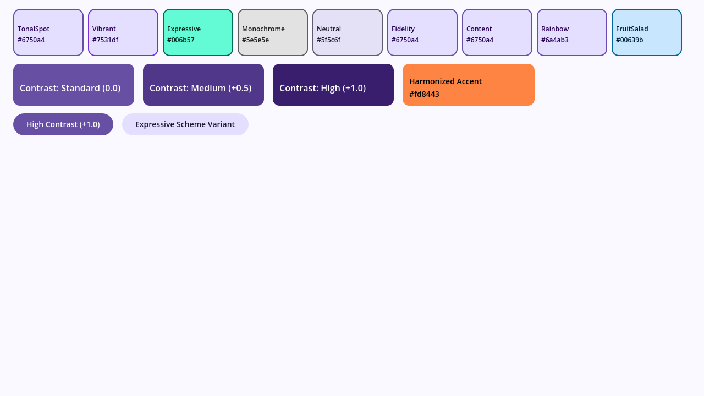](wiki/Foundations.md#foundationscolorcontrast_variants)<br>[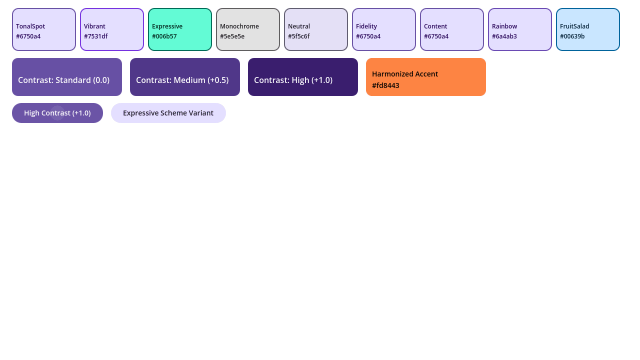](wiki/Foundations.md#foundationscolorcontrast_variants) | **[Contrast levels, 9 scheme variants & harmonization](wiki/Foundations.md#foundationscolorcontrast_variants)**<br>`foundations.color.contrast_variants`<br> | **Variants:** `standard/medium/high contrast`, `9 DynamicScheme variants (TonalSpot, Vibrant, Expressive, Monochrome, Neutral, Fidelity, Content, Rainbow, FruitSalad)`, `color harmonization`<br>9 DynamicScheme variants, 3 contrast levels, and color harmonization / Interactive contrast level and scheme variant switching ([More in Wiki](wiki/Foundations.md#foundationscolorcontrast_variants)) |
| [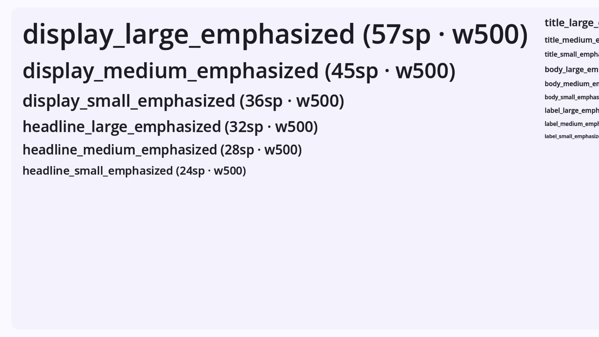](wiki/Foundations.md#foundationstypographyemphasized)<br>[](wiki/Foundations.md#foundationstypographyemphasized) | **[Emphasized type scale (15 Expressive roles)](wiki/Foundations.md#foundationstypographyemphasized)**<br>`foundations.typography.emphasized`<br> | **Variants:** `display L/M/S emphasized`, `headline L/M/S emphasized`, `title L/M/S emphasized`, `body L/M/S emphasized`, `label L/M/S emphasized`<br>All 15 M3 Expressive Emphasized type scale roles ([More in Wiki](wiki/Foundations.md#foundationstypographyemphasized)) |
| [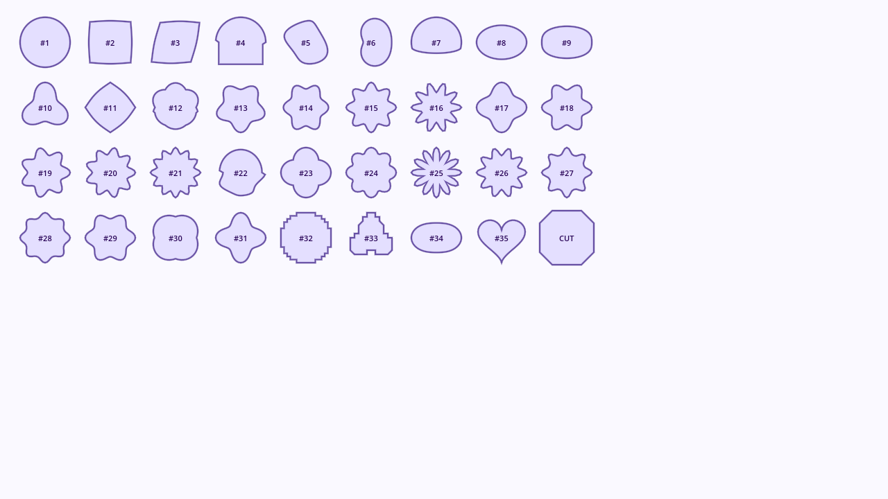](wiki/Foundations.md#foundationsshapeexpressive_morph)<br>[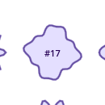](wiki/Foundations.md#foundationsshapeexpressive_morph) | **[Expressive 35 polygon shapes, Cut corners & morphing](wiki/Foundations.md#foundationsshapeexpressive_morph)**<br>`foundations.shape.expressive_morph`<br> | **Variants:** `35 MaterialShapes polygons`, `Cut corner family (chamfered)`, `extra_large_increased 32dp & extra_extra_large 48dp`, `polygon vertex morphing`<br>35 M3 Expressive MaterialShapes, 32/48dp tokens, and Cut corner family / Live polygon vertex morphing across frames ([More in Wiki](wiki/Foundations.md#foundationsshapeexpressive_morph)) |
| [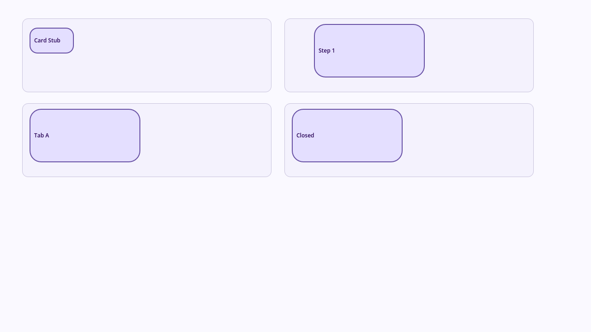](wiki/Foundations.md#foundationsmotionsprings_transitions)<br>[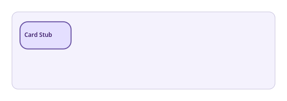](wiki/Foundations.md#foundationsmotionsprings_transitions) | **[Spring physics (Spatial vs Effects) & 4 transition patterns](wiki/Foundations.md#foundationsmotionsprings_transitions)**<br>`foundations.motion.springs_transitions`<br> | **Variants:** `Spatial springs (Fast/Default/Slow with overshoot)`, `Effects springs (critically damped)`, `Container Transform`, `Shared Axis X/Y/Z`, `Fade Through & Fade`<br>Spatial/Effects springs & 4 M3 transition patterns / Live Spatial & Effects spring transition playback ([More in Wiki](wiki/Foundations.md#foundationsmotionsprings_transitions)) |
| [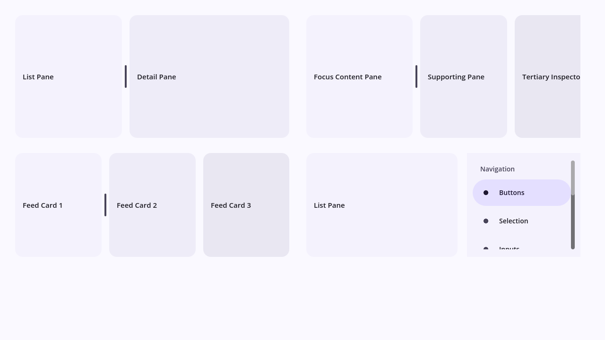](wiki/Foundations.md#foundationslayoutcanonical_scaffolds)<br>[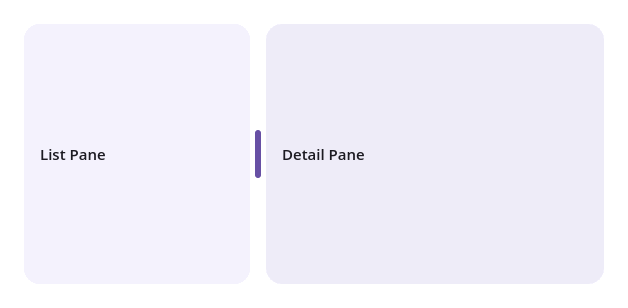](wiki/Foundations.md#foundationslayoutcanonical_scaffolds) | **[Canonical multi-pane scaffolds & Pane Expansion splitter](wiki/Foundations.md#foundationslayoutcanonical_scaffolds)**<br>`foundations.layout.canonical_scaffolds`<br> | **Variants:** `List-Detail scaffold`, `Supporting-Pane scaffold`, `Feed grid scaffold`, `draggable Pane Expansion splitter`, `Large (1200-1599) & Extra-Large (>=1600) size classes`<br> ([More in Wiki](wiki/Foundations.md#foundationslayoutcanonical_scaffolds)) |
| [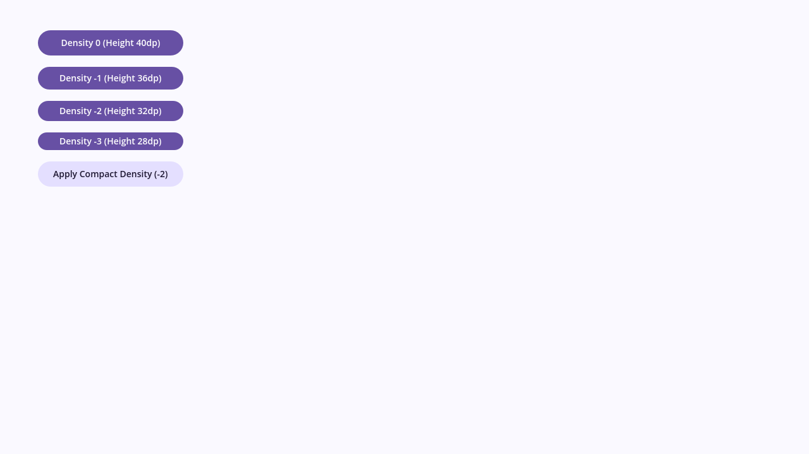](wiki/Foundations.md#foundationslayoutdensity)<br>[](wiki/Foundations.md#foundationslayoutdensity) | **[Visual density scale (0, -1, -2, -3)](wiki/Foundations.md#foundationslayoutdensity)**<br>`foundations.layout.density`<br> | **Variants:** `density 0 (default)`, `density -1 (-4dp)`, `density -2 (-8dp)`, `density -3 (-12dp)`<br>Visual density scale 0 (40dp), -1 (36dp), -2 (32dp), -3 (28dp) / Live visual density step change ([More in Wiki](wiki/Foundations.md#foundationslayoutdensity)) |

### [Actions (9)](wiki/Actions.md)

Buttons and action controls: standard buttons in 5 styles and sizes, icon buttons, floating action buttons (FABs), expandable FAB menus, segmented buttons, connected button groups, and split buttons.

| Buttons, button groups, and segmented buttons (dark mode) | FAB menu and split button (dark mode) |
|---|---|
| 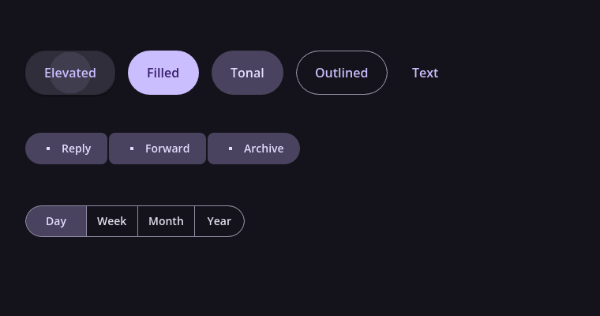 | 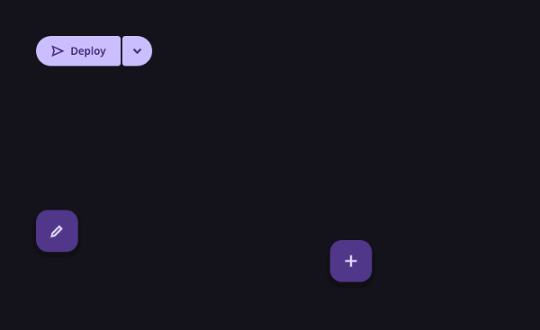 |

| Preview | Component & Script | Variants & Details |
|---|---|---|
| [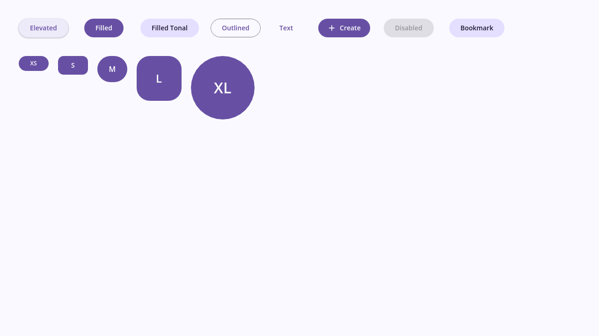](wiki/Actions.md#actionsbuttoncommon)<br>[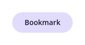](wiki/Actions.md#actionsbuttoncommon) | **[Common buttons](wiki/Actions.md#actionsbuttoncommon)**<br>`actions.button.common`<br> | **Variants:** `elevated`, `filled`, `filled tonal`, `outlined`, `text`, `with icon`, `disabled`, `toggle`<br>All variants, sizes XS..XL, round/square, icon, disabled, toggle (light) / All variants in dark mode ([More in Wiki](wiki/Actions.md#actionsbuttoncommon)) |
| [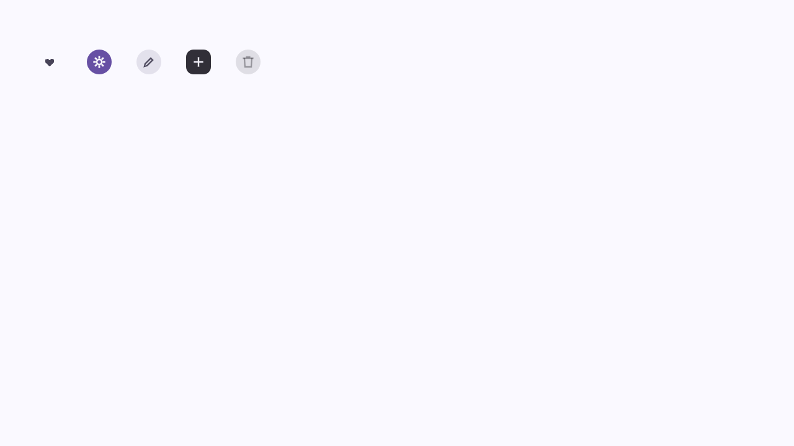](wiki/Actions.md#actionsbuttonicon)<br>[](wiki/Actions.md#actionsbuttonicon) | **[Icon buttons](wiki/Actions.md#actionsbuttonicon)**<br>`actions.button.icon`<br> | **Variants:** `standard`, `filled`, `filled tonal`, `outlined`, `toggle selected/unselected`<br> ([More in Wiki](wiki/Actions.md#actionsbuttonicon)) |
| [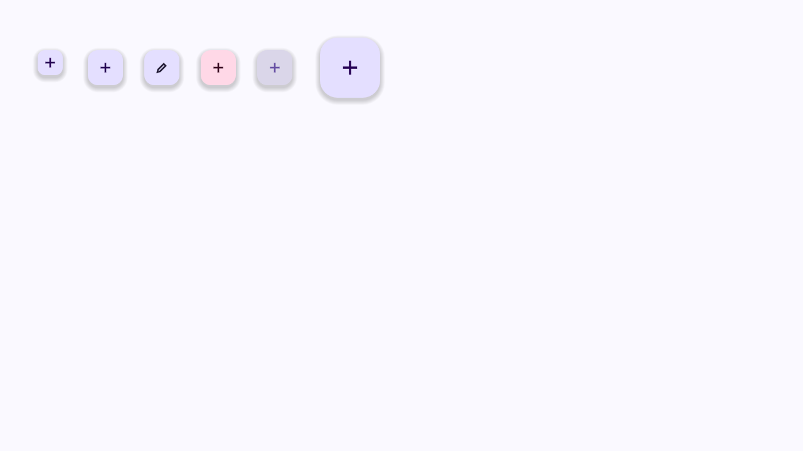](wiki/Actions.md#actionsfab)<br>[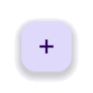](wiki/Actions.md#actionsfab) | **[Floating action buttons](wiki/Actions.md#actionsfab)**<br>`actions.fab`<br> | **Variants:** `small`, `FAB`, `large`, `primary/secondary/tertiary/surface colors`<br> ([More in Wiki](wiki/Actions.md#actionsfab)) |
| [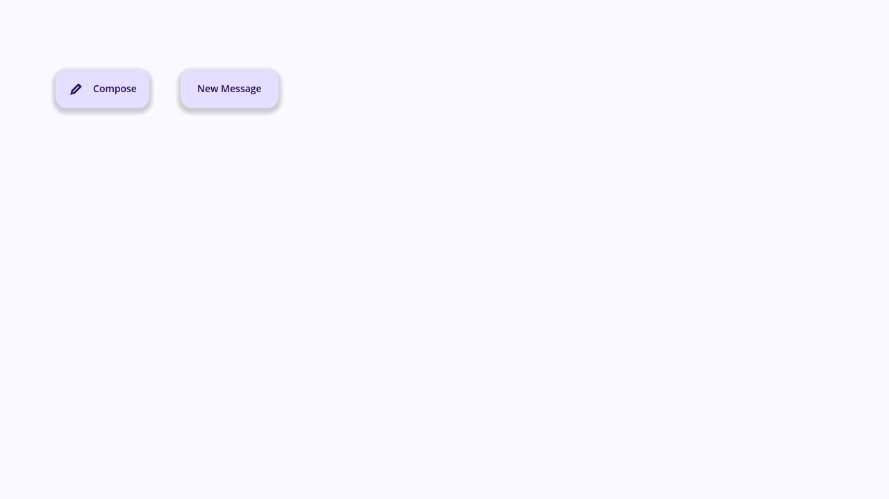](wiki/Actions.md#actionsfabextended)<br>[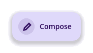](wiki/Actions.md#actionsfabextended) | **[Extended FAB](wiki/Actions.md#actionsfabextended)**<br>`actions.fab.extended`<br> | **Variants:** `icon + label`, `label only`<br> ([More in Wiki](wiki/Actions.md#actionsfabextended)) |
| [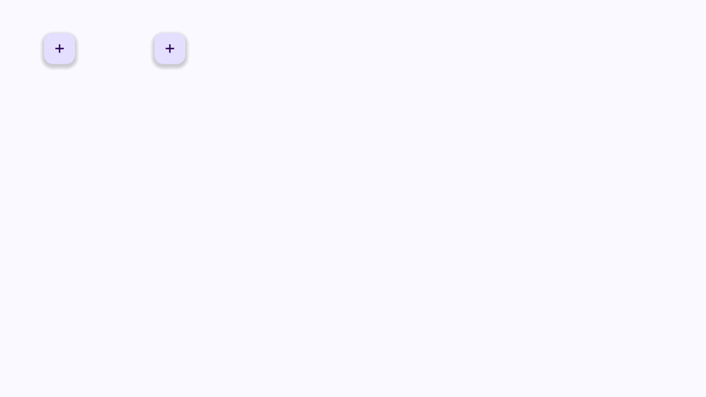](wiki/Actions.md#actionsfabmenu)<br>[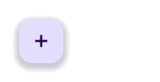](wiki/Actions.md#actionsfabmenu) | **[FAB menu (Expressive)](wiki/Actions.md#actionsfabmenu)**<br>`actions.fab.menu`<br> | **Variants:** `closed`, `open with 2-6 items`, `close button morph`<br>Closed state / Open state with 3 items and close button morph ([More in Wiki](wiki/Actions.md#actionsfabmenu)) |
| [](wiki/Actions.md#actionsbuttonsegmented)<br>[](wiki/Actions.md#actionsbuttonsegmented) | **[Segmented buttons](wiki/Actions.md#actionsbuttonsegmented)**<br>`actions.button.segmented`<br> | **Variants:** `single-select`, `multi-select`, `selected checkmark`<br> ([More in Wiki](wiki/Actions.md#actionsbuttonsegmented)) |
| [](wiki/Actions.md#actionsbuttongroup)<br>[](wiki/Actions.md#actionsbuttongroup) | **[Button groups (Expressive)](wiki/Actions.md#actionsbuttongroup)**<br>`actions.button.group`<br> | **Variants:** `standard`, `connected`, `press width morph`<br> ([More in Wiki](wiki/Actions.md#actionsbuttongroup)) |
| [](wiki/Actions.md#actionsbuttonsplit)<br>[](wiki/Actions.md#actionsbuttonsplit) | **[Split buttons (Expressive)](wiki/Actions.md#actionsbuttonsplit)**<br>`actions.button.split`<br> | **Variants:** `filled/tonal/elevated/outlined`, `trailing menu open/closed`<br>Filled, Tonal, Elevated, Outlined split buttons (closed) / Split button with trailing popup menu open ([More in Wiki](wiki/Actions.md#actionsbuttonsplit)) |
| [](wiki/Actions.md#actionsbuttoniconexpressive)<br>[](wiki/Actions.md#actionsbuttoniconexpressive) | **[Icon buttons — Expressive sizes, widths & shapes](wiki/Actions.md#actionsbuttoniconexpressive)**<br>`actions.button.icon.expressive`<br> | **Variants:** `5 size tiers (XS 32dp, S 40dp, M 56dp, L 96dp, XL 136dp)`, `3 width modes (Narrow, Default, Wide)`, `Round vs Square resting shapes`<br>5 sizes XS..XL, 3 width modes, Round and Square shapes ([More in Wiki](wiki/Actions.md#actionsbuttoniconexpressive)) |

### [Communication (9)](wiki/Communication.md)

Status and feedback controls: badges, linear and circular progress bars (including wavy style), animated loading indicators, snackbars, plain and rich tooltips, and banners.

| Wavy progress bars and loading indicators (dark mode) | Banner, tooltip, and snackbar |
|---|---|
|  |  |

| Preview | Component & Script | Variants & Details |
|---|---|---|
| [](wiki/Communication.md#communicationbadge)<br>[](wiki/Communication.md#communicationbadge) | **[Badges](wiki/Communication.md#communicationbadge)**<br>`communication.badge`<br> | **Variants:** `small dot`, `large count`, `max count 999+`<br> ([More in Wiki](wiki/Communication.md#communicationbadge)) |
| [](wiki/Communication.md#communicationprogresslinear)<br>[](wiki/Communication.md#communicationprogresslinear) | **[Linear progress indicator](wiki/Communication.md#communicationprogresslinear)**<br>`communication.progress.linear`<br> | **Variants:** `determinate`, `indeterminate`<br> ([More in Wiki](wiki/Communication.md#communicationprogresslinear)) |
| [](wiki/Communication.md#communicationprogresscircular)<br>[](wiki/Communication.md#communicationprogresscircular) | **[Circular progress indicator](wiki/Communication.md#communicationprogresscircular)**<br>`communication.progress.circular`<br> | **Variants:** `determinate`, `indeterminate`<br> ([More in Wiki](wiki/Communication.md#communicationprogresscircular)) |
| [](wiki/Communication.md#communicationloading_indicator)<br>[](wiki/Communication.md#communicationloading_indicator) | **[Loading indicator (Expressive)](wiki/Communication.md#communicationloading_indicator)**<br>`communication.loading_indicator`<br> | **Variants:** `uncontained`, `contained`, `shape morph sequence`<br> ([More in Wiki](wiki/Communication.md#communicationloading_indicator)) |
| [](wiki/Communication.md#communicationsnackbar)<br>[](wiki/Communication.md#communicationsnackbar) | **[Snackbar](wiki/Communication.md#communicationsnackbar)**<br>`communication.snackbar`<br> | **Variants:** `single line`, `with action`, `with close icon`<br> ([More in Wiki](wiki/Communication.md#communicationsnackbar)) |
| [](wiki/Communication.md#communicationtooltipplain)<br>[](wiki/Communication.md#communicationtooltipplain) | **[Plain tooltip](wiki/Communication.md#communicationtooltipplain)**<br>`communication.tooltip.plain`<br> | **Variants:** `plain`<br> ([More in Wiki](wiki/Communication.md#communicationtooltipplain)) |
| [](wiki/Communication.md#communicationtooltiprich)<br>[](wiki/Communication.md#communicationtooltiprich) | **[Rich tooltip](wiki/Communication.md#communicationtooltiprich)**<br>`communication.tooltip.rich`<br> | **Variants:** `title + body`, `with action`<br> ([More in Wiki](wiki/Communication.md#communicationtooltiprich)) |
| [](wiki/Communication.md#communicationbanner)<br>[](wiki/Communication.md#communicationbanner) | **[Banner](wiki/Communication.md#communicationbanner)**<br>`communication.banner`<br> | **Variants:** `one action`, `two actions`, `dismiss`<br> ([More in Wiki](wiki/Communication.md#communicationbanner)) |
| [](wiki/Communication.md#communicationprogresswavy)<br>[](wiki/Communication.md#communicationprogresswavy) | **[Wavy progress indicators (Expressive)](wiki/Communication.md#communicationprogresswavy)**<br>`communication.progress.wavy`<br> | **Variants:** `wavy linear determinate & indeterminate`, `wavy circular determinate & indeterminate`, `animated wave phase & amplitude`<br> ([More in Wiki](wiki/Communication.md#communicationprogresswavy)) |

### [Containment (8)](wiki/Containment.md)

Containers and overlays: bottom sheets, side sheets, cards, scrollable carousels, basic and full-screen dialogs, dividers, and list items.

| Carousel and cards (dark mode) | Bottom sheet and side sheet |
|---|---|
|  |  |

**Divider styles**


| Preview | Component & Script | Variants & Details |
|---|---|---|
| [](wiki/Containment.md#containmentbottom_sheet)<br>[](wiki/Containment.md#containmentbottom_sheet) | **[Bottom sheets](wiki/Containment.md#containmentbottom_sheet)**<br>`containment.bottom_sheet`<br> | **Variants:** `standard`, `modal with scrim`, `drag handle`<br> ([More in Wiki](wiki/Containment.md#containmentbottom_sheet)) |
| [](wiki/Containment.md#containmentcard)<br>[](wiki/Containment.md#containmentcard) | **[Cards](wiki/Containment.md#containmentcard)**<br>`containment.card`<br> | **Variants:** `elevated`, `filled`, `outlined`, `clickable states`<br> ([More in Wiki](wiki/Containment.md#containmentcard)) |
| [](wiki/Containment.md#containmentcarousel)<br>[](wiki/Containment.md#containmentcarousel) | **[Carousel](wiki/Containment.md#containmentcarousel)**<br>`containment.carousel`<br> | **Variants:** `multi-browse`, `uncontained`, `hero`, `full-screen`<br> ([More in Wiki](wiki/Containment.md#containmentcarousel)) |
| [](wiki/Containment.md#containmentdialogbasic)<br>[](wiki/Containment.md#containmentdialogbasic) | **[Basic dialog](wiki/Containment.md#containmentdialogbasic)**<br>`containment.dialog.basic`<br> | **Variants:** `headline + body + actions`, `with icon`, `scrim dismiss`<br> ([More in Wiki](wiki/Containment.md#containmentdialogbasic)) |
| [](wiki/Containment.md#containmentdialogfullscreen)<br>[](wiki/Containment.md#containmentdialogfullscreen) | **[Full-screen dialog](wiki/Containment.md#containmentdialogfullscreen)**<br>`containment.dialog.fullscreen`<br> | **Variants:** `full-screen with close + confirm action`<br> ([More in Wiki](wiki/Containment.md#containmentdialogfullscreen)) |
| [](wiki/Containment.md#containmentdivider)<br>[](wiki/Containment.md#containmentdivider) | **[Dividers](wiki/Containment.md#containmentdivider)**<br>`containment.divider`<br> | **Variants:** `full-width`, `inset`, `vertical`<br> ([More in Wiki](wiki/Containment.md#containmentdivider)) |
| [](wiki/Containment.md#containmentlist)<br>[](wiki/Containment.md#containmentlist) | **[Lists](wiki/Containment.md#containmentlist)**<br>`containment.list`<br> | **Variants:** `one-line`, `two-line`, `three-line`, `leading/trailing elements`, `selected`<br> ([More in Wiki](wiki/Containment.md#containmentlist)) |
| [](wiki/Containment.md#containmentside_sheet)<br>[](wiki/Containment.md#containmentside_sheet) | **[Side sheets](wiki/Containment.md#containmentside_sheet)**<br>`containment.side_sheet`<br> | **Variants:** `standard`, `modal with scrim`<br> ([More in Wiki](wiki/Containment.md#containmentside_sheet)) |

### [Navigation (10)](wiki/Navigation.md)

Navigation bars and chrome: collapsing top app bars, bottom app bars, docked and floating toolbars, bottom navigation bars, drawers, navigation rails, search bars, fixed and scrollable tabs, and responsive navigation that adapts to window width.

| Responsive window resizing | Top app bar, tabs, and floating toolbar (dark mode) |
|---|---|
|  |  |

| Preview | Component & Script | Variants & Details |
|---|---|---|
| [](wiki/Navigation.md#navigationapp_bartop)<br>[](wiki/Navigation.md#navigationapp_bartop) | **[Top app bar](wiki/Navigation.md#navigationapp_bartop)**<br>`navigation.app_bar.top`<br> | **Variants:** `center-aligned`, `small`, `medium`, `large`, `scrolled (on-scroll container color)`<br> ([More in Wiki](wiki/Navigation.md#navigationapp_bartop)) |
| [](wiki/Navigation.md#navigationapp_barbottom)<br>[](wiki/Navigation.md#navigationapp_barbottom) | **[Bottom app bar](wiki/Navigation.md#navigationapp_barbottom)**<br>`navigation.app_bar.bottom`<br> | **Variants:** `actions + FAB`, `hide on scroll`<br> ([More in Wiki](wiki/Navigation.md#navigationapp_barbottom)) |
| [](wiki/Navigation.md#navigationtoolbar)<br>[](wiki/Navigation.md#navigationtoolbar) | **[Toolbars (Expressive)](wiki/Navigation.md#navigationtoolbar)**<br>`navigation.toolbar`<br> | **Variants:** `docked`, `floating`, `standard/vibrant colors`<br> ([More in Wiki](wiki/Navigation.md#navigationtoolbar)) |
| [](wiki/Navigation.md#navigationbar)<br>[](wiki/Navigation.md#navigationbar) | **[Navigation bar](wiki/Navigation.md#navigationbar)**<br>`navigation.bar`<br> | **Variants:** `3-5 destinations`, `active indicator`, `badges`<br> ([More in Wiki](wiki/Navigation.md#navigationbar)) |
| [](wiki/Navigation.md#navigationdrawer)<br>[](wiki/Navigation.md#navigationdrawer) | **[Navigation drawer](wiki/Navigation.md#navigationdrawer)**<br>`navigation.drawer`<br> | **Variants:** `standard`, `modal with scrim`<br> ([More in Wiki](wiki/Navigation.md#navigationdrawer)) |
| [](wiki/Navigation.md#navigationrail)<br>[](wiki/Navigation.md#navigationrail) | **[Navigation rail](wiki/Navigation.md#navigationrail)**<br>`navigation.rail`<br> | **Variants:** `with FAB`, `active indicator`<br> ([More in Wiki](wiki/Navigation.md#navigationrail)) |
| [](wiki/Navigation.md#navigationsearch)<br>[](wiki/Navigation.md#navigationsearch) | **[Search (bar + view)](wiki/Navigation.md#navigationsearch)**<br>`navigation.search`<br> | **Variants:** `search bar`, `search view expanded with suggestions`<br> ([More in Wiki](wiki/Navigation.md#navigationsearch)) |
| [](wiki/Navigation.md#navigationtabs)<br>[](wiki/Navigation.md#navigationtabs) | **[Tabs](wiki/Navigation.md#navigationtabs)**<br>`navigation.tabs`<br> | **Variants:** `primary`, `secondary`, `indicator slide`<br> ([More in Wiki](wiki/Navigation.md#navigationtabs)) |
| [](wiki/Navigation.md#navigationadaptive)<br>[](wiki/Navigation.md#navigationadaptive) | **[Adaptive navigation](wiki/Navigation.md#navigationadaptive)**<br>`navigation.adaptive`<br> | **Variants:** `bar (compact)`, `rail (medium)`, `drawer (expanded)`<br> ([More in Wiki](wiki/Navigation.md#navigationadaptive)) |
| [](wiki/Navigation.md#navigationtabsscrollable)<br>[](wiki/Navigation.md#navigationtabsscrollable) | **[Scrollable tabs (52dp leading offset)](wiki/Navigation.md#navigationtabsscrollable)**<br>`navigation.tabs.scrollable`<br> | **Variants:** `scrollable primary tabs`, `scrollable secondary tabs`, `auto-scroll to active tab`<br> ([More in Wiki](wiki/Navigation.md#navigationtabsscrollable)) |

### [Selection (11)](wiki/Selection.md)

Inputs for picking values and options: checkboxes, chips, date pickers, menus and submenus, radio buttons, sliders (horizontal, vertical, range, and centered-zero), switches, and clock dial time pickers.

| Checkboxes, switches, radios, chips, and sliders (dark mode) | 24-hour time picker and year grid date picker |
|---|---|
|  |  |

| Preview | Component & Script | Variants & Details |
|---|---|---|
| [](wiki/Selection.md#selectioncheckbox)<br>[](wiki/Selection.md#selectioncheckbox) | **[Checkbox](wiki/Selection.md#selectioncheckbox)**<br>`selection.checkbox`<br> | **Variants:** `unchecked`, `checked`, `indeterminate`, `error`, `disabled`<br>Unchecked, checked, indeterminate, error, disabled / Click toggles unchecked -> checked ([More in Wiki](wiki/Selection.md#selectioncheckbox)) |
| [](wiki/Selection.md#selectionchip)<br>[](wiki/Selection.md#selectionchip) | **[Chips](wiki/Selection.md#selectionchip)**<br>`selection.chip`<br> | **Variants:** `assist`, `filter`, `input`, `suggestion`, `elevated`<br>Assist, filter, input, suggestion, elevated / Filter chip toggle + Input chip close ([More in Wiki](wiki/Selection.md#selectionchip)) |
| [](wiki/Selection.md#selectiondate_picker)<br>[](wiki/Selection.md#selectiondate_picker) | **[Date pickers](wiki/Selection.md#selectiondate_picker)**<br>`selection.date_picker`<br> | **Variants:** `docked`, `modal`, `modal input`, `range`<br>Docked and Modal M3DatePicker variants / Day cell selection, month navigation, and confirmation ([More in Wiki](wiki/Selection.md#selectiondate_picker)) |
| [](wiki/Selection.md#selectionmenu)<br>[](wiki/Selection.md#selectionmenu) | **[Menus](wiki/Selection.md#selectionmenu)**<br>`selection.menu`<br> | **Variants:** `items with icons`, `trailing shortcut`, `divider`, `disabled item`<br>Menu open scale/fade open_progress transition / Items with leading/trailing icons, shortcut, divider, disabled item ([More in Wiki](wiki/Selection.md#selectionmenu)) |
| [](wiki/Selection.md#selectionradio)<br>[](wiki/Selection.md#selectionradio) | **[Radio button](wiki/Selection.md#selectionradio)**<br>`selection.radio`<br> | **Variants:** `selected`, `unselected`, `group exclusivity`<br>Selected, unselected, disabled, group / Click unselected radio selects it and deselects previous ([More in Wiki](wiki/Selection.md#selectionradio)) |
| [](wiki/Selection.md#selectionslider)<br>[](wiki/Selection.md#selectionslider) | **[Sliders](wiki/Selection.md#selectionslider)**<br>`selection.slider`<br> | **Variants:** `continuous`, `discrete with ticks`, `range`, `value indicator`<br>Continuous, discrete with ticks, range / Drag discrete slider snaps to step 80 ([More in Wiki](wiki/Selection.md#selectionslider)) |
| [](wiki/Selection.md#selectionswitch)<br>[](wiki/Selection.md#selectionswitch) | **[Switch](wiki/Selection.md#selectionswitch)**<br>`selection.switch`<br> | **Variants:** `off`, `on`, `with icons`, `disabled`<br>Off, on, with icons, disabled (light) / Click switch toggles selected -> true ([More in Wiki](wiki/Selection.md#selectionswitch)) |
| [](wiki/Selection.md#selectiontime_picker)<br>[](wiki/Selection.md#selectiontime_picker) | **[Time pickers](wiki/Selection.md#selectiontime_picker)**<br>`selection.time_picker`<br> | **Variants:** `dial`, `input`, `AM/PM selector`, `hour/minute modes`<br>Dial hour, dial minute, AM/PM, and input time picker variants / Clock dial hour click, AM/PM toggle, minute chip, and OK confirm ([More in Wiki](wiki/Selection.md#selectiontime_picker)) |
| [](wiki/Selection.md#selectionsliderexpressive)<br>[](wiki/Selection.md#selectionsliderexpressive) | **[Sliders — Vertical, centered-zero & Expressive sizes](wiki/Selection.md#selectionsliderexpressive)**<br>`selection.slider.expressive`<br> | **Variants:** `vertical orientation`, `centered-zero bipolar (-100..+100)`, `Expressive XS/S/M/L/XL track heights`<br>Expressive thick tracks, centered-zero bidirectional, and vertical slider / Vertical upward drag and centered-zero negative selection ([More in Wiki](wiki/Selection.md#selectionsliderexpressive)) |
| [](wiki/Selection.md#selectionmenucascading_grouped)<br>[](wiki/Selection.md#selectionmenucascading_grouped) | **[Menus — Cascading submenus & Expressive groups](wiki/Selection.md#selectionmenucascading_grouped)**<br>`selection.menu.cascading_grouped`<br> | **Variants:** `nested cascading flyout submenu`, `Expressive detached rounded menu groups`, `keyboard shortcut labels`<br>Cascading submenu scale/fade and submenu_open_progress tween / Expressive grouped menu containers and open cascading submenu ([More in Wiki](wiki/Selection.md#selectionmenucascading_grouped)) |
| [](wiki/Selection.md#selectionpickersextended)<br>[](wiki/Selection.md#selectionpickersextended) | **[Pickers — 24h dual-ring Time Picker & Year-grid Date Picker](wiki/Selection.md#selectionpickersextended)**<br>`selection.pickers.extended`<br> | **Variants:** `24-hour inner/outer concentric clock dial (00-12 / 13-23)`, `interactive multi-year grid selector in Date Picker`<br>24h inner-ring dial_hand_length tween and year_picker_progress transition / 24-hour concentric dual-ring clock face and 3x5 Multi-Year Grid ([More in Wiki](wiki/Selection.md#selectionpickersextended)) |

### [Text inputs (3)](wiki/Text-Inputs.md)

Text entry controls: filled and outlined text fields with floating labels, icons, validation errors, multiline text areas, and dropdown select fields.

| Preview | Component & Script | Variants & Details |
|---|---|---|
| [](wiki/Text-Inputs.md#inputstext_field)<br>[](wiki/Text-Inputs.md#inputstext_field) | **[Text fields](wiki/Text-Inputs.md#inputstext_field)**<br>`inputs.text_field`<br> | **Variants:** `filled`, `outlined`, `error`, `supporting text`, `counter`, `leading/trailing icons`<br>All text field variants in light mode / Click focus, keyboard typing, clear & password toggle ([More in Wiki](wiki/Text-Inputs.md#inputstext_field)) |
| [](wiki/Text-Inputs.md#inputstext_fieldextended)<br>[](wiki/Text-Inputs.md#inputstext_fieldextended) | **[Text fields — Multiline textarea & prefix/suffix affixes](wiki/Text-Inputs.md#inputstext_fieldextended)**<br>`inputs.text_field.extended`<br> | **Variants:** `multiline wrapping textarea mode`, `prefix text ($)`, `suffix text (kg / .com)`<br>Prefix/suffix affixes and multiline auto-expanding textarea / Focus/type into prefix/suffix field and add lines to multiline field ([More in Wiki](wiki/Text-Inputs.md#inputstext_fieldextended)) |
| [](wiki/Text-Inputs.md#inputsselect)<br>[](wiki/Text-Inputs.md#inputsselect) | **[Exposed dropdown menu (select)](wiki/Text-Inputs.md#inputsselect)**<br>`inputs.select`<br> | **Variants:** `filled`, `outlined`, `open menu`, `selected value`<br>Filled, outlined, open menu, and M3SelectDropdown variants / Open dropdown and click option item ([More in Wiki](wiki/Text-Inputs.md#inputsselect)) |

---

## Quick Code Examples

### Changing Theme Colors and Dark Mode
```gdscript
# Update the M3Theme autoload at runtime or in the Inspector
M3Theme.set_seed_color(M3PaletteGenerator.PRESET_BASELINE_INDIGO)
M3Theme.set_scheme_variant(M3PaletteGenerator.SchemeVariant.EXPRESSIVE)
M3Theme.set_contrast_level(M3PaletteGenerator.CONTRAST_MEDIUM) # 0.0 Standard, 0.5 Medium, 1.0 High
M3Theme.set_dark_mode(true)
M3Theme.set_visual_density(-1) # 0, -1 (-4dp), -2 (-8dp), -3 (-12dp)

# Shift a custom color toward the current theme hue
var success_green: Color = M3Theme.harmonize_color(Color("#2E7D32"))
```

### Buttons, Split Buttons, and FAB Menus
```gdscript
var btn := M3Button.new()
btn.text = "Publish"
btn.leading_icon = &"send"
btn.variant = M3Button.Variant.FILLED
btn.button_size = M3Button.ButtonSize.MEDIUM # XS(32), S(40), M(56), L(96), XL(136)
add_child(btn)

var split := M3SplitButton.new()
split.text = "Deploy"
split.add_menu_item("Deploy to Staging")
split.add_menu_item("Deploy to Production")
add_child(split)

var fab_menu := M3FabMenu.new()
fab_menu.add_item("New Document", "edit")
fab_menu.add_item("Upload Asset", "image")
add_child(fab_menu)
```

### Multi-Pane Layouts
```gdscript
var scaffold := M3CanonicalScaffold.new()
scaffold.scaffold_type = M3CanonicalScaffold.ScaffoldType.LIST_DETAIL
scaffold.set_split_ratio(0.38, true)
add_child(scaffold)
```

---

## Installation

### Option 1: Copy into Your Project
1. Copy the `addons/material3/` folder into your project's `addons/` directory.
2. Open **Project -> Project Settings -> Plugins** in Godot and enable **Material 3 Godot**.
3. The `M3Theme` autoload is added automatically.

### Option 2: Sync Across Local Projects (`tools/m3_sync.py`)
```bash
# Copy addons/material3 to projects listed in .m3_projects.json
python3 tools/m3_sync.py --copy

# Or symlink for local development
python3 tools/m3_sync.py --link
```

---

## Running Tests

```bash
# Windowed GPU snapshot tests (captures PNGs and filmstrips)
godot --path . --script res://tests/gss/gss_runner.gd

# Headless snapshot tests
godot --headless --path . --script res://tests/gss/gss_runner.gd

# Unit tests
godot --headless --path . --script res://tests/gdtest_runner.gd

# Integration tests
godot --headless --path . --script res://tests/test_runner.gd

# Visual audits
godot --headless --path . --script res://tests/audit/audit_runner.gd
```
