# Actions

[Back to Wiki Home](Home.md) | [Godot 4 Editor Guide](IDE-Integration-and-Editor-Guide.md) | 9 components

Buttons and action controls: standard buttons in 5 styles and sizes, icon buttons, floating action buttons (FABs), expandable FAB menus, segmented buttons, connected button groups, and split buttons.

## Category Animations

| Buttons, button groups, and segmented buttons (dark mode) | FAB menu and split button (dark mode) |
|---|---|
| 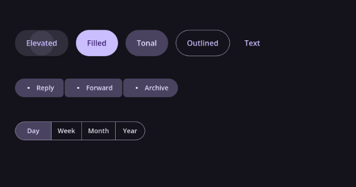 | 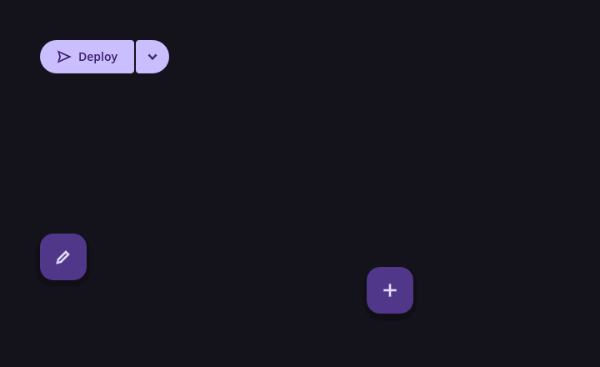 |

## Contents

- [Common buttons (`actions.button.common`)](#actionsbuttoncommon)
- [Icon buttons (`actions.button.icon`)](#actionsbuttonicon)
- [Floating action buttons (`actions.fab`)](#actionsfab)
- [Extended FAB (`actions.fab.extended`)](#actionsfabextended)
- [FAB menu (Expressive) (`actions.fab.menu`)](#actionsfabmenu)
- [Segmented buttons (`actions.button.segmented`)](#actionsbuttonsegmented)
- [Button groups (Expressive) (`actions.button.group`)](#actionsbuttongroup)
- [Split buttons (Expressive) (`actions.button.split`)](#actionsbuttonsplit)
- [Icon buttons — Expressive sizes, widths & shapes (`actions.button.icon.expressive`)](#actionsbuttoniconexpressive)

---

<a id="actionsbuttoncommon"></a>
## Common buttons (`actions.button.common`)

- **Material 3 Spec**: [https://m3.material.io/components/buttons/overview](https://m3.material.io/components/buttons/overview)
- **Supported Variants**: `elevated`, `filled`, `filled tonal`, `outlined`, `text`, `with icon`, `disabled`, `toggle`

### Example
```gdscript
var btn := M3Button.new()
btn.text = "Publish Release"
btn.leading_icon = &"send"
btn.variant = M3Button.Variant.FILLED
btn.button_size = M3Button.ButtonSize.MEDIUM # XS(32), S(40), M(56), L(96), XL(136)
btn.button_shape = M3Button.ButtonShape.ROUND
```

### Screenshots and Animations

#### All variants, sizes XS..XL, round/square, icon, disabled, toggle (light)
Test: `tests/gss/test_gss_actions.gd::test_actions_button_common` | [HTML Snapshot](../artifacts/gss/actions/actions.button.common__variants_light.gss.html) | [JSON Data](../artifacts/gss/actions/actions.button.common__variants_light.gss.json)

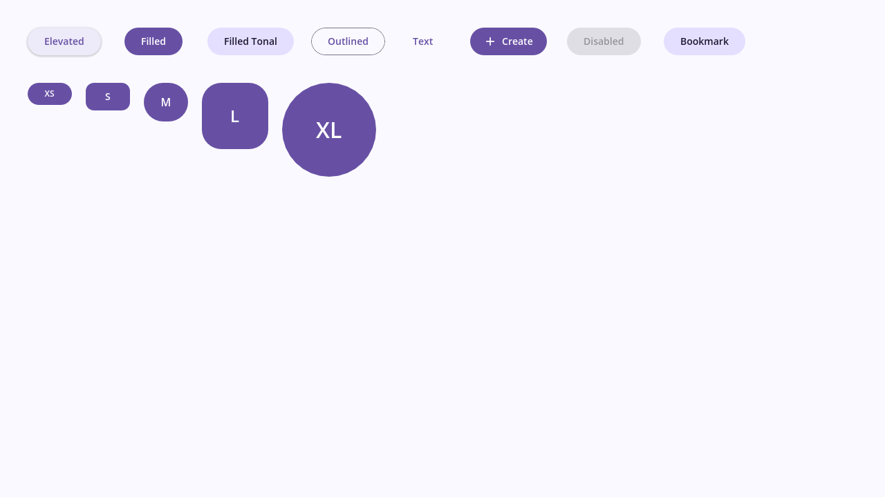

#### All variants in dark mode
Test: `tests/gss/test_gss_actions.gd::test_actions_button_common` | [HTML Snapshot](../artifacts/gss/actions/actions.button.common__variants_dark.gss.html) | [JSON Data](../artifacts/gss/actions/actions.button.common__variants_dark.gss.json)

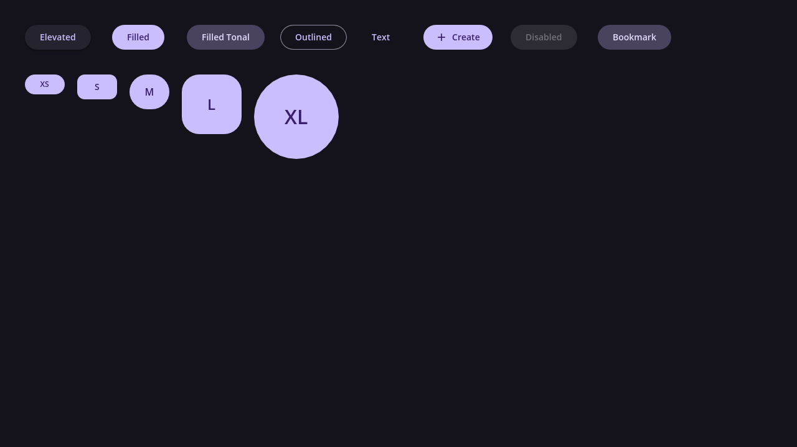

#### 
Test: `tests/gss/test_gss_actions.gd::test_actions_button_common` | [HTML Snapshot](../artifacts/gss/actions/actions.button.common__hover_press_toggle.gss.live.html) | [JSON Data](../artifacts/gss/actions/actions.button.common__hover_press_toggle.gss.live.json)

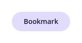


Frame breakdown (`actions.button.common__hover_press_toggle.filmstrip.png`):

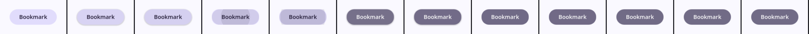

#### 
Test: `tests/gss/test_gss_actions.gd::test_actions_button_common` | [HTML Snapshot](../artifacts/gss/actions/actions.button.common__hover_press_toggle.gss.live.html) | [JSON Data](../artifacts/gss/actions/actions.button.common__hover_press_toggle.gss.live.json)

---

<a id="actionsbuttonicon"></a>
## Icon buttons (`actions.button.icon`)

- **Material 3 Spec**: [https://m3.material.io/components/icon-buttons/overview](https://m3.material.io/components/icon-buttons/overview)
- **Supported Variants**: `standard`, `filled`, `filled tonal`, `outlined`, `toggle selected/unselected`

### Example
```gdscript
var icon_btn := M3IconButton.new()
icon_btn.icon_name = &"favorite"
icon_btn.variant = M3IconButton.Variant.TONAL
icon_btn.toggle_mode = true
```

### Screenshots and Animations

#### 
Test: `tests/gss/test_gss_actions.gd::test_actions_button_icon` | [HTML Snapshot](../artifacts/gss/actions/actions.button.icon__variants_light.gss.html) | [JSON Data](../artifacts/gss/actions/actions.button.icon__variants_light.gss.json)


#### 
Test: `tests/gss/test_gss_actions.gd::test_actions_button_icon` | [HTML Snapshot](../artifacts/gss/actions/actions.button.icon__toggle_select.gss.live.html) | [JSON Data](../artifacts/gss/actions/actions.button.icon__toggle_select.gss.live.json)


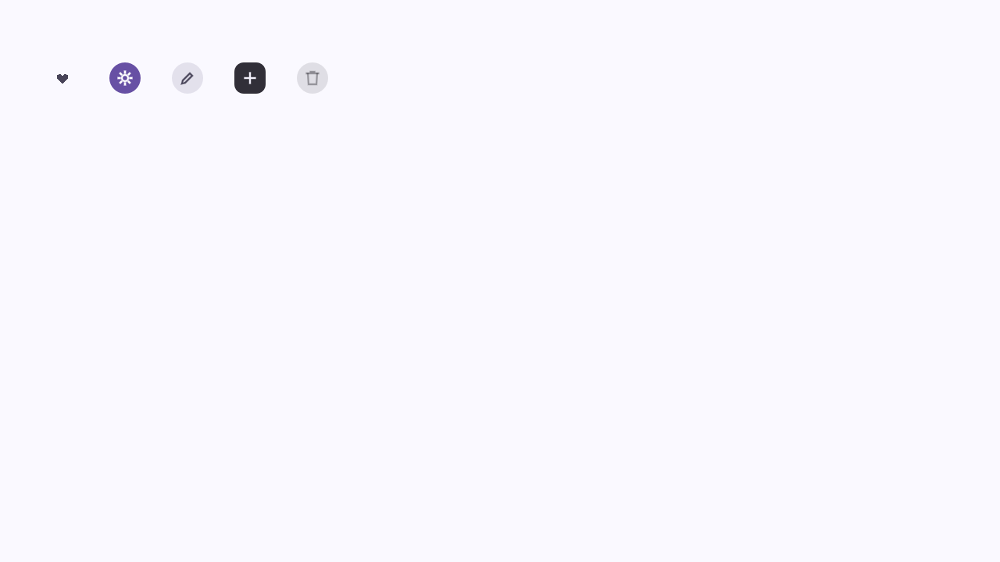

Frame breakdown (`actions.button.icon__toggle_select.filmstrip.png`):


#### 
Test: `tests/gss/test_gss_actions.gd::test_actions_button_icon` | [HTML Snapshot](../artifacts/gss/actions/actions.button.icon__toggle_select.gss.live.html) | [JSON Data](../artifacts/gss/actions/actions.button.icon__toggle_select.gss.live.json)

---

<a id="actionsfab"></a>
## Floating action buttons (`actions.fab`)

- **Material 3 Spec**: [https://m3.material.io/components/floating-action-button/overview](https://m3.material.io/components/floating-action-button/overview)
- **Supported Variants**: `small`, `FAB`, `large`, `primary/secondary/tertiary/surface colors`

### Example
```gdscript
var fab := M3FAB.new()
fab.icon_name = &"add"
fab.fab_variant = M3FAB.FabVariant.STANDARD # SMALL(40), STANDARD(56), LARGE(96)
fab.color_Preset = M3FAB.ColorPreset.PRIMARY
```

### Screenshots and Animations

#### 
Test: `tests/gss/test_gss_actions.gd::test_actions_fab` | [HTML Snapshot](../artifacts/gss/actions/actions.fab__sizes_and_palettes.gss.html) | [JSON Data](../artifacts/gss/actions/actions.fab__sizes_and_palettes.gss.json)

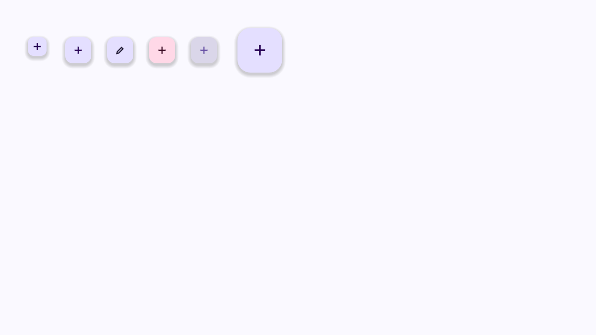

#### 
Test: `tests/gss/test_gss_actions.gd::test_actions_fab` | [HTML Snapshot](../artifacts/gss/actions/actions.fab__hover_press_elevation.gss.live.html) | [JSON Data](../artifacts/gss/actions/actions.fab__hover_press_elevation.gss.live.json)

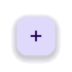


Frame breakdown (`actions.fab__hover_press_elevation.filmstrip.png`):

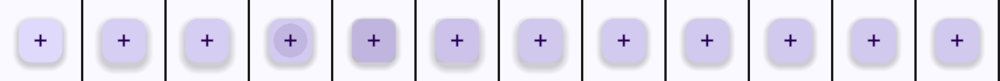

#### 
Test: `tests/gss/test_gss_actions.gd::test_actions_fab` | [HTML Snapshot](../artifacts/gss/actions/actions.fab__hover_press_elevation.gss.live.html) | [JSON Data](../artifacts/gss/actions/actions.fab__hover_press_elevation.gss.live.json)

---

<a id="actionsfabextended"></a>
## Extended FAB (`actions.fab.extended`)

- **Material 3 Spec**: [https://m3.material.io/components/extended-fab/overview](https://m3.material.io/components/extended-fab/overview)
- **Supported Variants**: `icon + label`, `label only`

### Example
```gdscript
var ext_fab := M3FAB.new()
ext_fab.icon_name = &"edit"
ext_fab.label = "Compose"
ext_fab.set_extended(true) # Smoothly tweens width between 56dp and extended pill
```

### Screenshots and Animations

#### 
Test: `tests/gss/test_gss_actions.gd::test_actions_fab_extended` | [HTML Snapshot](../artifacts/gss/actions/actions.fab.extended__variants_light.gss.html) | [JSON Data](../artifacts/gss/actions/actions.fab.extended__variants_light.gss.json)


#### 
Test: `tests/gss/test_gss_actions.gd::test_actions_fab_extended` | [HTML Snapshot](../artifacts/gss/actions/actions.fab.extended__collapse_and_expand.gss.live.html) | [JSON Data](../artifacts/gss/actions/actions.fab.extended__collapse_and_expand.gss.live.json)

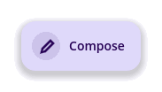

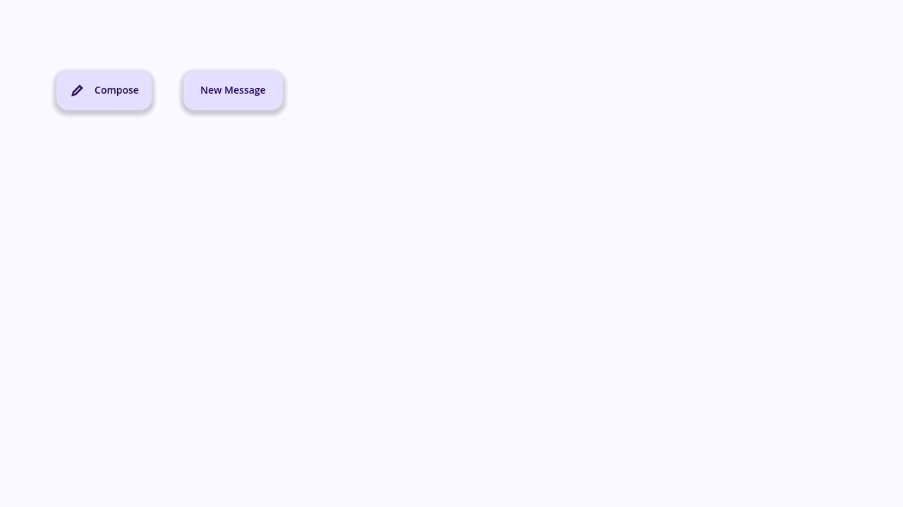

Frame breakdown (`actions.fab.extended__collapse_and_expand.filmstrip.png`):

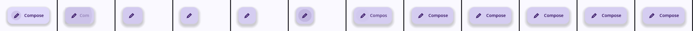

#### 
Test: `tests/gss/test_gss_actions.gd::test_actions_fab_extended` | [HTML Snapshot](../artifacts/gss/actions/actions.fab.extended__collapse_and_expand.gss.live.html) | [JSON Data](../artifacts/gss/actions/actions.fab.extended__collapse_and_expand.gss.live.json)

---

<a id="actionsfabmenu"></a>
## FAB menu (Expressive) (`actions.fab.menu`)

- **Material 3 Spec**: [https://m3.material.io/components/fab-menu/overview](https://m3.material.io/components/fab-menu/overview)
- **Supported Variants**: `closed`, `open with 2-6 items`, `close button morph`

### Example
```gdscript
var fab_menu := M3FabMenu.new()
fab_menu.add_item("New Document", "edit")
fab_menu.add_item("Upload Image", "image")
fab_menu.add_item("Share Link", "share")
```

### Screenshots and Animations

#### Closed state
Test: `tests/gss/test_gss_actions.gd::test_actions_fab_menu` | [HTML Snapshot](../artifacts/gss/actions/actions.fab.menu__closed_state.gss.html) | [JSON Data](../artifacts/gss/actions/actions.fab.menu__closed_state.gss.json)

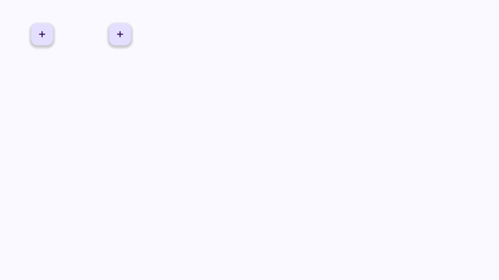

#### 
Test: `tests/gss/test_gss_actions.gd::test_actions_fab_menu` | [HTML Snapshot](../artifacts/gss/actions/actions.fab.menu__expand_and_select.gss.live.html) | [JSON Data](../artifacts/gss/actions/actions.fab.menu__expand_and_select.gss.live.json)

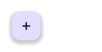


Frame breakdown (`actions.fab.menu__expand_and_select.filmstrip.png`):

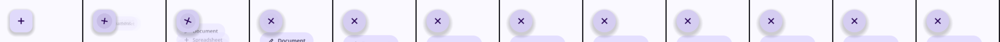

#### 
Test: `tests/gss/test_gss_actions.gd::test_actions_fab_menu` | [HTML Snapshot](../artifacts/gss/actions/actions.fab.menu__expand_and_select.gss.live.html) | [JSON Data](../artifacts/gss/actions/actions.fab.menu__expand_and_select.gss.live.json)

#### Open state with 3 items and close button morph
Test: `tests/gss/test_gss_actions.gd::test_actions_fab_menu` | [HTML Snapshot](../artifacts/gss/actions/actions.fab.menu__open_with_items.gss.html) | [JSON Data](../artifacts/gss/actions/actions.fab.menu__open_with_items.gss.json)

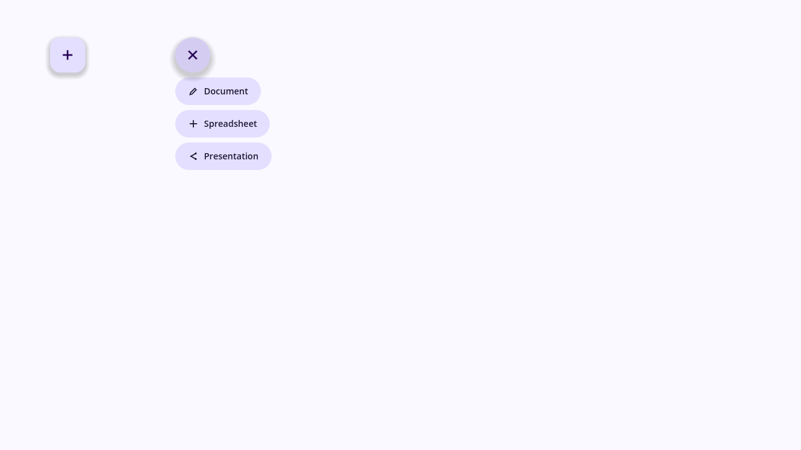

---

<a id="actionsbuttonsegmented"></a>
## Segmented buttons (`actions.button.segmented`)

- **Material 3 Spec**: [https://m3.material.io/components/segmented-buttons/overview](https://m3.material.io/components/segmented-buttons/overview)
- **Supported Variants**: `single-select`, `multi-select`, `selected checkmark`

### Example
```gdscript
var seg_group := M3SegmentedButtonGroup.new()
seg_group.multi_select = false
seg_group.set_items(["Day", "Week", "Month", "Year"])
```

### Screenshots and Animations

#### 
Test: `tests/gss/test_gss_actions.gd::test_actions_button_segmented` | [HTML Snapshot](../artifacts/gss/actions/actions.button.segmented__single_and_multi.gss.html) | [JSON Data](../artifacts/gss/actions/actions.button.segmented__single_and_multi.gss.json)

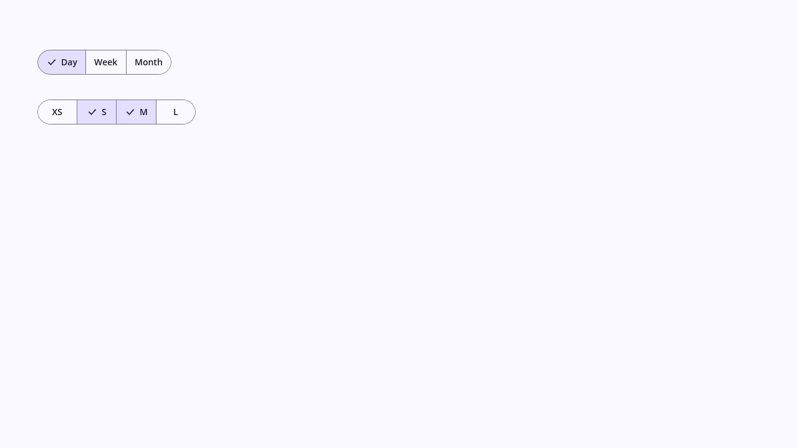

#### 
Test: `tests/gss/test_gss_actions.gd::test_actions_button_segmented` | [HTML Snapshot](../artifacts/gss/actions/actions.button.segmented__select_segment_checkmark.gss.live.html) | [JSON Data](../artifacts/gss/actions/actions.button.segmented__select_segment_checkmark.gss.live.json)

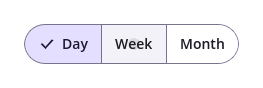


Frame breakdown (`actions.button.segmented__select_segment_checkmark.filmstrip.png`):

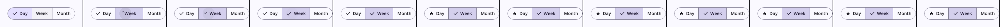

#### 
Test: `tests/gss/test_gss_actions.gd::test_actions_button_segmented` | [HTML Snapshot](../artifacts/gss/actions/actions.button.segmented__select_segment_checkmark.gss.live.html) | [JSON Data](../artifacts/gss/actions/actions.button.segmented__select_segment_checkmark.gss.live.json)

---

<a id="actionsbuttongroup"></a>
## Button groups (Expressive) (`actions.button.group`)

- **Material 3 Spec**: [https://m3.material.io/components/button-groups/overview](https://m3.material.io/components/button-groups/overview)
- **Supported Variants**: `standard`, `connected`, `press width morph`

### Example
```gdscript
var group := M3ButtonGroup.new()
group.group_variant = M3ButtonGroup.GroupVariant.CONNECTED
group.add_button("Reply", "undo")
group.add_button("Forward", "send")
group.add_button("Archive", "bookmark")
```

### Screenshots and Animations

#### 
Test: `tests/gss/test_gss_actions.gd::test_actions_button_group` | [HTML Snapshot](../artifacts/gss/actions/actions.button.group__standard_and_connected.gss.html) | [JSON Data](../artifacts/gss/actions/actions.button.group__standard_and_connected.gss.json)

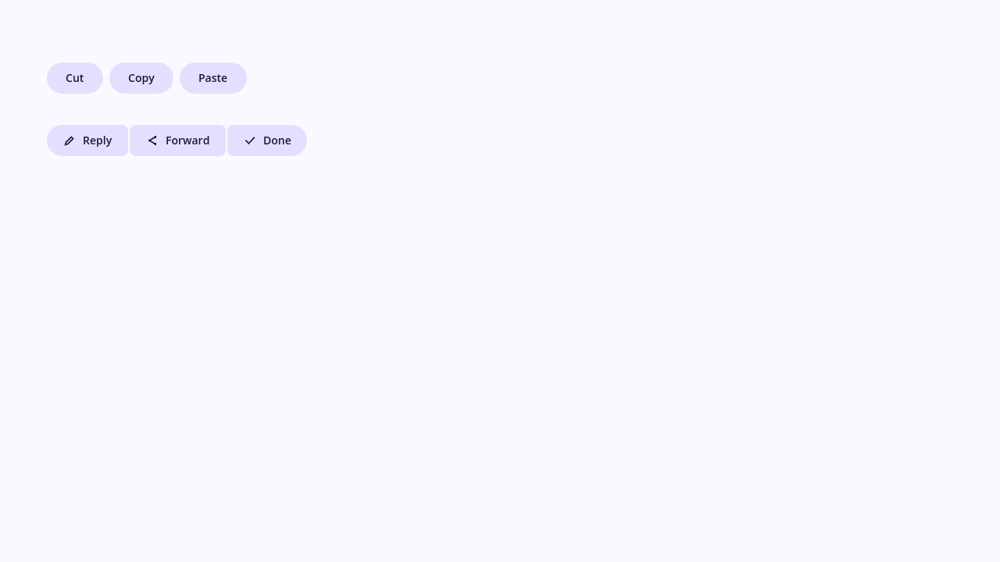

#### 
Test: `tests/gss/test_gss_actions.gd::test_actions_button_group` | [HTML Snapshot](../artifacts/gss/actions/actions.button.group__connected_press_width_morph.gss.live.html) | [JSON Data](../artifacts/gss/actions/actions.button.group__connected_press_width_morph.gss.live.json)

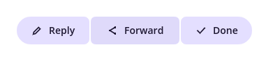


Frame breakdown (`actions.button.group__connected_press_width_morph.filmstrip.png`):

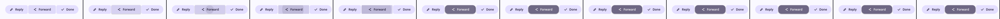

#### 
Test: `tests/gss/test_gss_actions.gd::test_actions_button_group` | [HTML Snapshot](../artifacts/gss/actions/actions.button.group__connected_press_width_morph.gss.live.html) | [JSON Data](../artifacts/gss/actions/actions.button.group__connected_press_width_morph.gss.live.json)

---

<a id="actionsbuttonsplit"></a>
## Split buttons (Expressive) (`actions.button.split`)

- **Material 3 Spec**: [https://m3.material.io/components/split-button/overview](https://m3.material.io/components/split-button/overview)
- **Supported Variants**: `filled/tonal/elevated/outlined`, `trailing menu open/closed`

### Example
```gdscript
var split := M3SplitButton.new()
split.text = "Send"
split.leading_icon = &"send"
split.variant = M3SplitButton.VariantType.FILLED
split.add_menu_item("Schedule send")
split.add_menu_item("Save as draft")
```

### Screenshots and Animations

#### Filled, Tonal, Elevated, Outlined split buttons (closed)
Test: `tests/gss/test_gss_actions.gd::test_actions_button_split` | [HTML Snapshot](../artifacts/gss/actions/actions.button.split__variants_closed.gss.html) | [JSON Data](../artifacts/gss/actions/actions.button.split__variants_closed.gss.json)


#### 
Test: `tests/gss/test_gss_actions.gd::test_actions_button_split` | [HTML Snapshot](../artifacts/gss/actions/actions.button.split__primary_and_menu_open.gss.live.html) | [JSON Data](../artifacts/gss/actions/actions.button.split__primary_and_menu_open.gss.live.json)


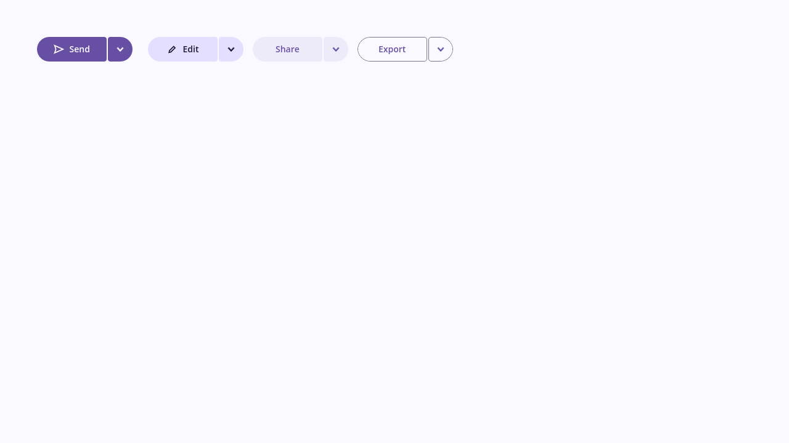

Frame breakdown (`actions.button.split__primary_and_menu_open.filmstrip.png`):


#### 
Test: `tests/gss/test_gss_actions.gd::test_actions_button_split` | [HTML Snapshot](../artifacts/gss/actions/actions.button.split__primary_and_menu_open.gss.live.html) | [JSON Data](../artifacts/gss/actions/actions.button.split__primary_and_menu_open.gss.live.json)

#### Split button with trailing popup menu open
Test: `tests/gss/test_gss_actions.gd::test_actions_button_split` | [HTML Snapshot](../artifacts/gss/actions/actions.button.split__menu_open.gss.html) | [JSON Data](../artifacts/gss/actions/actions.button.split__menu_open.gss.json)

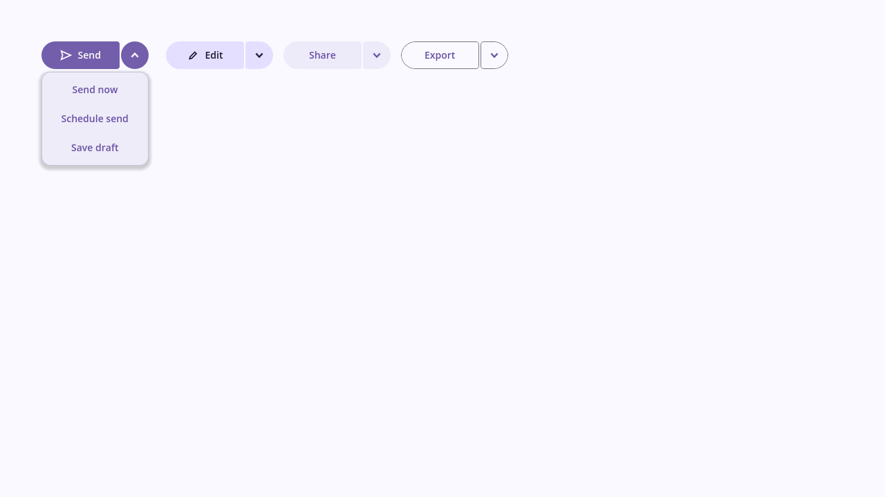

---

<a id="actionsbuttoniconexpressive"></a>
## Icon buttons — Expressive sizes, widths & shapes (`actions.button.icon.expressive`)

- **Material 3 Spec**: [https://m3.material.io/components/icon-buttons/specs](https://m3.material.io/components/icon-buttons/specs)
- **Supported Variants**: `5 size tiers (XS 32dp, S 40dp, M 56dp, L 96dp, XL 136dp)`, `3 width modes (Narrow, Default, Wide)`, `Round vs Square resting shapes`

### Example
```gdscript
var exp_icon := M3IconButton.new()
exp_icon.icon_name = &"edit"
exp_icon.variant = M3IconButton.Variant.FILLED
exp_icon.button_size = M3IconButton.ButtonSize.LARGE # 96dp
exp_icon.width_mode = M3IconButton.WidthMode.WIDE    # 128x96dp
exp_icon.button_shape = M3IconButton.ButtonShape.SQUARE
```

### Screenshots and Animations

#### 5 sizes XS..XL, 3 width modes, Round and Square shapes
Test: `tests/gss/test_gss_actions.gd::test_actions_button_icon_expressive` | [HTML Snapshot](../artifacts/gss/actions/actions.button.icon.expressive__sizes_widths_shapes.gss.html) | [JSON Data](../artifacts/gss/actions/actions.button.icon.expressive__sizes_widths_shapes.gss.json)

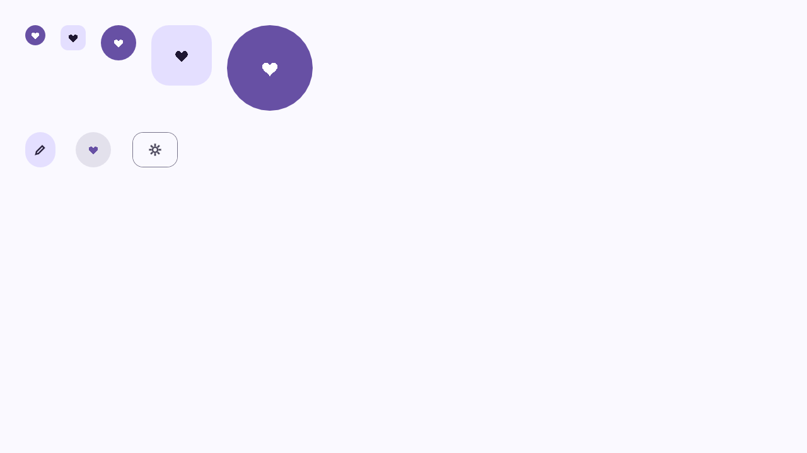

#### 
Test: `tests/gss/test_gss_actions.gd::test_actions_button_icon_expressive` | [HTML Snapshot](../artifacts/gss/actions/actions.button.icon.expressive__press_morph_and_toggle.gss.live.html) | [JSON Data](../artifacts/gss/actions/actions.button.icon.expressive__press_morph_and_toggle.gss.live.json)


Frame breakdown (`actions.button.icon.expressive__press_morph_and_toggle.filmstrip.png`):


#### 
Test: `tests/gss/test_gss_actions.gd::test_actions_button_icon_expressive` | [HTML Snapshot](../artifacts/gss/actions/actions.button.icon.expressive__press_morph_and_toggle.gss.live.html) | [JSON Data](../artifacts/gss/actions/actions.button.icon.expressive__press_morph_and_toggle.gss.live.json)

---
