# Communication

[Back to Wiki Home](Home.md) | [Godot 4 Editor Guide](IDE-Integration-and-Editor-Guide.md) | 9 components

Status and feedback controls: badges, linear and circular progress bars (including wavy style), animated loading indicators, snackbars, plain and rich tooltips, and banners.

## Category Animations

| Wavy progress bars and loading indicators (dark mode) | Banner, tooltip, and snackbar |
|---|---|
| 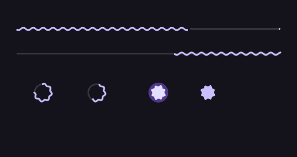 | 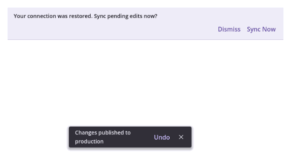 |

## Contents

- [Badges (`communication.badge`)](#communicationbadge)
- [Linear progress indicator (`communication.progress.linear`)](#communicationprogresslinear)
- [Circular progress indicator (`communication.progress.circular`)](#communicationprogresscircular)
- [Loading indicator (Expressive) (`communication.loading_indicator`)](#communicationloading_indicator)
- [Snackbar (`communication.snackbar`)](#communicationsnackbar)
- [Plain tooltip (`communication.tooltip.plain`)](#communicationtooltipplain)
- [Rich tooltip (`communication.tooltip.rich`)](#communicationtooltiprich)
- [Banner (`communication.banner`)](#communicationbanner)
- [Wavy progress indicators (Expressive) (`communication.progress.wavy`)](#communicationprogresswavy)

---

<a id="communicationbadge"></a>
## Badges (`communication.badge`)

- **Material 3 Spec**: [https://m3.material.io/components/badges/overview](https://m3.material.io/components/badges/overview)
- **Supported Variants**: `small dot`, `large count`, `max count 999+`

### Example
```gdscript
var badge := M3Badge.new()
badge.badge_size = M3Badge.BadgeSize.LARGE
badge.count = 42
```

### Screenshots and Animations

#### 
Test: `tests/gss/test_gss_communication.gd::test_communication_badge` | [HTML Snapshot](../artifacts/gss/communication/communication.badge__variants_light.gss.html) | [JSON Data](../artifacts/gss/communication/communication.badge__variants_light.gss.json)

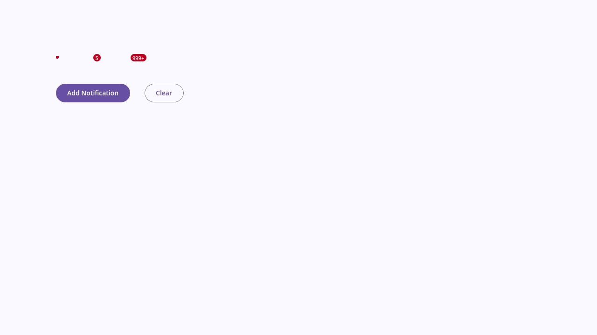

#### 
Test: `tests/gss/test_gss_communication.gd::test_communication_badge` | [HTML Snapshot](../artifacts/gss/communication/communication.badge__increment_and_clear.gss.live.html) | [JSON Data](../artifacts/gss/communication/communication.badge__increment_and_clear.gss.live.json)


Frame breakdown (`communication.badge__increment_and_clear.filmstrip.png`):


---

<a id="communicationprogresslinear"></a>
## Linear progress indicator (`communication.progress.linear`)

- **Material 3 Spec**: [https://m3.material.io/components/progress-indicators/overview](https://m3.material.io/components/progress-indicators/overview)
- **Supported Variants**: `determinate`, `indeterminate`

### Example
```gdscript
var bar := M3LinearProgress.new()
bar.set_value_animated(0.75)
```

### Screenshots and Animations

#### 
Test: `tests/gss/test_gss_communication.gd::test_communication_progress_linear` | [HTML Snapshot](../artifacts/gss/communication/communication.progress.linear__variants_light.gss.html) | [JSON Data](../artifacts/gss/communication/communication.progress.linear__variants_light.gss.json)


#### 
Test: `tests/gss/test_gss_communication.gd::test_communication_progress_linear` | [HTML Snapshot](../artifacts/gss/communication/communication.progress.linear__animate_progress.gss.live.html) | [JSON Data](../artifacts/gss/communication/communication.progress.linear__animate_progress.gss.live.json)

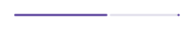


Frame breakdown (`communication.progress.linear__animate_progress.filmstrip.png`):


---

<a id="communicationprogresscircular"></a>
## Circular progress indicator (`communication.progress.circular`)

- **Material 3 Spec**: [https://m3.material.io/components/progress-indicators/overview](https://m3.material.io/components/progress-indicators/overview)
- **Supported Variants**: `determinate`, `indeterminate`

### Example
```gdscript
var ring := M3CircularProgress.new()
ring.indeterminate = true
```

### Screenshots and Animations

#### 
Test: `tests/gss/test_gss_communication.gd::test_communication_progress_circular` | [HTML Snapshot](../artifacts/gss/communication/communication.progress.circular__variants_dark.gss.html) | [JSON Data](../artifacts/gss/communication/communication.progress.circular__variants_dark.gss.json)


#### 
Test: `tests/gss/test_gss_communication.gd::test_communication_progress_circular` | [HTML Snapshot](../artifacts/gss/communication/communication.progress.circular__animate_progress.gss.live.html) | [JSON Data](../artifacts/gss/communication/communication.progress.circular__animate_progress.gss.live.json)


Frame breakdown (`communication.progress.circular__animate_progress.filmstrip.png`):

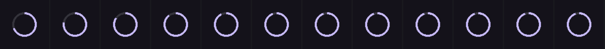

---

<a id="communicationloading_indicator"></a>
## Loading indicator (Expressive) (`communication.loading_indicator`)

- **Material 3 Spec**: [https://m3.material.io/components/loading-indicator/overview](https://m3.material.io/components/loading-indicator/overview)
- **Supported Variants**: `uncontained`, `contained`, `shape morph sequence`

### Example
```gdscript
var loader := M3LoadingIndicator.new()
loader.contained = true # 48x48 primary_container circle with morphing 5-shape polygon
```

### Screenshots and Animations

#### 
Test: `tests/gss/test_gss_communication.gd::test_communication_loading_indicator` | [HTML Snapshot](../artifacts/gss/communication/communication.loading_indicator__variants_and_morph_sequence.gss.html) | [JSON Data](../artifacts/gss/communication/communication.loading_indicator__variants_and_morph_sequence.gss.json)


#### 
Test: `tests/gss/test_gss_communication.gd::test_communication_loading_indicator` | [HTML Snapshot](../artifacts/gss/communication/communication.loading_indicator__morph_and_rotate.gss.live.html) | [JSON Data](../artifacts/gss/communication/communication.loading_indicator__morph_and_rotate.gss.live.json)


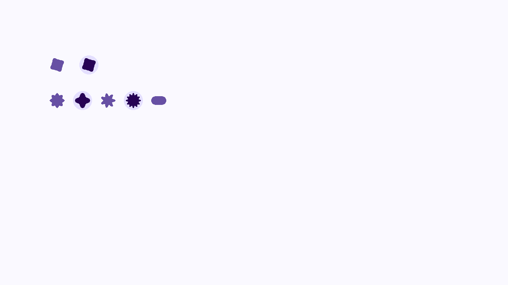

Frame breakdown (`communication.loading_indicator__morph_and_rotate.filmstrip.png`):

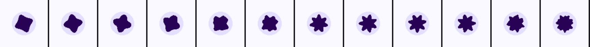

---

<a id="communicationsnackbar"></a>
## Snackbar (`communication.snackbar`)

- **Material 3 Spec**: [https://m3.material.io/components/snackbar/overview](https://m3.material.io/components/snackbar/overview)
- **Supported Variants**: `single line`, `with action`, `with close icon`

### Example
```gdscript
var snackbar := M3Snackbar.new()
snackbar.message_text = "Message archived"
snackbar.action_text = "Undo"
snackbar.show_close_icon = true
snackbar.show_snackbar()
```

### Screenshots and Animations

#### 
Test: `tests/gss/test_gss_communication.gd::test_communication_snackbar` | [HTML Snapshot](../artifacts/gss/communication/communication.snackbar__variants_light.gss.html) | [JSON Data](../artifacts/gss/communication/communication.snackbar__variants_light.gss.json)

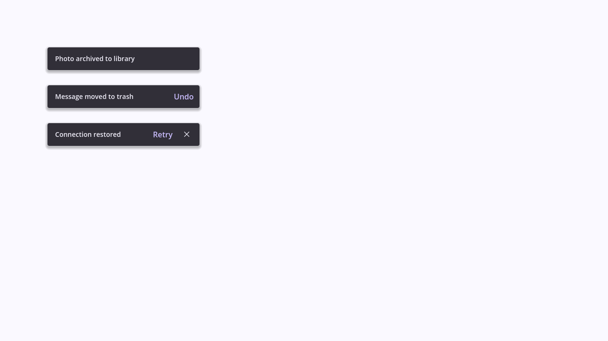

#### 
Test: `tests/gss/test_gss_communication.gd::test_communication_snackbar` | [HTML Snapshot](../artifacts/gss/communication/communication.snackbar__enter_action_and_dismiss.gss.live.html) | [JSON Data](../artifacts/gss/communication/communication.snackbar__enter_action_and_dismiss.gss.live.json)


Frame breakdown (`communication.snackbar__enter_action_and_dismiss.filmstrip.png`):


#### 
Test: `tests/gss/test_gss_communication.gd::test_communication_snackbar` | [HTML Snapshot](../artifacts/gss/communication/communication.snackbar__enter_action_and_dismiss.gss.live.html) | [JSON Data](../artifacts/gss/communication/communication.snackbar__enter_action_and_dismiss.gss.live.json)

---

<a id="communicationtooltipplain"></a>
## Plain tooltip (`communication.tooltip.plain`)

- **Material 3 Spec**: [https://m3.material.io/components/tooltips/overview](https://m3.material.io/components/tooltips/overview)
- **Supported Variants**: `plain`

### Example
```gdscript
var tip := M3Tooltip.new()
tip.tooltip_type = M3Tooltip.TooltipType.PLAIN
tip.body_text = "Add to favorites"
tip.show_tooltip()
```

### Screenshots and Animations

#### 
Test: `tests/gss/test_gss_communication.gd::test_communication_tooltip_plain` | [HTML Snapshot](../artifacts/gss/communication/communication.tooltip.plain__plain_variant.gss.html) | [JSON Data](../artifacts/gss/communication/communication.tooltip.plain__plain_variant.gss.json)

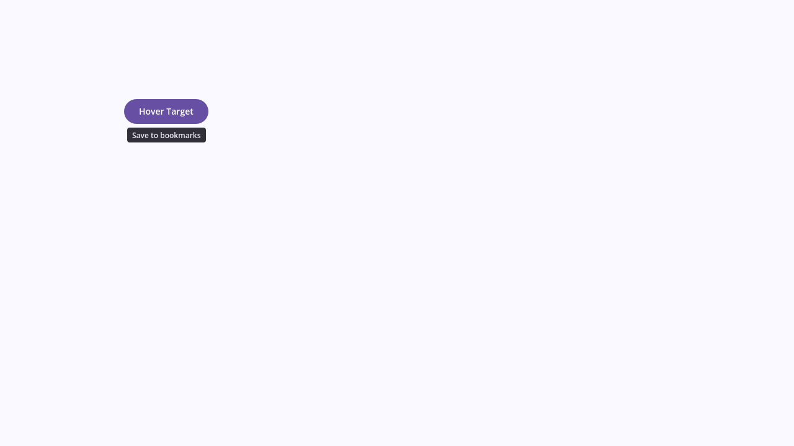

#### 
Test: `tests/gss/test_gss_communication.gd::test_communication_tooltip_plain` | [HTML Snapshot](../artifacts/gss/communication/communication.tooltip.plain__hover_fade_in_and_out.gss.live.html) | [JSON Data](../artifacts/gss/communication/communication.tooltip.plain__hover_fade_in_and_out.gss.live.json)


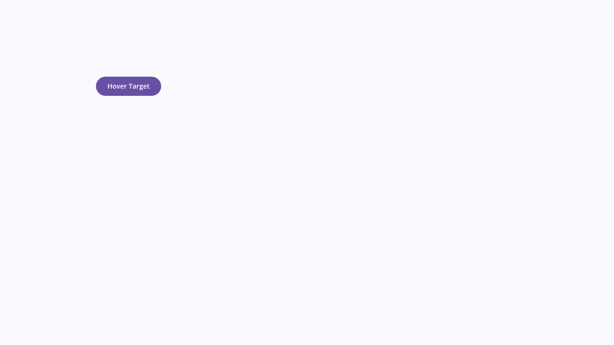

Frame breakdown (`communication.tooltip.plain__hover_fade_in_and_out.filmstrip.png`):


#### 
Test: `tests/gss/test_gss_communication.gd::test_communication_tooltip_plain` | [HTML Snapshot](../artifacts/gss/communication/communication.tooltip.plain__hover_fade_in_and_out.gss.live.html) | [JSON Data](../artifacts/gss/communication/communication.tooltip.plain__hover_fade_in_and_out.gss.live.json)

---

<a id="communicationtooltiprich"></a>
## Rich tooltip (`communication.tooltip.rich`)

- **Material 3 Spec**: [https://m3.material.io/components/tooltips/overview](https://m3.material.io/components/tooltips/overview)
- **Supported Variants**: `title + body`, `with action`

### Example
```gdscript
var rich_tip := M3Tooltip.new()
rich_tip.tooltip_type = M3Tooltip.TooltipType.RICH
rich_tip.title_text = "Dynamic Color"
rich_tip.body_text = "Automatically generates 49 accessible tonal roles from any seed color."
rich_tip.action_text = "Learn more"
```

### Screenshots and Animations

#### 
Test: `tests/gss/test_gss_communication.gd::test_communication_tooltip_rich` | [HTML Snapshot](../artifacts/gss/communication/communication.tooltip.rich__variants_light.gss.html) | [JSON Data](../artifacts/gss/communication/communication.tooltip.rich__variants_light.gss.json)

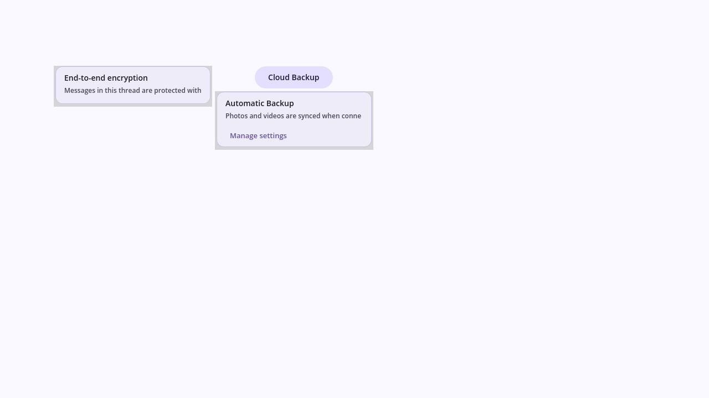

#### 
Test: `tests/gss/test_gss_communication.gd::test_communication_tooltip_rich` | [HTML Snapshot](../artifacts/gss/communication/communication.tooltip.rich__hover_open_and_click_action.gss.live.html) | [JSON Data](../artifacts/gss/communication/communication.tooltip.rich__hover_open_and_click_action.gss.live.json)

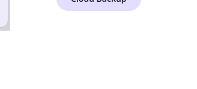


Frame breakdown (`communication.tooltip.rich__hover_open_and_click_action.filmstrip.png`):


#### 
Test: `tests/gss/test_gss_communication.gd::test_communication_tooltip_rich` | [HTML Snapshot](../artifacts/gss/communication/communication.tooltip.rich__hover_open_and_click_action.gss.live.html) | [JSON Data](../artifacts/gss/communication/communication.tooltip.rich__hover_open_and_click_action.gss.live.json)

---

<a id="communicationbanner"></a>
## Banner (`communication.banner`)

- **Material 3 Spec**: [https://m2.material.io/components/banners](https://m2.material.io/components/banners)
- **Supported Variants**: `one action`, `two actions`, `dismiss`

### Example
```gdscript
var banner := M3Banner.new()
banner.message_text = "Your offline changes will sync when reconnected."
banner.primary_action_text = "Retry Now"
banner.secondary_action_text = "Dismiss"
banner.show_banner()
```

### Screenshots and Animations

#### 
Test: `tests/gss/test_gss_communication.gd::test_communication_banner` | [HTML Snapshot](../artifacts/gss/communication/communication.banner__variants_light.gss.html) | [JSON Data](../artifacts/gss/communication/communication.banner__variants_light.gss.json)


#### 
Test: `tests/gss/test_gss_communication.gd::test_communication_banner` | [HTML Snapshot](../artifacts/gss/communication/communication.banner__click_primary_and_dismiss.gss.live.html) | [JSON Data](../artifacts/gss/communication/communication.banner__click_primary_and_dismiss.gss.live.json)


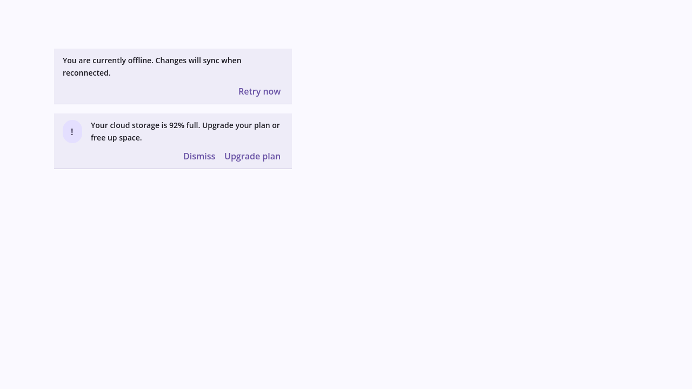

Frame breakdown (`communication.banner__click_primary_and_dismiss.filmstrip.png`):


#### 
Test: `tests/gss/test_gss_communication.gd::test_communication_banner` | [HTML Snapshot](../artifacts/gss/communication/communication.banner__click_primary_and_dismiss.gss.live.html) | [JSON Data](../artifacts/gss/communication/communication.banner__click_primary_and_dismiss.gss.live.json)

---

<a id="communicationprogresswavy"></a>
## Wavy progress indicators (Expressive) (`communication.progress.wavy`)

- **Material 3 Spec**: [https://m3.material.io/components/progress-indicators/overview](https://m3.material.io/components/progress-indicators/overview)
- **Supported Variants**: `wavy linear determinate & indeterminate`, `wavy circular determinate & indeterminate`, `animated wave phase & amplitude`

### Example
```gdscript
var wavy_bar := M3LinearProgress.new()
wavy_bar.wavy = true
wavy_bar.wave_amplitude = 3.0
wavy_bar.wave_wavelength = 24.0
wavy_bar.set_value_immediate(0.65)
```

### Screenshots and Animations

#### 
Test: `tests/gss/test_gss_communication.gd::test_communication_progress_wavy` | [HTML Snapshot](../artifacts/gss/communication/communication.progress.wavy__linear_and_circular_wavy.gss.html) | [JSON Data](../artifacts/gss/communication/communication.progress.wavy__linear_and_circular_wavy.gss.json)

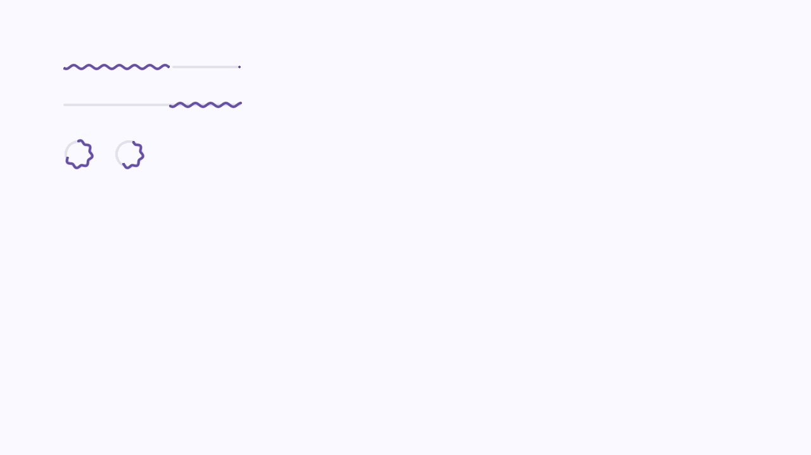

#### 
Test: `tests/gss/test_gss_communication.gd::test_communication_progress_wavy` | [HTML Snapshot](../artifacts/gss/communication/communication.progress.wavy__animate_wave_phase.gss.live.html) | [JSON Data](../artifacts/gss/communication/communication.progress.wavy__animate_wave_phase.gss.live.json)


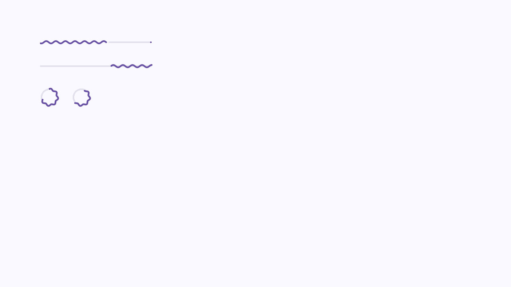

Frame breakdown (`communication.progress.wavy__animate_wave_phase.filmstrip.png`):

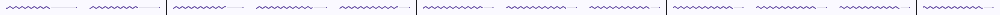

---
