# Containment

[Back to Wiki Home](Home.md) | [Godot 4 Editor Guide](IDE-Integration-and-Editor-Guide.md) | 8 components

Containers and overlays: bottom sheets, side sheets, cards, scrollable carousels, basic and full-screen dialogs, dividers, and list items.

## Category Animations

| Carousel and cards (dark mode) | Bottom sheet and side sheet |
|---|---|
| 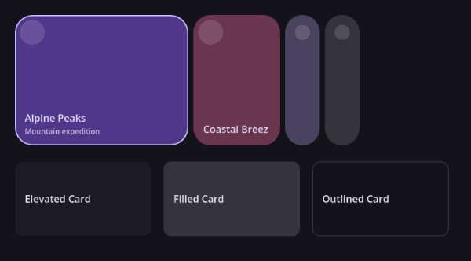 |  |

**Divider styles**

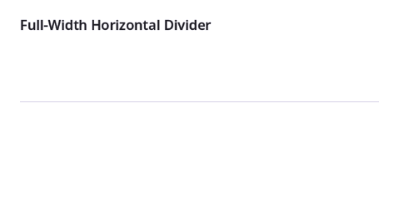

## Contents

- [Bottom sheets (`containment.bottom_sheet`)](#containmentbottom_sheet)
- [Cards (`containment.card`)](#containmentcard)
- [Carousel (`containment.carousel`)](#containmentcarousel)
- [Basic dialog (`containment.dialog.basic`)](#containmentdialogbasic)
- [Full-screen dialog (`containment.dialog.fullscreen`)](#containmentdialogfullscreen)
- [Dividers (`containment.divider`)](#containmentdivider)
- [Lists (`containment.list`)](#containmentlist)
- [Side sheets (`containment.side_sheet`)](#containmentside_sheet)

---

<a id="containmentbottom_sheet"></a>
## Bottom sheets (`containment.bottom_sheet`)

- **Material 3 Spec**: [https://m3.material.io/components/bottom-sheets/overview](https://m3.material.io/components/bottom-sheets/overview)
- **Supported Variants**: `standard`, `modal with scrim`, `drag handle`

### Example
```gdscript
var sheet := M3BottomSheet.new()
sheet.is_modal = true
sheet.show_drag_handle = true
sheet.open()
```

### Screenshots and Animations

#### 
Test: `tests/gss/test_gss_containment.gd::test_bottom_sheet_variants_and_interaction` | [HTML Snapshot](../artifacts/gss/containment/containment.bottom_sheet__open_slide_up.gss.live.html) | [JSON Data](../artifacts/gss/containment/containment.bottom_sheet__open_slide_up.gss.live.json)


Frame breakdown (`containment.bottom_sheet__open_slide_up.filmstrip.png`):


#### 
Test: `tests/gss/test_gss_containment.gd::test_bottom_sheet_variants_and_interaction` | [HTML Snapshot](../artifacts/gss/containment/containment.bottom_sheet__modal_open.gss.html) | [JSON Data](../artifacts/gss/containment/containment.bottom_sheet__modal_open.gss.json)

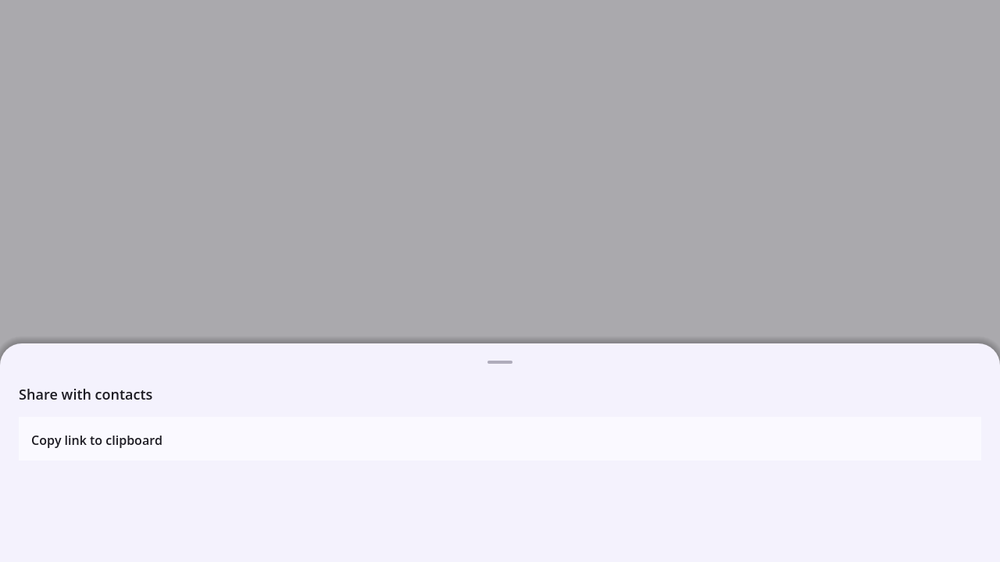

#### 
Test: `tests/gss/test_gss_containment.gd::test_bottom_sheet_variants_and_interaction` | [HTML Snapshot](../artifacts/gss/containment/containment.bottom_sheet__drag_handle_dismiss.gss.live.html) | [JSON Data](../artifacts/gss/containment/containment.bottom_sheet__drag_handle_dismiss.gss.live.json)

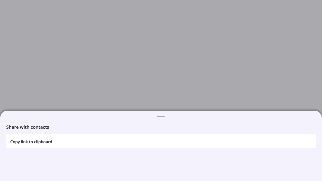


Frame breakdown (`containment.bottom_sheet__drag_handle_dismiss.filmstrip.png`):


---

<a id="containmentcard"></a>
## Cards (`containment.card`)

- **Material 3 Spec**: [https://m3.material.io/components/cards/overview](https://m3.material.io/components/cards/overview)
- **Supported Variants**: `elevated`, `filled`, `outlined`, `clickable states`

### Example
```gdscript
var card := M3Card.new()
card.card_type = M3Card.CardType.ELEVATED # ELEVATED, FILLED, OUTLINED
card.clickable = true
```

### Screenshots and Animations

#### 
Test: `tests/gss/test_gss_containment.gd::test_card_variants_and_interaction` | [HTML Snapshot](../artifacts/gss/containment/containment.card__variants_light.gss.html) | [JSON Data](../artifacts/gss/containment/containment.card__variants_light.gss.json)


#### 
Test: `tests/gss/test_gss_containment.gd::test_card_variants_and_interaction` | [HTML Snapshot](../artifacts/gss/containment/containment.card__variants_dark.gss.html) | [JSON Data](../artifacts/gss/containment/containment.card__variants_dark.gss.json)

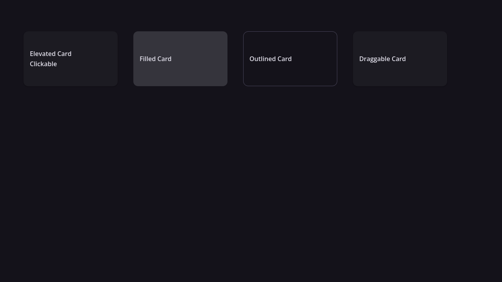

#### 
Test: `tests/gss/test_gss_containment.gd::test_card_variants_and_interaction` | [HTML Snapshot](../artifacts/gss/containment/containment.card__click_and_drag.gss.live.html) | [JSON Data](../artifacts/gss/containment/containment.card__click_and_drag.gss.live.json)

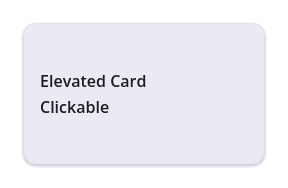

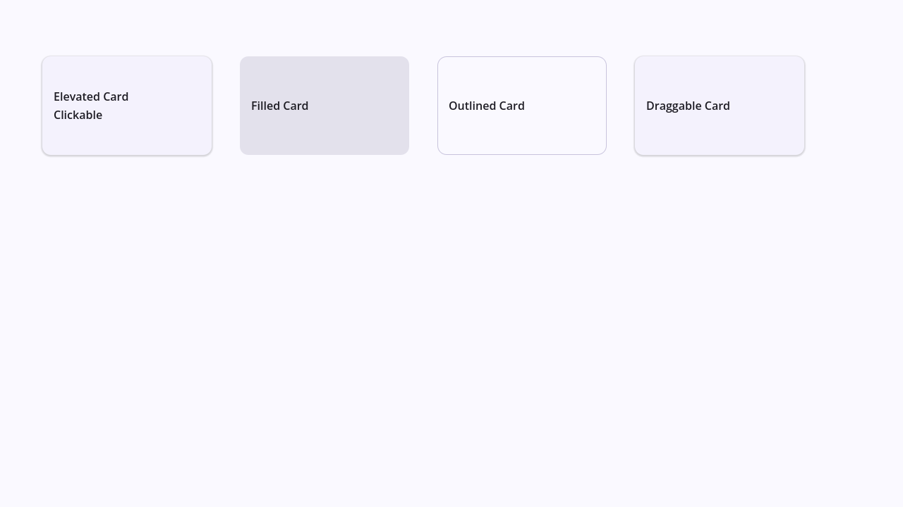

Frame breakdown (`containment.card__click_and_drag.filmstrip.png`):


#### 
Test: `tests/gss/test_gss_containment.gd::test_card_variants_and_interaction` | [HTML Snapshot](../artifacts/gss/containment/containment.card__click_and_drag.gss.live.html) | [JSON Data](../artifacts/gss/containment/containment.card__click_and_drag.gss.live.json)

---

<a id="containmentcarousel"></a>
## Carousel (`containment.carousel`)

- **Material 3 Spec**: [https://m3.material.io/components/carousel/overview](https://m3.material.io/components/carousel/overview)
- **Supported Variants**: `multi-browse`, `uncontained`, `hero`, `full-screen`

### Example
```gdscript
var carousel := M3Carousel.new()
carousel.carousel_style = M3Carousel.CarouselStyle.MULTI_BROWSE
carousel.add_item("Alpine Peaks", "Mountain expedition")
carousel.add_item("Coastal Breeze", "Pacific shoreline")
carousel.scroll_to_index(1, true)
```

### Screenshots and Animations

#### 
Test: `tests/gss/test_gss_containment.gd::test_carousel_variants_and_scrolling` | [HTML Snapshot](../artifacts/gss/containment/containment.carousel__all_styles.gss.html) | [JSON Data](../artifacts/gss/containment/containment.carousel__all_styles.gss.json)

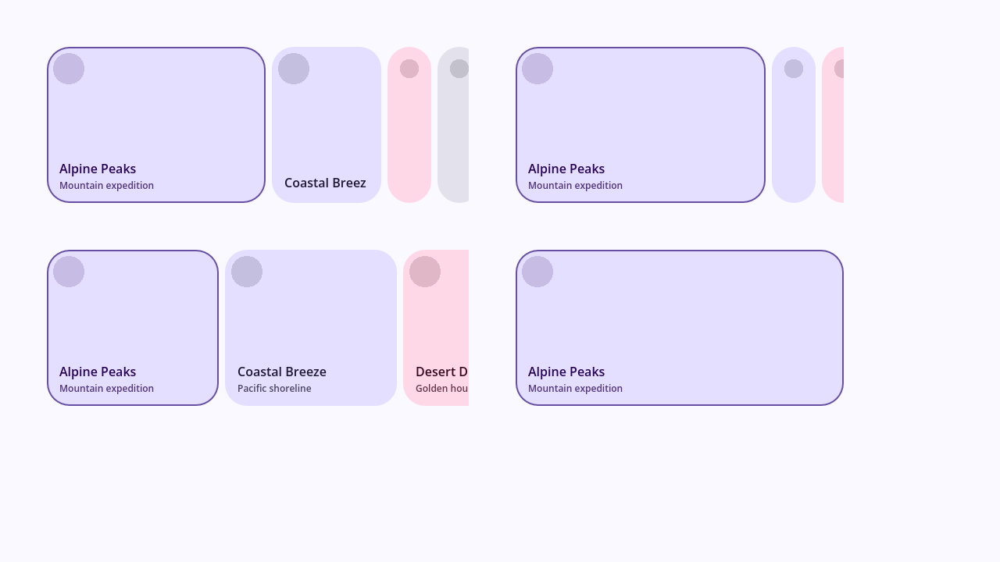

#### 
Test: `tests/gss/test_gss_containment.gd::test_carousel_variants_and_scrolling` | [HTML Snapshot](../artifacts/gss/containment/containment.carousel__click_and_drag_scroll.gss.live.html) | [JSON Data](../artifacts/gss/containment/containment.carousel__click_and_drag_scroll.gss.live.json)

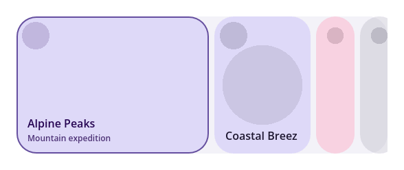


Frame breakdown (`containment.carousel__click_and_drag_scroll.filmstrip.png`):

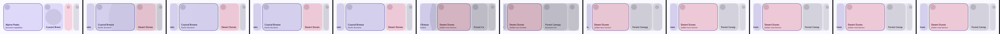

#### 
Test: `tests/gss/test_gss_containment.gd::test_carousel_variants_and_scrolling` | [HTML Snapshot](../artifacts/gss/containment/containment.carousel__click_and_drag_scroll.gss.live.html) | [JSON Data](../artifacts/gss/containment/containment.carousel__click_and_drag_scroll.gss.live.json)

---

<a id="containmentdialogbasic"></a>
## Basic dialog (`containment.dialog.basic`)

- **Material 3 Spec**: [https://m3.material.io/components/dialogs/overview](https://m3.material.io/components/dialogs/overview)
- **Supported Variants**: `headline + body + actions`, `with icon`, `scrim dismiss`

### Example
```gdscript
var dialog := M3Dialog.new()
dialog.title_text = "Discard draft?"
dialog.supporting_text = "This action cannot be undone."
dialog.confirm_text = "Discard"
dialog.cancel_text = "Cancel"
dialog.open()
```

### Screenshots and Animations

#### 
Test: `tests/gss/test_gss_containment.gd::test_basic_dialog_variants_and_interaction` | [HTML Snapshot](../artifacts/gss/containment/containment.dialog.basic__open_transition.gss.live.html) | [JSON Data](../artifacts/gss/containment/containment.dialog.basic__open_transition.gss.live.json)

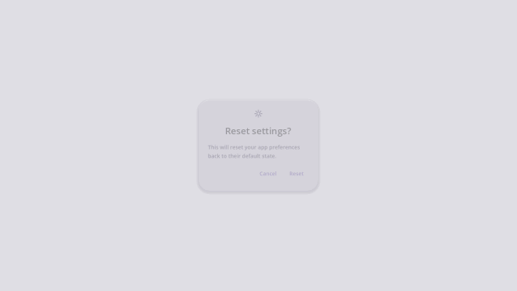


Frame breakdown (`containment.dialog.basic__open_transition.filmstrip.png`):

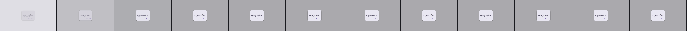

#### 
Test: `tests/gss/test_gss_containment.gd::test_basic_dialog_variants_and_interaction` | [HTML Snapshot](../artifacts/gss/containment/containment.dialog.basic__open_with_icon.gss.html) | [JSON Data](../artifacts/gss/containment/containment.dialog.basic__open_with_icon.gss.json)


#### 
Test: `tests/gss/test_gss_containment.gd::test_basic_dialog_variants_and_interaction` | [HTML Snapshot](../artifacts/gss/containment/containment.dialog.basic__confirm_click.gss.live.html) | [JSON Data](../artifacts/gss/containment/containment.dialog.basic__confirm_click.gss.live.json)

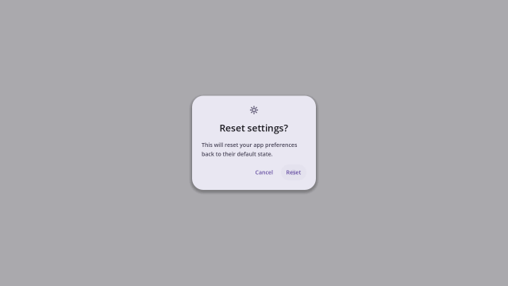

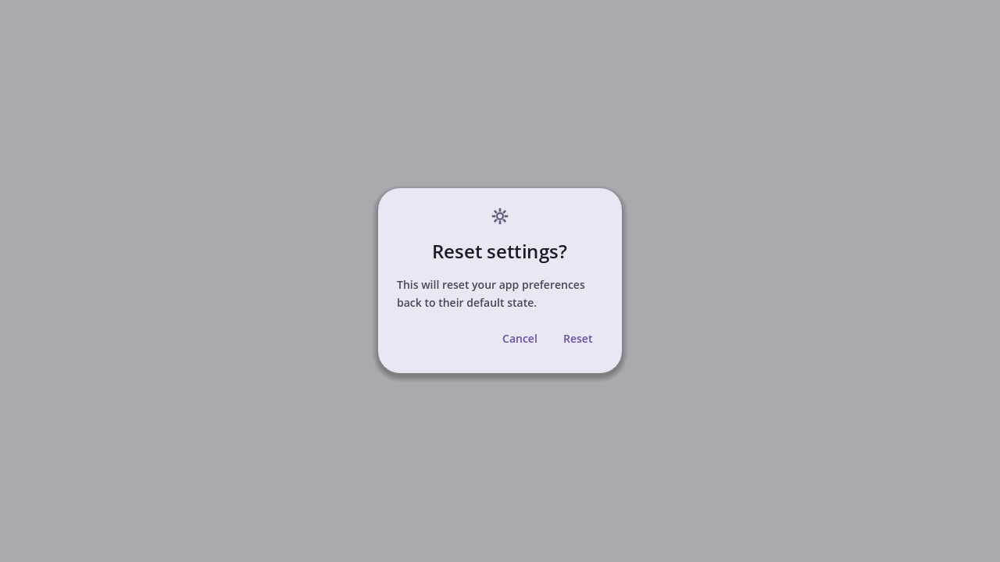

Frame breakdown (`containment.dialog.basic__confirm_click.filmstrip.png`):


---

<a id="containmentdialogfullscreen"></a>
## Full-screen dialog (`containment.dialog.fullscreen`)

- **Material 3 Spec**: [https://m3.material.io/components/dialogs/overview](https://m3.material.io/components/dialogs/overview)
- **Supported Variants**: `full-screen with close + confirm action`

### Example
```gdscript
var fs_dialog := M3Dialog.new()
fs_dialog.fullscreen = true
fs_dialog.title_text = "Create Calendar Event"
fs_dialog.confirm_text = "Save"
fs_dialog.open()
```

### Screenshots and Animations

#### 
Test: `tests/gss/test_gss_containment.gd::test_fullscreen_dialog_variants_and_interaction` | [HTML Snapshot](../artifacts/gss/containment/containment.dialog.fullscreen__open_fullscreen.gss.live.html) | [JSON Data](../artifacts/gss/containment/containment.dialog.fullscreen__open_fullscreen.gss.live.json)


Frame breakdown (`containment.dialog.fullscreen__open_fullscreen.filmstrip.png`):


#### 
Test: `tests/gss/test_gss_containment.gd::test_fullscreen_dialog_variants_and_interaction` | [HTML Snapshot](../artifacts/gss/containment/containment.dialog.fullscreen__open_header_and_body.gss.html) | [JSON Data](../artifacts/gss/containment/containment.dialog.fullscreen__open_header_and_body.gss.json)

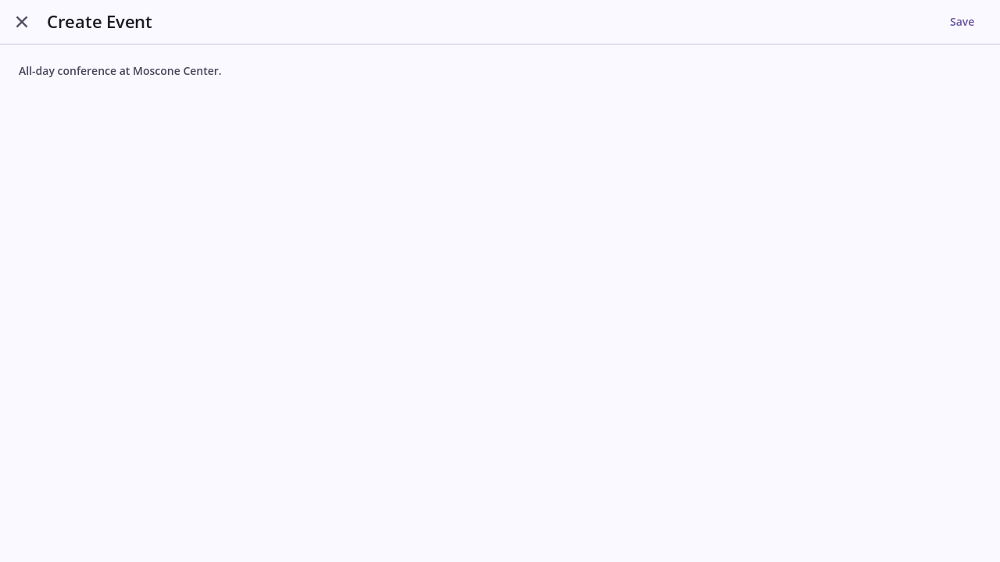

#### 
Test: `tests/gss/test_gss_containment.gd::test_fullscreen_dialog_variants_and_interaction` | [HTML Snapshot](../artifacts/gss/containment/containment.dialog.fullscreen__save_action.gss.live.html) | [JSON Data](../artifacts/gss/containment/containment.dialog.fullscreen__save_action.gss.live.json)

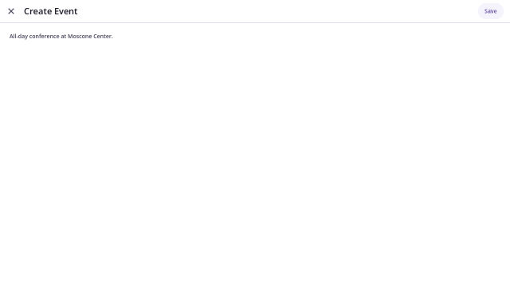


Frame breakdown (`containment.dialog.fullscreen__save_action.filmstrip.png`):


---

<a id="containmentdivider"></a>
## Dividers (`containment.divider`)

- **Material 3 Spec**: [https://m3.material.io/components/divider/overview](https://m3.material.io/components/divider/overview)
- **Supported Variants**: `full-width`, `inset`, `vertical`

### Example
```gdscript
var divider := M3Divider.new()
divider.inset_mode = M3Divider.InsetMode.INSET
```

### Screenshots and Animations


#### 
Test: `tests/gss/test_gss_containment.gd::test_divider_variants` | [HTML Snapshot](../artifacts/gss/containment/containment.divider__all_variants.gss.html) | [JSON Data](../artifacts/gss/containment/containment.divider__all_variants.gss.json)

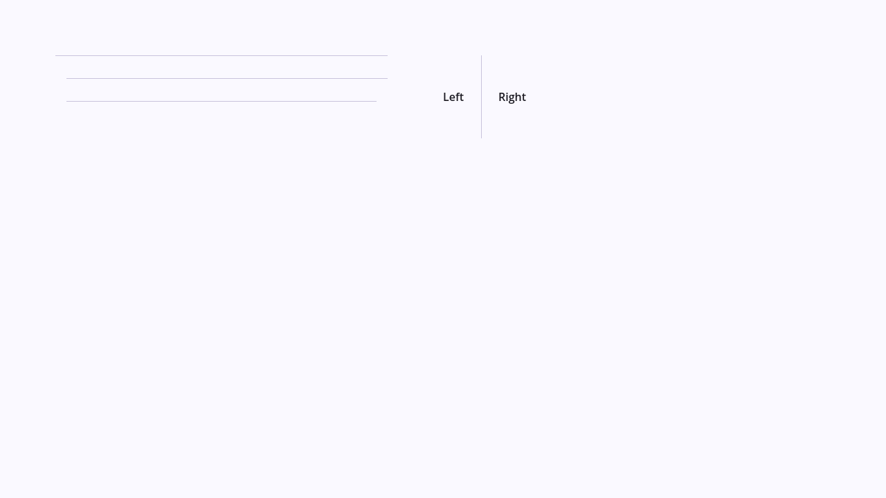

---

<a id="containmentlist"></a>
## Lists (`containment.list`)

- **Material 3 Spec**: [https://m3.material.io/components/lists/overview](https://m3.material.io/components/lists/overview)
- **Supported Variants**: `one-line`, `two-line`, `three-line`, `leading/trailing elements`, `selected`

### Example
```gdscript
var list := M3List.new()
list.selectable = true
var item := M3ListItem.new()
item.headline = "Material 3 Expressive"
item.supporting_text = "Two-line list item with leading avatar & trailing metadata"
item.leading_avatar_text = "M3"
list.add_child(item)
```

### Screenshots and Animations

#### 
Test: `tests/gss/test_gss_containment.gd::test_list_variants_and_selection` | [HTML Snapshot](../artifacts/gss/containment/containment.list__variants_light.gss.html) | [JSON Data](../artifacts/gss/containment/containment.list__variants_light.gss.json)


#### 
Test: `tests/gss/test_gss_containment.gd::test_list_variants_and_selection` | [HTML Snapshot](../artifacts/gss/containment/containment.list__select_item.gss.live.html) | [JSON Data](../artifacts/gss/containment/containment.list__select_item.gss.live.json)

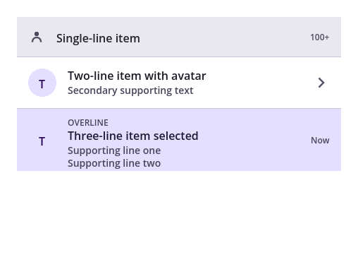

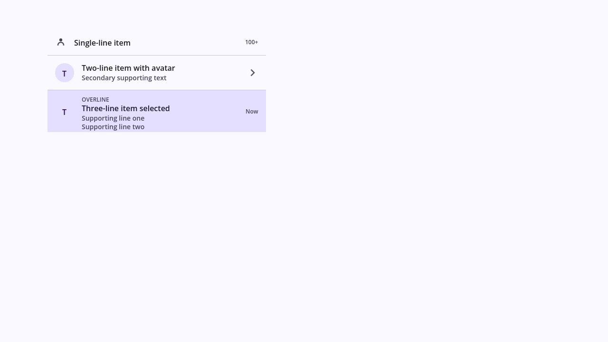

Frame breakdown (`containment.list__select_item.filmstrip.png`):

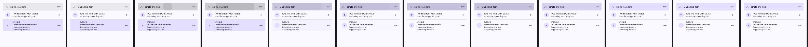

#### 
Test: `tests/gss/test_gss_containment.gd::test_list_variants_and_selection` | [HTML Snapshot](../artifacts/gss/containment/containment.list__select_item.gss.live.html) | [JSON Data](../artifacts/gss/containment/containment.list__select_item.gss.live.json)

---

<a id="containmentside_sheet"></a>
## Side sheets (`containment.side_sheet`)

- **Material 3 Spec**: [https://m3.material.io/components/side-sheets/overview](https://m3.material.io/components/side-sheets/overview)
- **Supported Variants**: `standard`, `modal with scrim`

### Example
```gdscript
var side_sheet := M3SideSheet.new()
side_sheet.sheet_type = M3SideSheet.SheetType.MODAL
side_sheet.title = "Filters & Sorting"
side_sheet.show_action_buttons = true
side_sheet.open()
```

### Screenshots and Animations

#### 
Test: `tests/gss/test_gss_containment.gd::test_side_sheet_variants_and_interaction` | [HTML Snapshot](../artifacts/gss/containment/containment.side_sheet__standard_and_modal.gss.html) | [JSON Data](../artifacts/gss/containment/containment.side_sheet__standard_and_modal.gss.json)


#### 
Test: `tests/gss/test_gss_containment.gd::test_side_sheet_variants_and_interaction` | [HTML Snapshot](../artifacts/gss/containment/containment.side_sheet__close_and_reopen.gss.live.html) | [JSON Data](../artifacts/gss/containment/containment.side_sheet__close_and_reopen.gss.live.json)

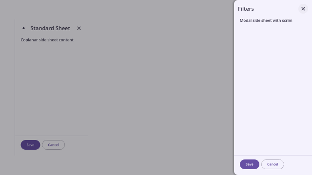


Frame breakdown (`containment.side_sheet__close_and_reopen.filmstrip.png`):


#### 
Test: `tests/gss/test_gss_containment.gd::test_side_sheet_variants_and_interaction` | [HTML Snapshot](../artifacts/gss/containment/containment.side_sheet__close_and_reopen.gss.live.html) | [JSON Data](../artifacts/gss/containment/containment.side_sheet__close_and_reopen.gss.live.json)

---
