# Foundations

[Back to Wiki Home](Home.md) | [Godot 4 Editor Guide](IDE-Integration-and-Editor-Guide.md) | 17 components

Core theme tokens and helpers: dynamic color schemes from a single seed color, light/dark modes, contrast levels, text styles, rounded/cut/morphing shapes, elevation shadows, spring animations, hover/press ripples, responsive layouts, and UI density.

## Category Animations

| Dynamic color palettes (light and dark) | Color scheme variants and contrast levels |
|---|---|
| 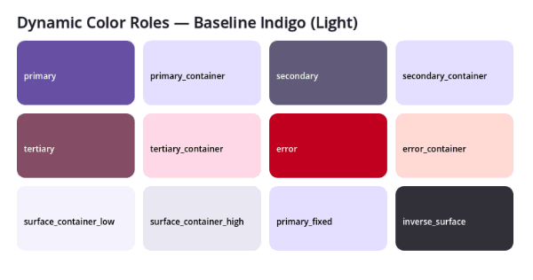 | 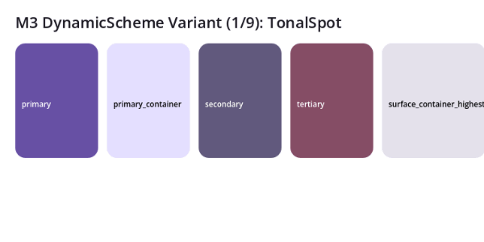 |

| Shape morphing loop | Spring motion curves |
|---|---|
| 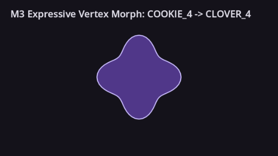 | 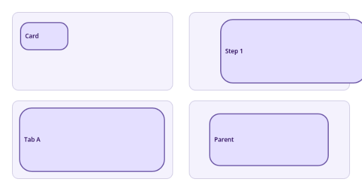 |

| Elevation levels 0 to 5 | Corner radius scale |
|---|---|
| 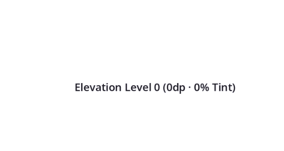 | 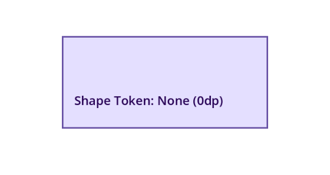 |

**Regular and emphasized typography**

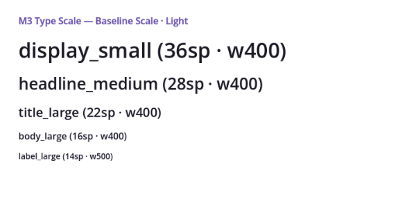

## Contents

- [Color roles (`foundations.color.roles`)](#foundationscolorroles)
- [Dynamic color (seed + light/dark) (`foundations.color.dynamic`)](#foundationscolordynamic)
- [Type scale (15 roles) (`foundations.typography`)](#foundationstypography)
- [Shape scale (`foundations.shape`)](#foundationsshape)
- [Elevation levels 0-5 (`foundations.elevation`)](#foundationselevation)
- [Motion easing & duration tokens (`foundations.motion`)](#foundationsmotion)
- [State layers (`foundations.states.layers`)](#foundationsstateslayers)
- [Ripple (pressed feedback) (`foundations.states.ripple`)](#foundationsstatesripple)
- [Disabled state opacities (`foundations.states.disabled`)](#foundationsstatesdisabled)
- [Minimum touch targets (48dp) (`foundations.accessibility.targets`)](#foundationsaccessibilitytargets)
- [Window size classes (`foundations.layout.window_classes`)](#foundationslayoutwindow_classes)
- [Contrast levels, 9 scheme variants & harmonization (`foundations.color.contrast_variants`)](#foundationscolorcontrast_variants)
- [Emphasized type scale (15 Expressive roles) (`foundations.typography.emphasized`)](#foundationstypographyemphasized)
- [Expressive 35 polygon shapes, Cut corners & morphing (`foundations.shape.expressive_morph`)](#foundationsshapeexpressive_morph)
- [Spring physics (Spatial vs Effects) & 4 transition patterns (`foundations.motion.springs_transitions`)](#foundationsmotionsprings_transitions)
- [Canonical multi-pane scaffolds & Pane Expansion splitter (`foundations.layout.canonical_scaffolds`)](#foundationslayoutcanonical_scaffolds)
- [Visual density scale (0, -1, -2, -3) (`foundations.layout.density`)](#foundationslayoutdensity)

---

<a id="foundationscolorroles"></a>
## Color roles (`foundations.color.roles`)

- **Material 3 Spec**: [https://m3.material.io/styles/color/roles](https://m3.material.io/styles/color/roles)
- **Supported Variants**: `primary/secondary/tertiary/error families`, `surface + surface containers`, `outline/inverse/scrim/shadow`, `fixed accents`

### Example
```gdscript
var scheme: M3ColorScheme = M3Theme.get_current_scheme()
var primary_col: Color = M3Theme.get_color(&"primary")
var container_col: Color = M3Theme.get_color(&"surface_container_high")
var fixed_accent: Color = M3Theme.get_color(&"primary_fixed")
```

### Screenshots and Animations


#### All 49 M3 semantic & fixed color roles
Test: `tests/gss/test_gss_foundations.gd::test_foundations_color_roles` | [HTML Snapshot](../artifacts/gss/foundations/foundations.color.roles__all_roles_light.gss.html) | [JSON Data](../artifacts/gss/foundations/foundations.color.roles__all_roles_light.gss.json)

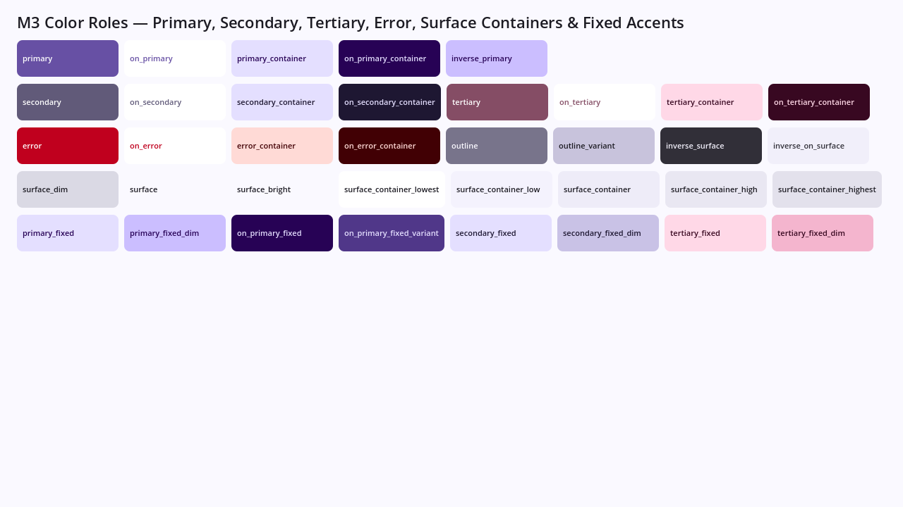

---

<a id="foundationscolordynamic"></a>
## Dynamic color (seed + light/dark) (`foundations.color.dynamic`)

- **Material 3 Spec**: [https://m3.material.io/styles/color/dynamic/choosing-a-source](https://m3.material.io/styles/color/dynamic/choosing-a-source)
- **Supported Variants**: `light scheme`, `dark scheme`, `seed change`

### Example
```gdscript
M3Theme.set_seed_color(M3PaletteGenerator.PRESET_EMERALD)
M3Theme.set_dark_mode(true)
M3Theme.toggle_dark_mode()
```

### Screenshots and Animations

#### Dynamic color light scheme
Test: `tests/gss/test_gss_foundations.gd::test_foundations_color_dynamic` | [HTML Snapshot](../artifacts/gss/foundations/foundations.color.dynamic__indigo_light_scheme.gss.html) | [JSON Data](../artifacts/gss/foundations/foundations.color.dynamic__indigo_light_scheme.gss.json)

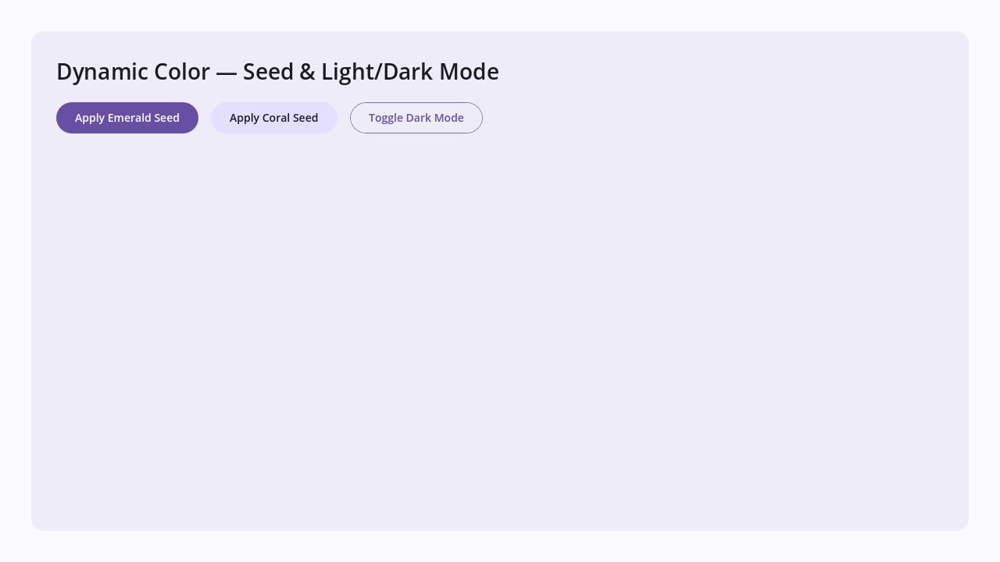

#### Live seed color + light/dark mode switch
Test: `tests/gss/test_gss_foundations.gd::test_foundations_color_dynamic` | [HTML Snapshot](../artifacts/gss/foundations/foundations.color.dynamic__seed_and_dark_mode_switch.gss.live.html) | [JSON Data](../artifacts/gss/foundations/foundations.color.dynamic__seed_and_dark_mode_switch.gss.live.json)

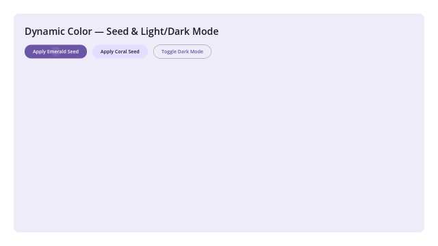


Frame breakdown (`foundations.color.dynamic__seed_and_dark_mode_switch.filmstrip.png`):

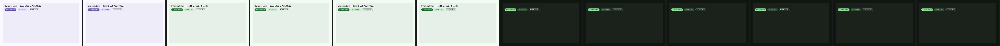

---

<a id="foundationstypography"></a>
## Type scale (15 roles) (`foundations.typography`)

- **Material 3 Spec**: [https://m3.material.io/styles/typography/type-scale-tokens](https://m3.material.io/styles/typography/type-scale-tokens)
- **Supported Variants**: `display L/M/S`, `headline L/M/S`, `title L/M/S`, `body L/M/S`, `label L/M/S`

### Example
```gdscript
var label := Label.new()
M3Typography.apply_to_label(label, M3Typography.Role.HEADLINE_MEDIUM, M3Theme.get_color(&"on_surface"))
```

### Screenshots and Animations


#### All 15 M3 type scale roles
Test: `tests/gss/test_gss_foundations.gd::test_foundations_typography` | [HTML Snapshot](../artifacts/gss/foundations/foundations.typography__type_scale_15_roles.gss.html) | [JSON Data](../artifacts/gss/foundations/foundations.typography__type_scale_15_roles.gss.json)

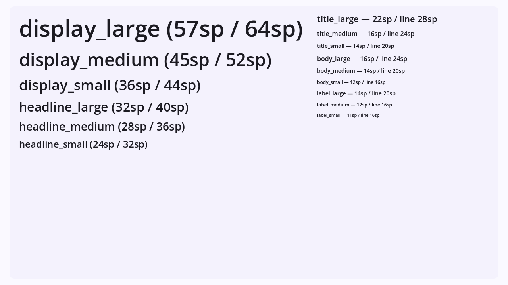

---

<a id="foundationsshape"></a>
## Shape scale (`foundations.shape`)

- **Material 3 Spec**: [https://m3.material.io/styles/shape/corner-radius-scale](https://m3.material.io/styles/shape/corner-radius-scale)
- **Supported Variants**: `none 0`, `extra-small 4`, `small 8`, `medium 12`, `large 16`, `extra-large 28`, `full`

### Example
```gdscript
var surface := M3Surface.new()
surface.shape_token = M3Shapes.ShapeToken.EXTRA_LARGE # 28dp
```

### Screenshots and Animations


#### 7 M3 corner radius shape scale tokens
Test: `tests/gss/test_gss_foundations.gd::test_foundations_shape` | [HTML Snapshot](../artifacts/gss/foundations/foundations.shape__shape_scale_7_tokens.gss.html) | [JSON Data](../artifacts/gss/foundations/foundations.shape__shape_scale_7_tokens.gss.json)

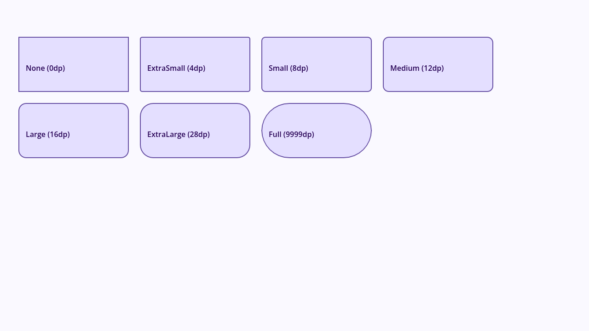

---

<a id="foundationselevation"></a>
## Elevation levels 0-5 (`foundations.elevation`)

- **Material 3 Spec**: [https://m3.material.io/styles/elevation/tokens](https://m3.material.io/styles/elevation/tokens)
- **Supported Variants**: `level0 0dp`, `level1 1dp`, `level2 3dp`, `level3 6dp`, `level4 8dp`, `level5 12dp`

### Example
```gdscript
var card_surface := M3Surface.new()
card_surface.elevation_level = M3Elevation.LEVEL_3 # 6dp height + 11% primary surface tint
```

### Screenshots and Animations


#### Elevation levels 0..5 with tonal tinting and shadows
Test: `tests/gss/test_gss_foundations.gd::test_foundations_elevation` | [HTML Snapshot](../artifacts/gss/foundations/foundations.elevation__elevation_levels_0_to_5.gss.html) | [JSON Data](../artifacts/gss/foundations/foundations.elevation__elevation_levels_0_to_5.gss.json)

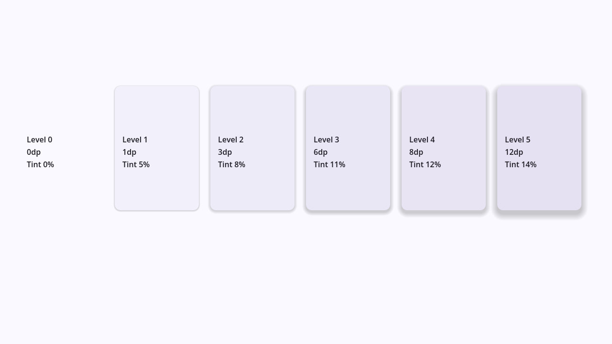

---

<a id="foundationsmotion"></a>
## Motion easing & duration tokens (`foundations.motion`)

- **Material 3 Spec**: [https://m3.material.io/styles/motion/easing-and-duration/tokens-specs](https://m3.material.io/styles/motion/easing-and-duration/tokens-specs)
- **Supported Variants**: `standard`, `standard accelerate/decelerate`, `emphasized`, `emphasized accelerate/decelerate`, `short/medium/long/extra-long durations`

### Example
```gdscript
var eased: float = M3Motion.evaluate_by_name(M3Motion.CURVE_EMPHASIZED_DECELERATE, t)
```

### Screenshots and Animations

#### 6 M3 easing curves & duration tokens
Test: `tests/gss/test_gss_foundations.gd::test_foundations_motion` | [HTML Snapshot](../artifacts/gss/foundations/foundations.motion__motion_curves_rest.gss.html) | [JSON Data](../artifacts/gss/foundations/foundations.motion__motion_curves_rest.gss.json)


#### Live easing curve evaluation across frames
Test: `tests/gss/test_gss_foundations.gd::test_foundations_motion` | [HTML Snapshot](../artifacts/gss/foundations/foundations.motion__motion_curves_active.gss.live.html) | [JSON Data](../artifacts/gss/foundations/foundations.motion__motion_curves_active.gss.live.json)

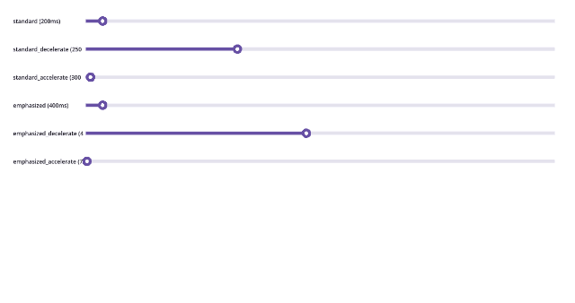

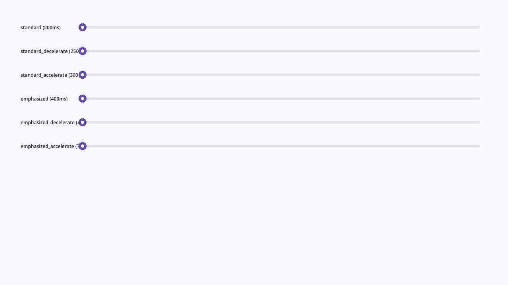

Frame breakdown (`foundations.motion__motion_curves_active.filmstrip.png`):

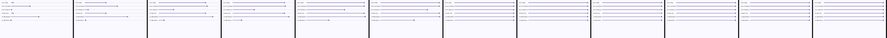

---

<a id="foundationsstateslayers"></a>
## State layers (`foundations.states.layers`)

- **Material 3 Spec**: [https://m3.material.io/foundations/interaction/states/state-layers](https://m3.material.io/foundations/interaction/states/state-layers)
- **Supported Variants**: `hover 0.08`, `focus 0.10`, `pressed 0.10`, `dragged 0.16`

### Example
```gdscript
# Inherited automatically by all M3Control subclasses:
# Hover = 8% opacity, Focus = 10%, Pressed = 10%, Dragged = 16%
```

### Screenshots and Animations

#### Hover, focus, pressed, and dragged state layer opacities
Test: `tests/gss/test_gss_foundations.gd::test_foundations_states_layers_and_ripple` | [HTML Snapshot](../artifacts/gss/foundations/foundations.states.layers__state_layers_overview.gss.html) | [JSON Data](../artifacts/gss/foundations/foundations.states.layers__state_layers_overview.gss.json)

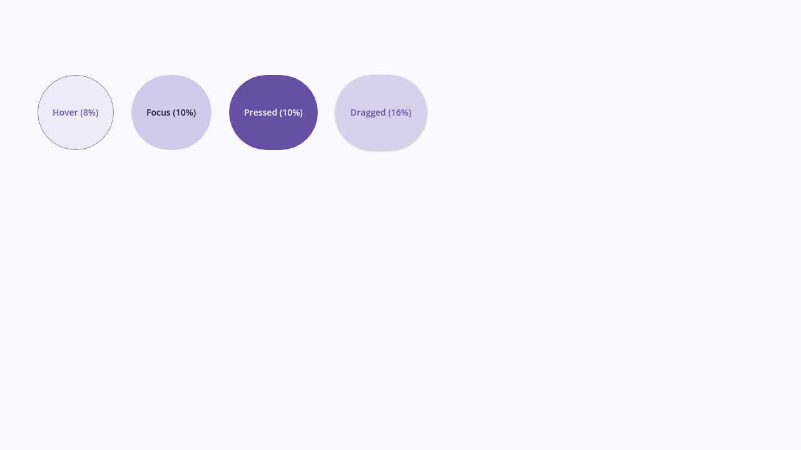

#### Hover, press, and release state layer & ripple
Test: `tests/gss/test_gss_foundations.gd::test_foundations_states_layers_and_ripple` | [HTML Snapshot](../artifacts/gss/foundations/foundations.states.ripple__press_ripple_and_state_layer.gss.live.html) | [JSON Data](../artifacts/gss/foundations/foundations.states.ripple__press_ripple_and_state_layer.gss.live.json)

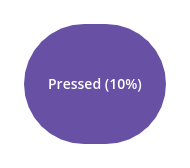


Frame breakdown (`foundations.states.ripple__press_ripple_and_state_layer.filmstrip.png`):

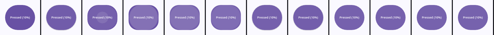

#### State layer alpha tween and ripple wave radius expansion
Test: `tests/gss/test_gss_foundations.gd::test_foundations_states_layers_and_ripple` | [HTML Snapshot](../artifacts/gss/foundations/foundations.states.ripple__press_ripple_and_state_layer.gss.live.html) | [JSON Data](../artifacts/gss/foundations/foundations.states.ripple__press_ripple_and_state_layer.gss.live.json)

---

<a id="foundationsstatesripple"></a>
## Ripple (pressed feedback) (`foundations.states.ripple`)

- **Material 3 Spec**: [https://m3.material.io/foundations/interaction/states/applying-states](https://m3.material.io/foundations/interaction/states/applying-states)
- **Supported Variants**: `press spawn`, `expand`, `release fade`

### Example
```gdscript
var btn := M3Button.new()
btn.ripple_enabled = true # Radial press wave spawns at pointer contact point
```

### Screenshots and Animations

#### Hover, press, and release state layer & ripple
Test: `tests/gss/test_gss_foundations.gd::test_foundations_states_layers_and_ripple` | [HTML Snapshot](../artifacts/gss/foundations/foundations.states.ripple__press_ripple_and_state_layer.gss.live.html) | [JSON Data](../artifacts/gss/foundations/foundations.states.ripple__press_ripple_and_state_layer.gss.live.json)


Frame breakdown (`foundations.states.ripple__press_ripple_and_state_layer.filmstrip.png`):


#### State layer alpha tween and ripple wave radius expansion
Test: `tests/gss/test_gss_foundations.gd::test_foundations_states_layers_and_ripple` | [HTML Snapshot](../artifacts/gss/foundations/foundations.states.ripple__press_ripple_and_state_layer.gss.live.html) | [JSON Data](../artifacts/gss/foundations/foundations.states.ripple__press_ripple_and_state_layer.gss.live.json)

---

<a id="foundationsstatesdisabled"></a>
## Disabled state opacities (`foundations.states.disabled`)

- **Material 3 Spec**: [https://m3.material.io/foundations/interaction/states/applying-states](https://m3.material.io/foundations/interaction/states/applying-states)
- **Supported Variants**: `content 38%`, `container 12%`

### Example
```gdscript
btn.disabled = true # Applies 12% container opacity and 38% content opacity
```

### Screenshots and Animations

#### Disabled 38%/12% opacities and >=48x48dp touch targets
Test: `tests/gss/test_gss_foundations.gd::test_foundations_states_disabled_and_accessibility_targets` | [HTML Snapshot](../artifacts/gss/foundations/foundations.states.disabled__disabled_and_48dp_targets.gss.html) | [JSON Data](../artifacts/gss/foundations/foundations.states.disabled__disabled_and_48dp_targets.gss.json)

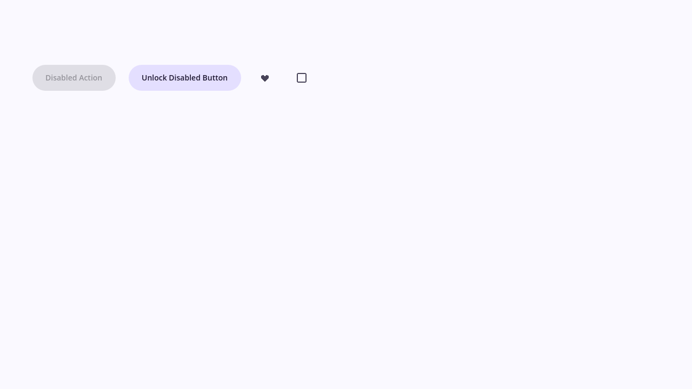

#### Disabled button blocks click until unlocked
Test: `tests/gss/test_gss_foundations.gd::test_foundations_states_disabled_and_accessibility_targets` | [HTML Snapshot](../artifacts/gss/foundations/foundations.states.disabled__disabled_rejects_then_unlocks.gss.live.html) | [JSON Data](../artifacts/gss/foundations/foundations.states.disabled__disabled_rejects_then_unlocks.gss.live.json)

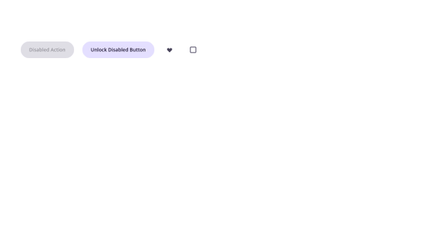


Frame breakdown (`foundations.states.disabled__disabled_rejects_then_unlocks.filmstrip.png`):

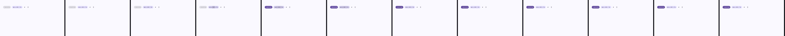

---

<a id="foundationsaccessibilitytargets"></a>
## Minimum touch targets (48dp) (`foundations.accessibility.targets`)

- **Material 3 Spec**: [https://m3.material.io/foundations/designing/structure](https://m3.material.io/foundations/designing/structure)
- **Supported Variants**: `48x48 target`

### Example
```gdscript
icon_btn.touch_target_min_size = Vector2(48, 48) # Enforces >= 48x48dp hit target
```

### Screenshots and Animations

#### Disabled 38%/12% opacities and >=48x48dp touch targets
Test: `tests/gss/test_gss_foundations.gd::test_foundations_states_disabled_and_accessibility_targets` | [HTML Snapshot](../artifacts/gss/foundations/foundations.states.disabled__disabled_and_48dp_targets.gss.html) | [JSON Data](../artifacts/gss/foundations/foundations.states.disabled__disabled_and_48dp_targets.gss.json)


---

<a id="foundationslayoutwindow_classes"></a>
## Window size classes (`foundations.layout.window_classes`)

- **Material 3 Spec**: [https://m3.material.io/foundations/layout/applying-layout/window-size-classes](https://m3.material.io/foundations/layout/applying-layout/window-size-classes)
- **Supported Variants**: `compact <600`, `medium 600-839`, `expanded >=840`

### Example
```gdscript
var mode := M3AdaptiveNavigation.classify_width(viewport_width)
var ext_class := M3AdaptiveNavigation.classify_extended_width(viewport_width)
```

### Screenshots and Animations

#### 
Test: `tests/gss/test_gss_navigation.gd::test_adaptive_navigation_and_window_classes` | [HTML Snapshot](../artifacts/gss/navigation/navigation.adaptive__compact_medium_expanded.gss.html) | [JSON Data](../artifacts/gss/navigation/navigation.adaptive__compact_medium_expanded.gss.json)

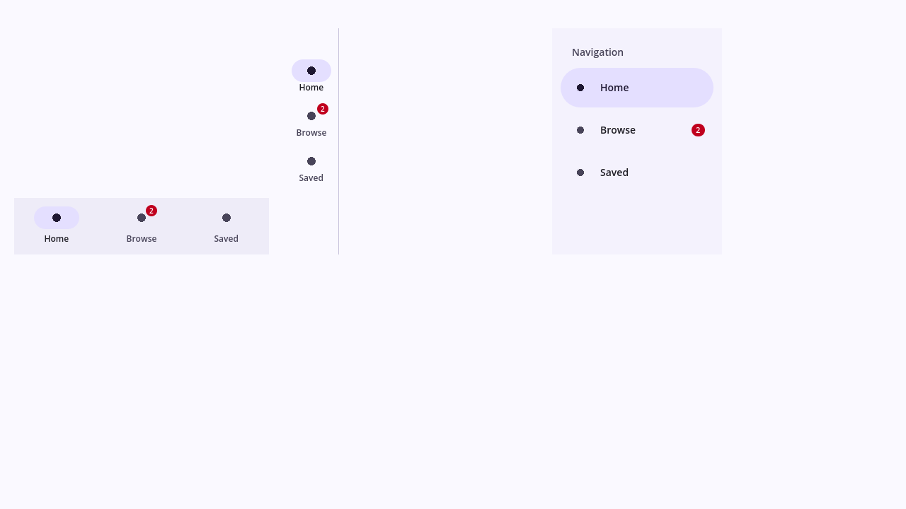

#### 
Test: `tests/gss/test_gss_navigation.gd::test_adaptive_navigation_and_window_classes` | [HTML Snapshot](../artifacts/gss/navigation/navigation.adaptive__navigate_and_breakpoint_switch.gss.live.html) | [JSON Data](../artifacts/gss/navigation/navigation.adaptive__navigate_and_breakpoint_switch.gss.live.json)

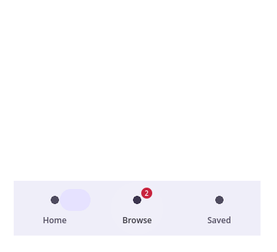


Frame breakdown (`navigation.adaptive__navigate_and_breakpoint_switch.filmstrip.png`):

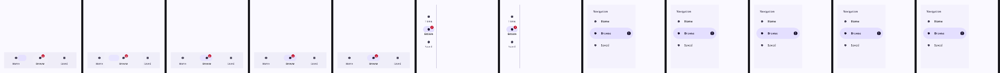

---

<a id="foundationscolorcontrast_variants"></a>
## Contrast levels, 9 scheme variants & harmonization (`foundations.color.contrast_variants`)

- **Material 3 Spec**: [https://m3.material.io/styles/color/system/how-the-system-works](https://m3.material.io/styles/color/system/how-the-system-works)
- **Supported Variants**: `standard/medium/high contrast`, `9 DynamicScheme variants (TonalSpot, Vibrant, Expressive, Monochrome, Neutral, Fidelity, Content, Rainbow, FruitSalad)`, `color harmonization`

### Example
```gdscript
# Switch between 9 M3 DynamicScheme variants & 3 contrast levels
M3Theme.set_scheme_variant(M3PaletteGenerator.SchemeVariant.EXPRESSIVE)
M3Theme.set_contrast_level(M3PaletteGenerator.CONTRAST_HIGH) # +1.0
var harmonized_warning: Color = M3Theme.harmonize_color(Color("#F28B0C"))
```

### Screenshots and Animations


#### 9 DynamicScheme variants, 3 contrast levels, and color harmonization
Test: `tests/gss/test_gss_foundations.gd::test_foundations_color_contrast_variants_and_harmonization` | [HTML Snapshot](../artifacts/gss/foundations/foundations.color.contrast_variants__nine_variants_and_contrast_levels.gss.html) | [JSON Data](../artifacts/gss/foundations/foundations.color.contrast_variants__nine_variants_and_contrast_levels.gss.json)

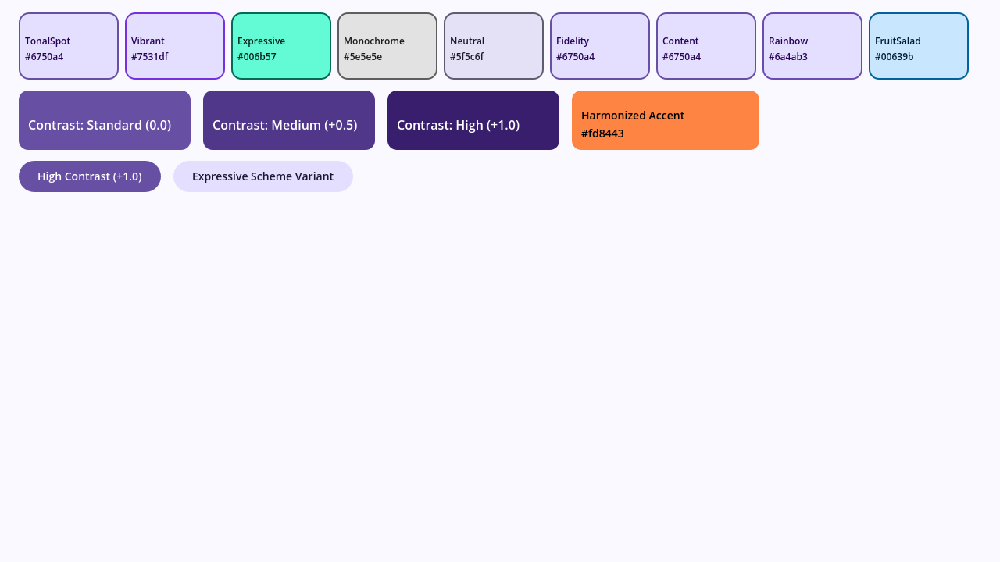

#### Interactive contrast level and scheme variant switching
Test: `tests/gss/test_gss_foundations.gd::test_foundations_color_contrast_variants_and_harmonization` | [HTML Snapshot](../artifacts/gss/foundations/foundations.color.contrast_variants__switch_contrast_and_variant.gss.live.html) | [JSON Data](../artifacts/gss/foundations/foundations.color.contrast_variants__switch_contrast_and_variant.gss.live.json)

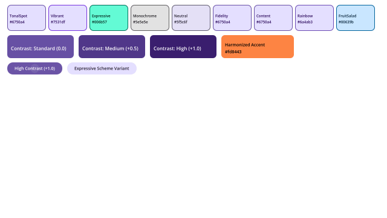


Frame breakdown (`foundations.color.contrast_variants__switch_contrast_and_variant.filmstrip.png`):

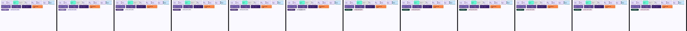

---

<a id="foundationstypographyemphasized"></a>
## Emphasized type scale (15 Expressive roles) (`foundations.typography.emphasized`)

- **Material 3 Spec**: [https://m3.material.io/styles/typography/type-scale-tokens](https://m3.material.io/styles/typography/type-scale-tokens)
- **Supported Variants**: `display L/M/S emphasized`, `headline L/M/S emphasized`, `title L/M/S emphasized`, `body L/M/S emphasized`, `label L/M/S emphasized`

### Example
```gdscript
var hero_label := Label.new()
M3Typography.apply_to_label(hero_label, M3Typography.Role.TITLE_LARGE_EMPHASIZED, M3Theme.get_color(&"primary"))
```

### Screenshots and Animations


#### All 15 M3 Expressive Emphasized type scale roles
Test: `tests/gss/test_gss_foundations.gd::test_foundations_typography_emphasized` | [HTML Snapshot](../artifacts/gss/foundations/foundations.typography.emphasized__emphasized_type_scale_15_roles.gss.html) | [JSON Data](../artifacts/gss/foundations/foundations.typography.emphasized__emphasized_type_scale_15_roles.gss.json)

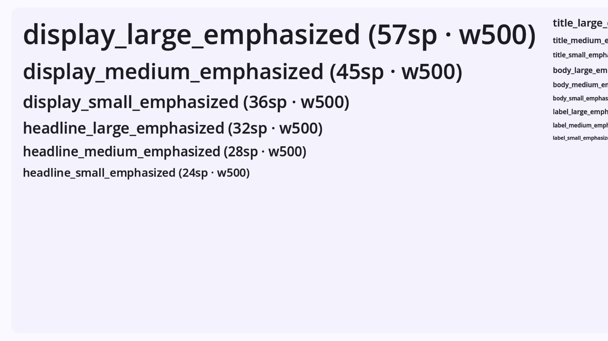

---

<a id="foundationsshapeexpressive_morph"></a>
## Expressive 35 polygon shapes, Cut corners & morphing (`foundations.shape.expressive_morph`)

- **Material 3 Spec**: [https://m3.material.io/styles/shape/overview-principles](https://m3.material.io/styles/shape/overview-principles)
- **Supported Variants**: `35 MaterialShapes polygons`, `Cut corner family (chamfered)`, `extra_large_increased 32dp & extra_extra_large 48dp`, `polygon vertex morphing`

### Example
```gdscript
var morph := M3ShapeMorph.new()
morph.from_shape = M3Shapes.MaterialShape.COOKIE_4
morph.morph_to(M3Shapes.MaterialShape.VERY_SUNNY, 0.35)
```

### Screenshots and Animations


#### 35 M3 Expressive MaterialShapes, 32/48dp tokens, and Cut corner family
Test: `tests/gss/test_gss_foundations.gd::test_foundations_shape_expressive_morph` | [HTML Snapshot](../artifacts/gss/foundations/foundations.shape.expressive_morph__all_35_expressive_shapes_and_cut.gss.html) | [JSON Data](../artifacts/gss/foundations/foundations.shape.expressive_morph__all_35_expressive_shapes_and_cut.gss.json)

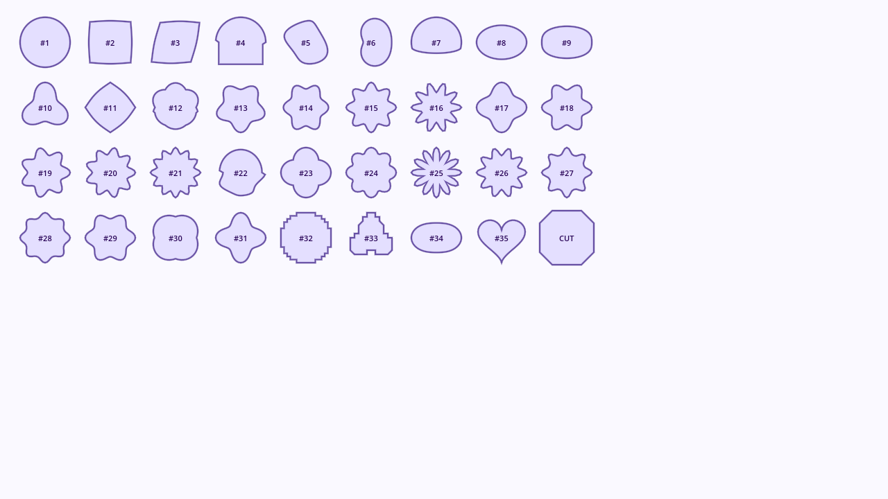

#### Live polygon vertex morphing across frames
Test: `tests/gss/test_gss_foundations.gd::test_foundations_shape_expressive_morph` | [HTML Snapshot](../artifacts/gss/foundations/foundations.shape.expressive_morph__polygon_vertex_morph.gss.live.html) | [JSON Data](../artifacts/gss/foundations/foundations.shape.expressive_morph__polygon_vertex_morph.gss.live.json)

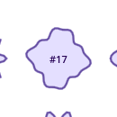


Frame breakdown (`foundations.shape.expressive_morph__polygon_vertex_morph.filmstrip.png`):

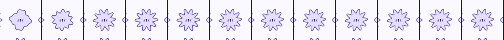

---

<a id="foundationsmotionsprings_transitions"></a>
## Spring physics (Spatial vs Effects) & 4 transition patterns (`foundations.motion.springs_transitions`)

- **Material 3 Spec**: [https://m3.material.io/styles/motion/overview/how-it-works](https://m3.material.io/styles/motion/overview/how-it-works)
- **Supported Variants**: `Spatial springs (Fast/Default/Slow with overshoot)`, `Effects springs (critically damped)`, `Container Transform`, `Shared Axis X/Y/Z`, `Fade Through & Fade`

### Example
```gdscript
var spring_y: float = M3Motion.evaluate_spring(M3Motion.SpringType.SPATIAL, M3Motion.SpringSpeed.FAST, t)
var transition := M3Transition.new()
transition.pattern = M3Motion.TransitionPattern.CONTAINER_TRANSFORM
transition.play_transition(true, 0.36)
```

### Screenshots and Animations


#### Spatial/Effects springs & 4 M3 transition patterns
Test: `tests/gss/test_gss_foundations.gd::test_foundations_motion_springs_and_transitions` | [HTML Snapshot](../artifacts/gss/foundations/foundations.motion.springs_transitions__four_transition_patterns_rest.gss.html) | [JSON Data](../artifacts/gss/foundations/foundations.motion.springs_transitions__four_transition_patterns_rest.gss.json)

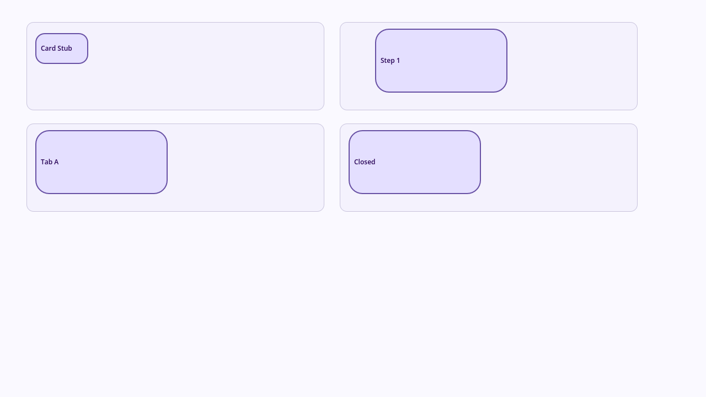

#### Live Spatial & Effects spring transition playback
Test: `tests/gss/test_gss_foundations.gd::test_foundations_motion_springs_and_transitions` | [HTML Snapshot](../artifacts/gss/foundations/foundations.motion.springs_transitions__springs_and_transitions_active.gss.live.html) | [JSON Data](../artifacts/gss/foundations/foundations.motion.springs_transitions__springs_and_transitions_active.gss.live.json)

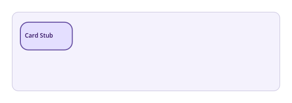


Frame breakdown (`foundations.motion.springs_transitions__springs_and_transitions_active.filmstrip.png`):

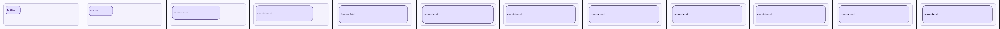

---

<a id="foundationslayoutcanonical_scaffolds"></a>
## Canonical multi-pane scaffolds & Pane Expansion splitter (`foundations.layout.canonical_scaffolds`)

- **Material 3 Spec**: [https://m3.material.io/foundations/layout/canonical-layouts/overview](https://m3.material.io/foundations/layout/canonical-layouts/overview)
- **Supported Variants**: `List-Detail scaffold`, `Supporting-Pane scaffold`, `Feed grid scaffold`, `draggable Pane Expansion splitter`, `Large (1200-1599) & Extra-Large (>=1600) size classes`

### Example
```gdscript
var scaffold := M3CanonicalScaffold.new()
scaffold.scaffold_type = M3CanonicalScaffold.ScaffoldType.LIST_DETAIL
scaffold.set_split_ratio(0.38, true) # Animated draggable pane splitter
```

### Screenshots and Animations

#### 
Test: `tests/gss/test_gss_navigation.gd::test_canonical_scaffolds_and_pane_splitter` | [HTML Snapshot](../artifacts/gss/navigation/foundations.layout.canonical_scaffolds__variants_light.gss.html) | [JSON Data](../artifacts/gss/navigation/foundations.layout.canonical_scaffolds__variants_light.gss.json)

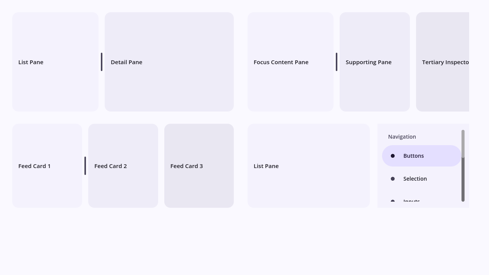

#### 
Test: `tests/gss/test_gss_navigation.gd::test_canonical_scaffolds_and_pane_splitter` | [HTML Snapshot](../artifacts/gss/navigation/foundations.layout.canonical_scaffolds__drag_splitter_and_compact_transition.gss.live.html) | [JSON Data](../artifacts/gss/navigation/foundations.layout.canonical_scaffolds__drag_splitter_and_compact_transition.gss.live.json)

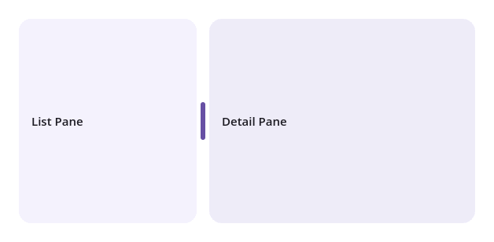


Frame breakdown (`foundations.layout.canonical_scaffolds__drag_splitter_and_compact_transition.filmstrip.png`):

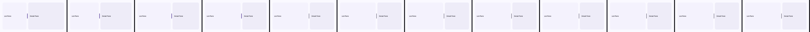

#### 
Test: `tests/gss/test_gss_navigation.gd::test_canonical_scaffolds_and_pane_splitter` | [HTML Snapshot](../artifacts/gss/navigation/foundations.layout.canonical_scaffolds__drag_splitter_and_compact_transition.gss.live.html) | [JSON Data](../artifacts/gss/navigation/foundations.layout.canonical_scaffolds__drag_splitter_and_compact_transition.gss.live.json)

---

<a id="foundationslayoutdensity"></a>
## Visual density scale (0, -1, -2, -3) (`foundations.layout.density`)

- **Material 3 Spec**: [https://m3.material.io/foundations/layout/understanding-layout/density](https://m3.material.io/foundations/layout/understanding-layout/density)
- **Supported Variants**: `density 0 (default)`, `density -1 (-4dp)`, `density -2 (-8dp)`, `density -3 (-12dp)`

### Example
```gdscript
M3Theme.set_visual_density(-2) # Compacts control heights by -8dp (-4dp per step)
```

### Screenshots and Animations

#### Visual density scale 0 (40dp), -1 (36dp), -2 (32dp), -3 (28dp)
Test: `tests/gss/test_gss_foundations.gd::test_foundations_layout_density` | [HTML Snapshot](../artifacts/gss/foundations/foundations.layout.density__density_scale_0_to_minus3.gss.html) | [JSON Data](../artifacts/gss/foundations/foundations.layout.density__density_scale_0_to_minus3.gss.json)

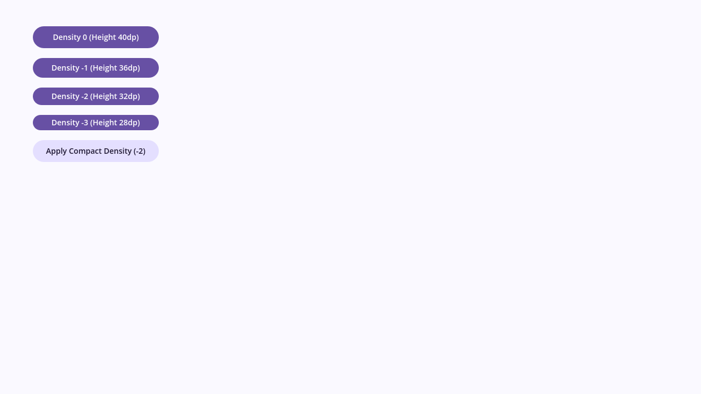

#### Live visual density step change
Test: `tests/gss/test_gss_foundations.gd::test_foundations_layout_density` | [HTML Snapshot](../artifacts/gss/foundations/foundations.layout.density__apply_compact_density.gss.live.html) | [JSON Data](../artifacts/gss/foundations/foundations.layout.density__apply_compact_density.gss.live.json)


Frame breakdown (`foundations.layout.density__apply_compact_density.filmstrip.png`):


---
