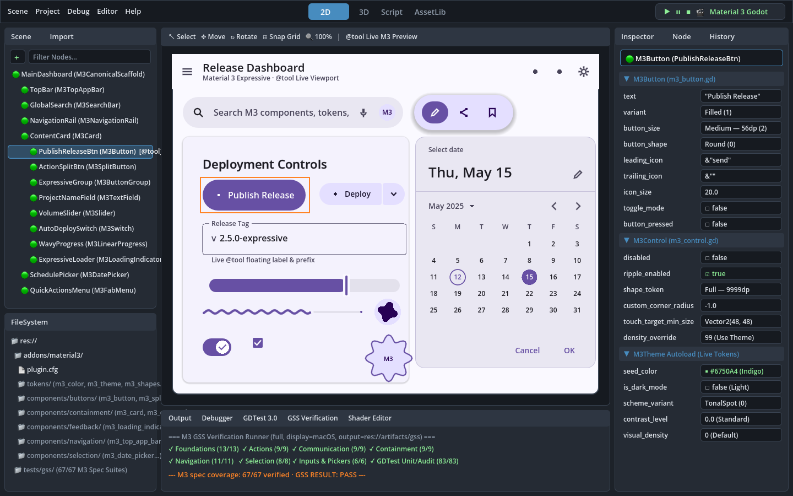
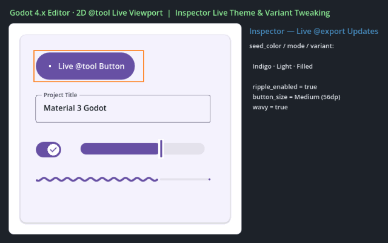
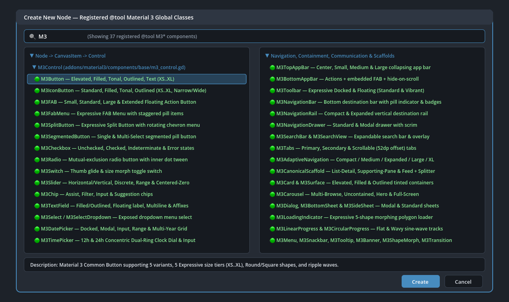
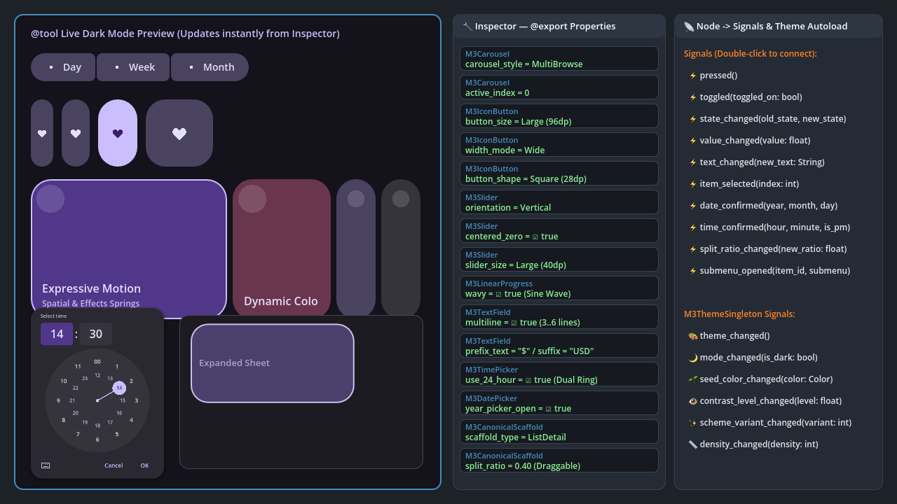
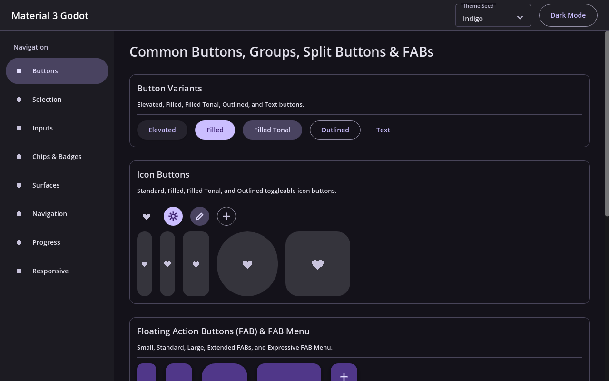
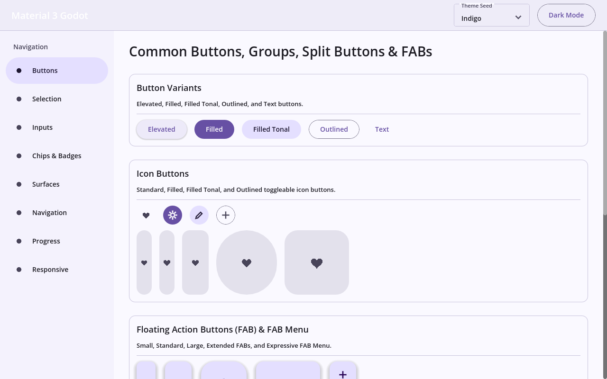
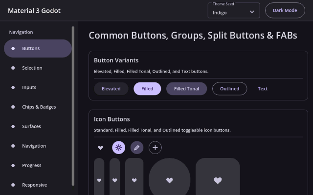

# Using Material 3 in the Godot 4 Editor

All components in this library are regular GDScript `@tool` scripts with global `class_name` declarations (`M3Button`, `M3Card`, `M3TopAppBar`, `M3DatePicker`, etc.). Because they are `@tool` scripts, they draw directly in the Godot 2D viewport while you edit your scene—you do not have to run the project to see how they look.

---

## 1. Working in the 2D Viewport

### Live Inspector Editing

- **Scene Tree (Left)**: Add and arrange `M3*` nodes the same way you use built-in Godot `Control` and `Container` nodes.
- **2D Viewport (Center)**: Move, resize, and anchor components with Godot's normal selection handles. Changing a property in the Inspector redraws the control right away.
- **Inspector (Right)**: Edit exported properties for the selected component (like `variant`, `button_size`, or `text`) as well as theme settings on `M3Theme`.

---

## 2. Adding Material 3 Nodes

Press `Cmd+A` (macOS) or `Ctrl+A` (Windows/Linux) in the Scene dock and type `M3` in the search box:

All `M3*` nodes show up under `Control` and `Container`. Pick one and click **Create** to drop it into your scene.

---

## 3. Inspector Properties, Signals, and Dark Mode

- **Component options**: Pick button styles (`Filled`, `Tonal`, `Elevated`, `Outlined`, `Text`), sizes (`XS` through `XL`), shapes (`Round` or `Square`), and icons from Inspector dropdowns.
- **Theme settings (`M3Theme` autoload)**:
  - `seed_color`: Pick any base color to generate matching light and dark palettes.
  - `scheme_variant`: Choose between the 9 Material 3 color schemes (`TonalSpot`, `Vibrant`, `Expressive`, `Monochrome`, `Neutral`, `Fidelity`, `Content`, `Rainbow`, `FruitSalad`).
  - `contrast_level`: Set contrast to `0.0` (Standard), `0.5` (Medium), or `1.0` (High).
  - `visual_density`: Tighten spacing with `0`, `-1`, `-2`, or `-3`.
- **Signals (`Node -> Signals`)**: Connect signals like `pressed()`, `toggled(bool)`, `value_changed(float)`, `text_changed(String)`, `item_selected(int)`, `date_confirmed(y, m, d)`, and `time_confirmed(h, m, pm)` straight to your scripts.

---

## 4. Showcase App (Dark and Light Mode)

Press `F5` in Godot (or run `godot --path .`) to open the built-in showcase app. It lets you try out all the components, switch color presets, toggle light/dark mode, and resize the window to see responsive layouts:

| Dark Mode | Light Mode |
|---|---|
|  |  |

### Showcase App Tour

