# Navigation

[Back to Wiki Home](Home.md) | [Godot 4 Editor Guide](IDE-Integration-and-Editor-Guide.md) | 10 components

Navigation bars and chrome: collapsing top app bars, bottom app bars, docked and floating toolbars, bottom navigation bars, drawers, navigation rails, search bars, fixed and scrollable tabs, and responsive navigation that adapts to window width.

## Category Animations

| Responsive window resizing | Top app bar, tabs, and floating toolbar (dark mode) |
|---|---|
| 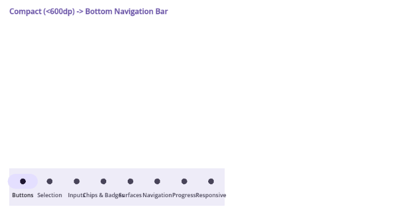 | 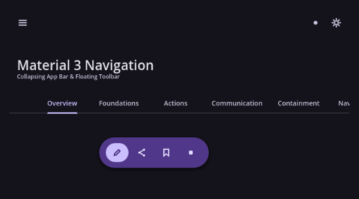 |

## Contents

- [Top app bar (`navigation.app_bar.top`)](#navigationapp_bartop)
- [Bottom app bar (`navigation.app_bar.bottom`)](#navigationapp_barbottom)
- [Toolbars (Expressive) (`navigation.toolbar`)](#navigationtoolbar)
- [Navigation bar (`navigation.bar`)](#navigationbar)
- [Navigation drawer (`navigation.drawer`)](#navigationdrawer)
- [Navigation rail (`navigation.rail`)](#navigationrail)
- [Search (bar + view) (`navigation.search`)](#navigationsearch)
- [Tabs (`navigation.tabs`)](#navigationtabs)
- [Adaptive navigation (`navigation.adaptive`)](#navigationadaptive)
- [Scrollable tabs (52dp leading offset) (`navigation.tabs.scrollable`)](#navigationtabsscrollable)

---

<a id="navigationapp_bartop"></a>
## Top app bar (`navigation.app_bar.top`)

- **Material 3 Spec**: [https://m3.material.io/components/top-app-bar/overview](https://m3.material.io/components/top-app-bar/overview)
- **Supported Variants**: `center-aligned`, `small`, `medium`, `large`, `scrolled (on-scroll container color)`

### Example
```gdscript
var top_bar := M3TopAppBar.new()
top_bar.bar_variant = M3TopAppBar.BarVariant.LARGE
top_bar.title = "Project Library"
top_bar.subtitle = "67 Verified M3 Specifications"
top_bar.add_action("search")
top_bar.add_action("more_vert")
```

### Screenshots and Animations

#### 
Test: `tests/gss/test_gss_navigation.gd::test_top_app_bar` | [HTML Snapshot](../artifacts/gss/navigation/navigation.app_bar.top__variants_light.gss.html) | [JSON Data](../artifacts/gss/navigation/navigation.app_bar.top__variants_light.gss.json)


#### 
Test: `tests/gss/test_gss_navigation.gd::test_top_app_bar` | [HTML Snapshot](../artifacts/gss/navigation/navigation.app_bar.top__scroll_collapse_and_actions.gss.live.html) | [JSON Data](../artifacts/gss/navigation/navigation.app_bar.top__scroll_collapse_and_actions.gss.live.json)

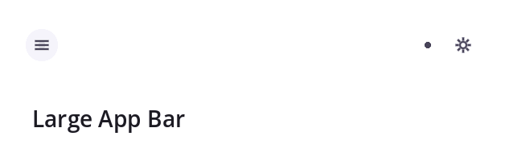

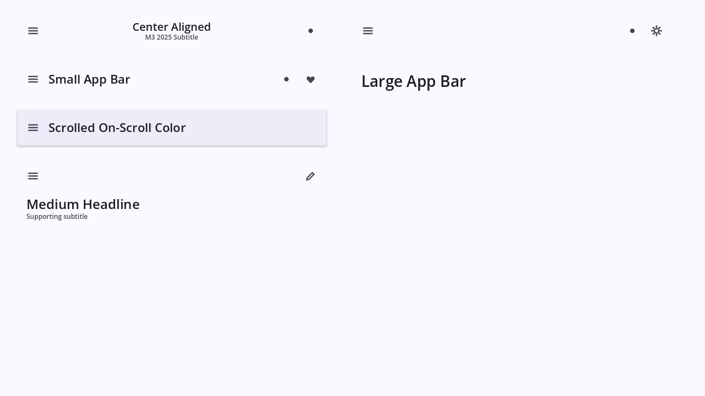

Frame breakdown (`navigation.app_bar.top__scroll_collapse_and_actions.filmstrip.png`):

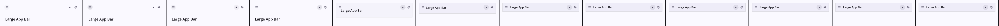

#### 
Test: `tests/gss/test_gss_navigation.gd::test_top_app_bar` | [HTML Snapshot](../artifacts/gss/navigation/navigation.app_bar.top__scroll_collapse_and_actions.gss.live.html) | [JSON Data](../artifacts/gss/navigation/navigation.app_bar.top__scroll_collapse_and_actions.gss.live.json)

---

<a id="navigationapp_barbottom"></a>
## Bottom app bar (`navigation.app_bar.bottom`)

- **Material 3 Spec**: [https://m3.material.io/components/bottom-app-bar/overview](https://m3.material.io/components/bottom-app-bar/overview)
- **Supported Variants**: `actions + FAB`, `hide on scroll`

### Example
```gdscript
var bottom_bar := M3BottomAppBar.new()
bottom_bar.add_action("search")
bottom_bar.add_action("bookmark")
bottom_bar.add_action("share")
bottom_bar.show_fab = true
bottom_bar.fab_icon = "add"
```

### Screenshots and Animations

#### 
Test: `tests/gss/test_gss_navigation.gd::test_bottom_app_bar` | [HTML Snapshot](../artifacts/gss/navigation/navigation.app_bar.bottom__variants_dark.gss.html) | [JSON Data](../artifacts/gss/navigation/navigation.app_bar.bottom__variants_dark.gss.json)

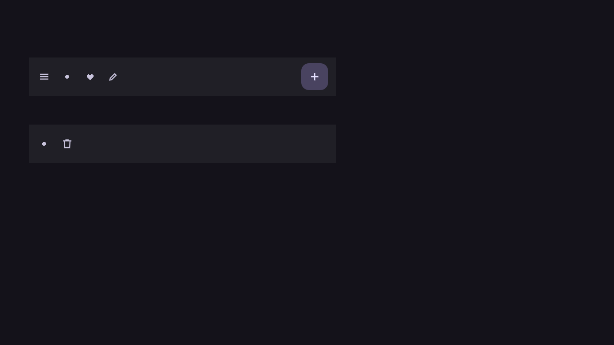

#### 
Test: `tests/gss/test_gss_navigation.gd::test_bottom_app_bar` | [HTML Snapshot](../artifacts/gss/navigation/navigation.app_bar.bottom__actions_fab_and_hide_on_scroll.gss.live.html) | [JSON Data](../artifacts/gss/navigation/navigation.app_bar.bottom__actions_fab_and_hide_on_scroll.gss.live.json)


Frame breakdown (`navigation.app_bar.bottom__actions_fab_and_hide_on_scroll.filmstrip.png`):


#### 
Test: `tests/gss/test_gss_navigation.gd::test_bottom_app_bar` | [HTML Snapshot](../artifacts/gss/navigation/navigation.app_bar.bottom__actions_fab_and_hide_on_scroll.gss.live.html) | [JSON Data](../artifacts/gss/navigation/navigation.app_bar.bottom__actions_fab_and_hide_on_scroll.gss.live.json)

---

<a id="navigationtoolbar"></a>
## Toolbars (Expressive) (`navigation.toolbar`)

- **Material 3 Spec**: [https://m3.material.io/components/toolbars/overview](https://m3.material.io/components/toolbars/overview)
- **Supported Variants**: `docked`, `floating`, `standard/vibrant colors`

### Example
```gdscript
var toolbar := M3Toolbar.new()
toolbar.toolbar_type = M3Toolbar.ToolbarType.FLOATING
toolbar.color_style = M3Toolbar.ColorStyle.VIBRANT
toolbar.add_item("edit", "Edit")
toolbar.add_item("image", "Media")
toolbar.add_item("share", "Share")
```

### Screenshots and Animations

#### 
Test: `tests/gss/test_gss_navigation.gd::test_toolbar` | [HTML Snapshot](../artifacts/gss/navigation/navigation.toolbar__variants_light.gss.html) | [JSON Data](../artifacts/gss/navigation/navigation.toolbar__variants_light.gss.json)


#### 
Test: `tests/gss/test_gss_navigation.gd::test_toolbar` | [HTML Snapshot](../artifacts/gss/navigation/navigation.toolbar__select_tool_item.gss.live.html) | [JSON Data](../artifacts/gss/navigation/navigation.toolbar__select_tool_item.gss.live.json)

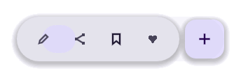

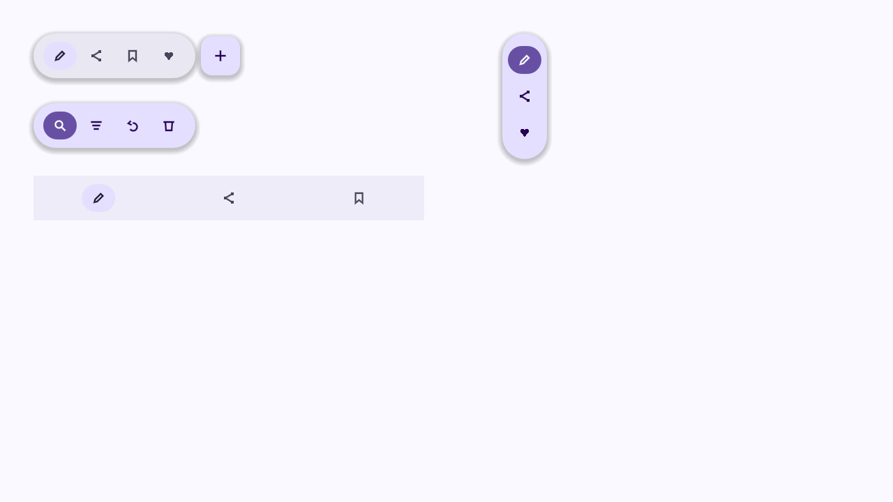

Frame breakdown (`navigation.toolbar__select_tool_item.filmstrip.png`):

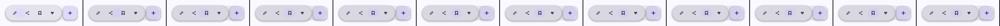

#### 
Test: `tests/gss/test_gss_navigation.gd::test_toolbar` | [HTML Snapshot](../artifacts/gss/navigation/navigation.toolbar__select_tool_item.gss.live.html) | [JSON Data](../artifacts/gss/navigation/navigation.toolbar__select_tool_item.gss.live.json)

---

<a id="navigationbar"></a>
## Navigation bar (`navigation.bar`)

- **Material 3 Spec**: [https://m3.material.io/components/navigation-bar/overview](https://m3.material.io/components/navigation-bar/overview)
- **Supported Variants**: `3-5 destinations`, `active indicator`, `badges`

### Example
```gdscript
var nav_bar := M3NavigationBar.new()
nav_bar.add_destination("Explore", null, 0)
nav_bar.add_destination("Saved", null, 3)
nav_bar.add_destination("Profile", null, -1)
```

### Screenshots and Animations

#### 
Test: `tests/gss/test_gss_navigation.gd::test_navigation_bar` | [HTML Snapshot](../artifacts/gss/navigation/navigation.bar__variants_light.gss.html) | [JSON Data](../artifacts/gss/navigation/navigation.bar__variants_light.gss.json)


#### 
Test: `tests/gss/test_gss_navigation.gd::test_navigation_bar` | [HTML Snapshot](../artifacts/gss/navigation/navigation.bar__select_destination.gss.live.html) | [JSON Data](../artifacts/gss/navigation/navigation.bar__select_destination.gss.live.json)


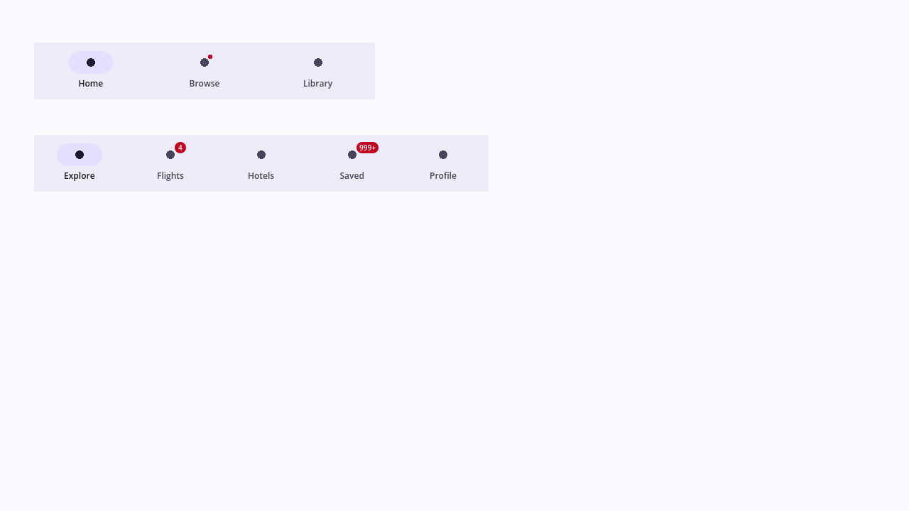

Frame breakdown (`navigation.bar__select_destination.filmstrip.png`):


#### 
Test: `tests/gss/test_gss_navigation.gd::test_navigation_bar` | [HTML Snapshot](../artifacts/gss/navigation/navigation.bar__select_destination.gss.live.html) | [JSON Data](../artifacts/gss/navigation/navigation.bar__select_destination.gss.live.json)

---

<a id="navigationdrawer"></a>
## Navigation drawer (`navigation.drawer`)

- **Material 3 Spec**: [https://m3.material.io/components/navigation-drawer/overview](https://m3.material.io/components/navigation-drawer/overview)
- **Supported Variants**: `standard`, `modal with scrim`

### Example
```gdscript
var drawer := M3NavigationDrawer.new()
drawer.is_modal = true
drawer.header_title = "Workspace"
drawer.add_item("Inbox", null, "24")
drawer.add_item("Starred", null, "")
```

### Screenshots and Animations

#### 
Test: `tests/gss/test_gss_navigation.gd::test_navigation_drawer` | [HTML Snapshot](../artifacts/gss/navigation/navigation.drawer__variants_light.gss.html) | [JSON Data](../artifacts/gss/navigation/navigation.drawer__variants_light.gss.json)


#### 
Test: `tests/gss/test_gss_navigation.gd::test_navigation_drawer` | [HTML Snapshot](../artifacts/gss/navigation/navigation.drawer__select_and_modal_close.gss.live.html) | [JSON Data](../artifacts/gss/navigation/navigation.drawer__select_and_modal_close.gss.live.json)

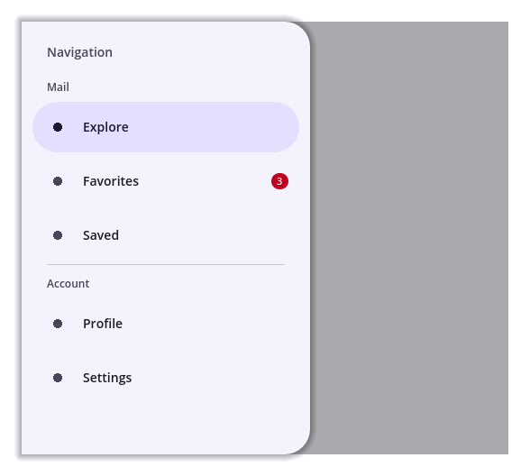

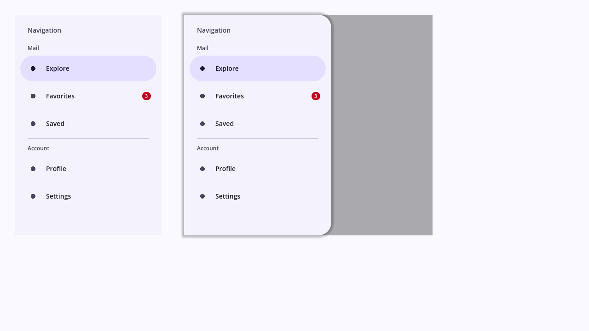

Frame breakdown (`navigation.drawer__select_and_modal_close.filmstrip.png`):

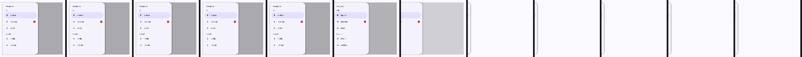

#### 
Test: `tests/gss/test_gss_navigation.gd::test_navigation_drawer` | [HTML Snapshot](../artifacts/gss/navigation/navigation.drawer__select_and_modal_close.gss.live.html) | [JSON Data](../artifacts/gss/navigation/navigation.drawer__select_and_modal_close.gss.live.json)

---

<a id="navigationrail"></a>
## Navigation rail (`navigation.rail`)

- **Material 3 Spec**: [https://m3.material.io/components/navigation-rail/overview](https://m3.material.io/components/navigation-rail/overview)
- **Supported Variants**: `with FAB`, `active indicator`

### Example
```gdscript
var rail := M3NavigationRail.new()
rail.show_menu_button = true
rail.show_fab = true
rail.set_expanded(true)
```

### Screenshots and Animations

#### 
Test: `tests/gss/test_gss_navigation.gd::test_navigation_rail` | [HTML Snapshot](../artifacts/gss/navigation/navigation.rail__variants_light.gss.html) | [JSON Data](../artifacts/gss/navigation/navigation.rail__variants_light.gss.json)

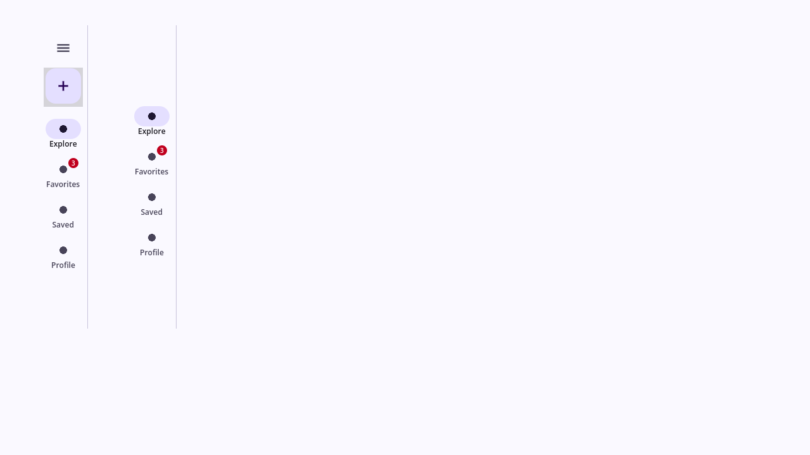

#### 
Test: `tests/gss/test_gss_navigation.gd::test_navigation_rail` | [HTML Snapshot](../artifacts/gss/navigation/navigation.rail__select_destination_and_fab.gss.live.html) | [JSON Data](../artifacts/gss/navigation/navigation.rail__select_destination_and_fab.gss.live.json)

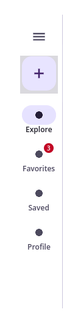


Frame breakdown (`navigation.rail__select_destination_and_fab.filmstrip.png`):

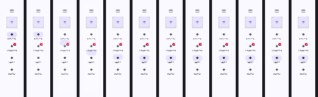

#### 
Test: `tests/gss/test_gss_navigation.gd::test_navigation_rail` | [HTML Snapshot](../artifacts/gss/navigation/navigation.rail__select_destination_and_fab.gss.live.html) | [JSON Data](../artifacts/gss/navigation/navigation.rail__select_destination_and_fab.gss.live.json)

---

<a id="navigationsearch"></a>
## Search (bar + view) (`navigation.search`)

- **Material 3 Spec**: [https://m3.material.io/components/search/overview](https://m3.material.io/components/search/overview)
- **Supported Variants**: `search bar`, `search view expanded with suggestions`

### Example
```gdscript
var search_bar := M3SearchBar.new()
var search_view := M3SearchView.new()
search_bar.search_view = search_view
search_view.add_suggestion("Material 3 Expressive buttons", "schedule")
```

### Screenshots and Animations

#### 
Test: `tests/gss/test_gss_navigation.gd::test_search_bar_and_view` | [HTML Snapshot](../artifacts/gss/navigation/navigation.search__variants_light.gss.html) | [JSON Data](../artifacts/gss/navigation/navigation.search__variants_light.gss.json)

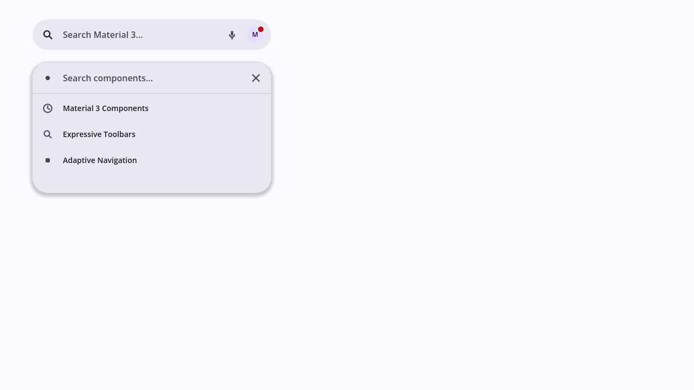

#### 
Test: `tests/gss/test_gss_navigation.gd::test_search_bar_and_view` | [HTML Snapshot](../artifacts/gss/navigation/navigation.search__activate_and_select_suggestion.gss.live.html) | [JSON Data](../artifacts/gss/navigation/navigation.search__activate_and_select_suggestion.gss.live.json)

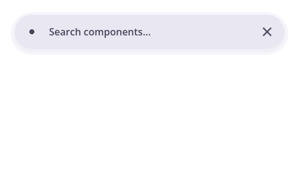

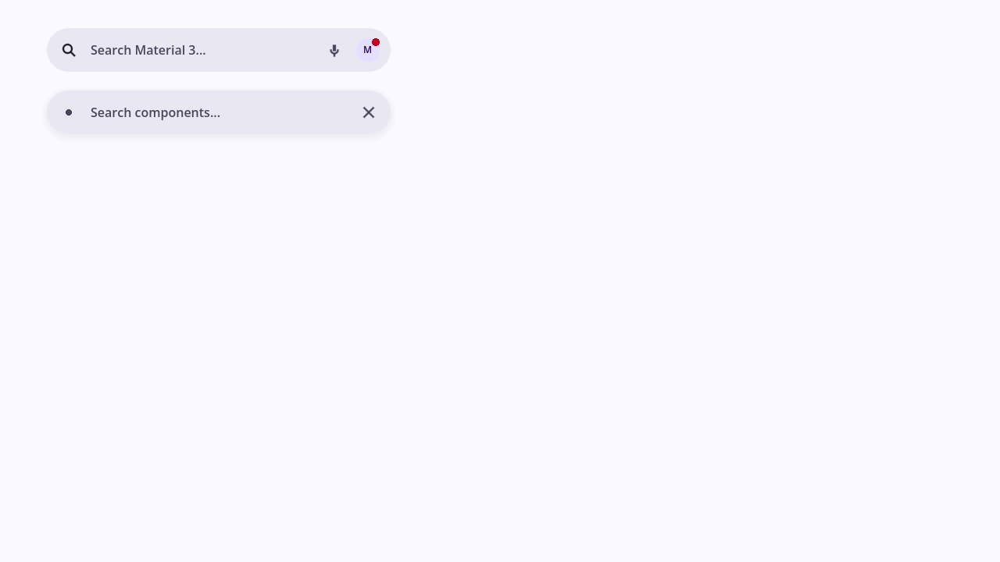

Frame breakdown (`navigation.search__activate_and_select_suggestion.filmstrip.png`):

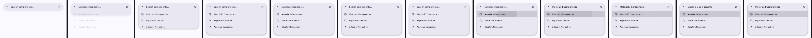

#### 
Test: `tests/gss/test_gss_navigation.gd::test_search_bar_and_view` | [HTML Snapshot](../artifacts/gss/navigation/navigation.search__activate_and_select_suggestion.gss.live.html) | [JSON Data](../artifacts/gss/navigation/navigation.search__activate_and_select_suggestion.gss.live.json)

---

<a id="navigationtabs"></a>
## Tabs (`navigation.tabs`)

- **Material 3 Spec**: [https://m3.material.io/components/tabs/overview](https://m3.material.io/components/tabs/overview)
- **Supported Variants**: `primary`, `secondary`, `indicator slide`

### Example
```gdscript
var tabs := M3Tabs.new()
tabs.tab_variant = M3Tabs.TabVariant.PRIMARY
tabs.set_tabs(["Overview", "Specifications", "Guidelines"])
```

### Screenshots and Animations

#### 
Test: `tests/gss/test_gss_navigation.gd::test_tabs` | [HTML Snapshot](../artifacts/gss/navigation/navigation.tabs__variants_light.gss.html) | [JSON Data](../artifacts/gss/navigation/navigation.tabs__variants_light.gss.json)


#### 
Test: `tests/gss/test_gss_navigation.gd::test_tabs` | [HTML Snapshot](../artifacts/gss/navigation/navigation.tabs__indicator_slide.gss.live.html) | [JSON Data](../artifacts/gss/navigation/navigation.tabs__indicator_slide.gss.live.json)


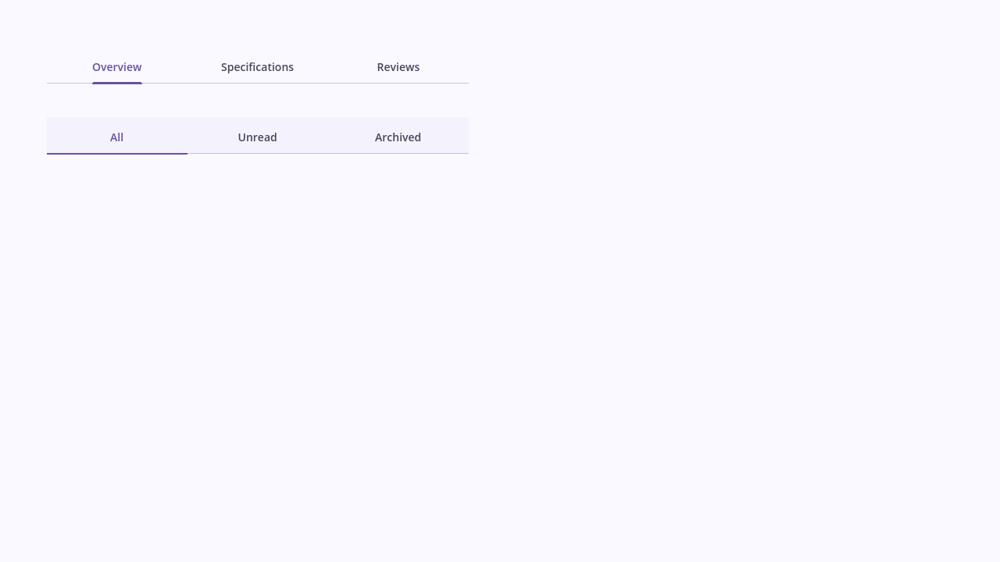

Frame breakdown (`navigation.tabs__indicator_slide.filmstrip.png`):


#### 
Test: `tests/gss/test_gss_navigation.gd::test_tabs` | [HTML Snapshot](../artifacts/gss/navigation/navigation.tabs__indicator_slide.gss.live.html) | [JSON Data](../artifacts/gss/navigation/navigation.tabs__indicator_slide.gss.live.json)

---

<a id="navigationadaptive"></a>
## Adaptive navigation (`navigation.adaptive`)

- **Material 3 Spec**: [https://m3.material.io/foundations/layout/applying-layout/window-size-classes](https://m3.material.io/foundations/layout/applying-layout/window-size-classes)
- **Supported Variants**: `bar (compact)`, `rail (medium)`, `drawer (expanded)`

### Example
```gdscript
var adaptive := M3AdaptiveNavigation.new()
# Automatically switches between M3NavigationBar (<600dp),
# M3NavigationRail (600..839dp), and M3NavigationDrawer (>=840dp).
```

### Screenshots and Animations

#### 
Test: `tests/gss/test_gss_navigation.gd::test_adaptive_navigation_and_window_classes` | [HTML Snapshot](../artifacts/gss/navigation/navigation.adaptive__compact_medium_expanded.gss.html) | [JSON Data](../artifacts/gss/navigation/navigation.adaptive__compact_medium_expanded.gss.json)


#### 
Test: `tests/gss/test_gss_navigation.gd::test_adaptive_navigation_and_window_classes` | [HTML Snapshot](../artifacts/gss/navigation/navigation.adaptive__navigate_and_breakpoint_switch.gss.live.html) | [JSON Data](../artifacts/gss/navigation/navigation.adaptive__navigate_and_breakpoint_switch.gss.live.json)

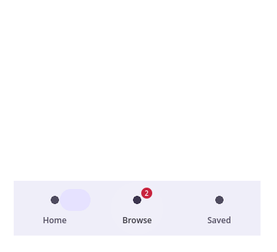

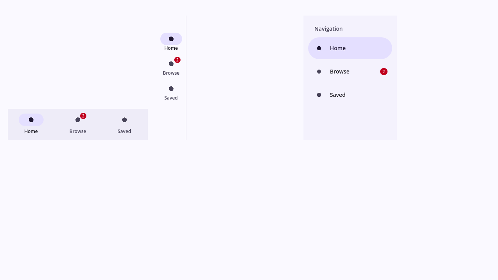

Frame breakdown (`navigation.adaptive__navigate_and_breakpoint_switch.filmstrip.png`):

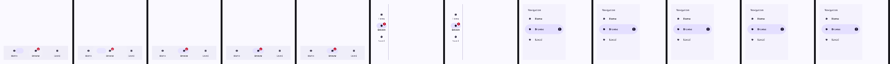

---

<a id="navigationtabsscrollable"></a>
## Scrollable tabs (52dp leading offset) (`navigation.tabs.scrollable`)

- **Material 3 Spec**: [https://m3.material.io/components/tabs/specs](https://m3.material.io/components/tabs/specs)
- **Supported Variants**: `scrollable primary tabs`, `scrollable secondary tabs`, `auto-scroll to active tab`

### Example
```gdscript
var scroll_tabs := M3Tabs.new()
scroll_tabs.scrollable = true
scroll_tabs.leading_edge_offset = 52.0
scroll_tabs.set_tabs(["All", "Foundations", "Actions", "Communication", "Containment", "Navigation", "Selection"])
```

### Screenshots and Animations

#### 
Test: `tests/gss/test_gss_navigation.gd::test_scrollable_tabs` | [HTML Snapshot](../artifacts/gss/navigation/navigation.tabs.scrollable__variants_light.gss.html) | [JSON Data](../artifacts/gss/navigation/navigation.tabs.scrollable__variants_light.gss.json)


#### 
Test: `tests/gss/test_gss_navigation.gd::test_scrollable_tabs` | [HTML Snapshot](../artifacts/gss/navigation/navigation.tabs.scrollable__select_and_auto_scroll.gss.live.html) | [JSON Data](../artifacts/gss/navigation/navigation.tabs.scrollable__select_and_auto_scroll.gss.live.json)


Frame breakdown (`navigation.tabs.scrollable__select_and_auto_scroll.filmstrip.png`):


#### 
Test: `tests/gss/test_gss_navigation.gd::test_scrollable_tabs` | [HTML Snapshot](../artifacts/gss/navigation/navigation.tabs.scrollable__select_and_auto_scroll.gss.live.html) | [JSON Data](../artifacts/gss/navigation/navigation.tabs.scrollable__select_and_auto_scroll.gss.live.json)

---
