# Selection

[Back to Wiki Home](Home.md) | [Godot 4 Editor Guide](IDE-Integration-and-Editor-Guide.md) | 11 components

Inputs for picking values and options: checkboxes, chips, date pickers, menus and submenus, radio buttons, sliders (horizontal, vertical, range, and centered-zero), switches, and clock dial time pickers.

## Category Animations

| Checkboxes, switches, radios, chips, and sliders (dark mode) | 24-hour time picker and year grid date picker |
|---|---|
| 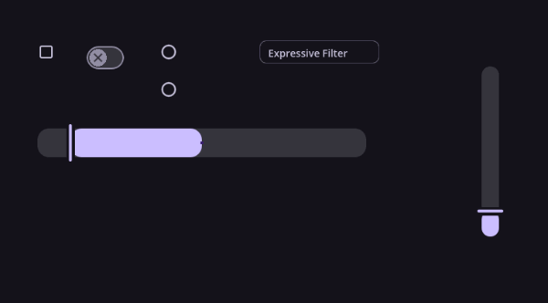 | 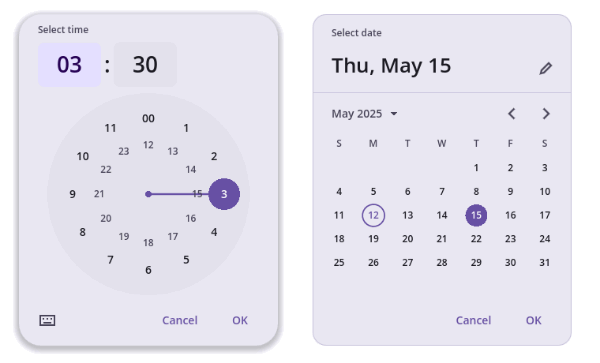 |

## Contents

- [Checkbox (`selection.checkbox`)](#selectioncheckbox)
- [Chips (`selection.chip`)](#selectionchip)
- [Date pickers (`selection.date_picker`)](#selectiondate_picker)
- [Menus (`selection.menu`)](#selectionmenu)
- [Radio button (`selection.radio`)](#selectionradio)
- [Sliders (`selection.slider`)](#selectionslider)
- [Switch (`selection.switch`)](#selectionswitch)
- [Time pickers (`selection.time_picker`)](#selectiontime_picker)
- [Sliders — Vertical, centered-zero & Expressive sizes (`selection.slider.expressive`)](#selectionsliderexpressive)
- [Menus — Cascading submenus & Expressive groups (`selection.menu.cascading_grouped`)](#selectionmenucascading_grouped)
- [Pickers — 24h dual-ring Time Picker & Year-grid Date Picker (`selection.pickers.extended`)](#selectionpickersextended)

---

<a id="selectioncheckbox"></a>
## Checkbox (`selection.checkbox`)

- **Material 3 Spec**: [https://m3.material.io/components/checkbox/overview](https://m3.material.io/components/checkbox/overview)
- **Supported Variants**: `unchecked`, `checked`, `indeterminate`, `error`, `disabled`

### Example
```gdscript
var cb := M3Checkbox.new()
cb.check_state = M3Checkbox.CheckState.INDETERMINATE
cb.is_error = false
```

### Screenshots and Animations

#### Unchecked, checked, indeterminate, error, disabled
Test: `tests/gss/test_gss_selection.gd::test_selection_checkbox` | [HTML Snapshot](../artifacts/gss/selection/selection.checkbox__variants_light.gss.html) | [JSON Data](../artifacts/gss/selection/selection.checkbox__variants_light.gss.json)

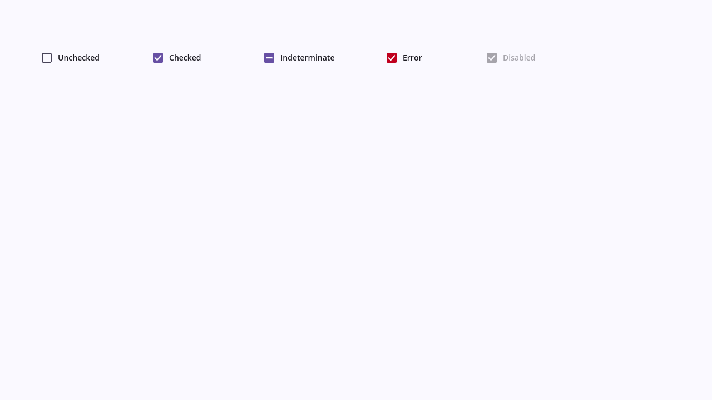

#### Click toggles unchecked -> checked
Test: `tests/gss/test_gss_selection.gd::test_selection_checkbox` | [HTML Snapshot](../artifacts/gss/selection/selection.checkbox__check_morph.gss.live.html) | [JSON Data](../artifacts/gss/selection/selection.checkbox__check_morph.gss.live.json)

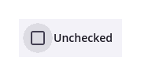


Frame breakdown (`selection.checkbox__check_morph.filmstrip.png`):


#### _anim_progress spring tween
Test: `tests/gss/test_gss_selection.gd::test_selection_checkbox` | [HTML Snapshot](../artifacts/gss/selection/selection.checkbox__check_morph.gss.live.html) | [JSON Data](../artifacts/gss/selection/selection.checkbox__check_morph.gss.live.json)

---

<a id="selectionchip"></a>
## Chips (`selection.chip`)

- **Material 3 Spec**: [https://m3.material.io/components/chips/overview](https://m3.material.io/components/chips/overview)
- **Supported Variants**: `assist`, `filter`, `input`, `suggestion`, `elevated`

### Example
```gdscript
var chip := M3Chip.new()
chip.chip_type = M3Chip.ChipType.FILTER
chip.text = "Expressive"
chip.selected = true
```

### Screenshots and Animations

#### Assist, filter, input, suggestion, elevated
Test: `tests/gss/test_gss_selection.gd::test_selection_chip` | [HTML Snapshot](../artifacts/gss/selection/selection.chip__variants_light.gss.html) | [JSON Data](../artifacts/gss/selection/selection.chip__variants_light.gss.json)


#### Filter chip toggle + Input chip close
Test: `tests/gss/test_gss_selection.gd::test_selection_chip` | [HTML Snapshot](../artifacts/gss/selection/selection.chip__filter_toggle_and_input_close.gss.live.html) | [JSON Data](../artifacts/gss/selection/selection.chip__filter_toggle_and_input_close.gss.live.json)

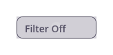

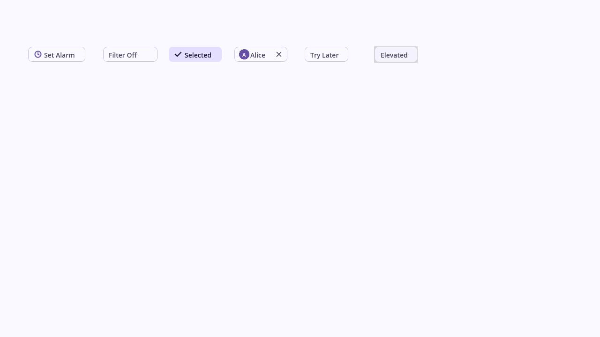

Frame breakdown (`selection.chip__filter_toggle_and_input_close.filmstrip.png`):

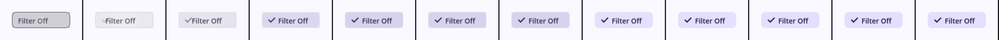

#### Filter chip _select_progress & _checkmark_progress tween
Test: `tests/gss/test_gss_selection.gd::test_selection_chip` | [HTML Snapshot](../artifacts/gss/selection/selection.chip__filter_toggle_and_input_close.gss.live.html) | [JSON Data](../artifacts/gss/selection/selection.chip__filter_toggle_and_input_close.gss.live.json)

---

<a id="selectiondate_picker"></a>
## Date pickers (`selection.date_picker`)

- **Material 3 Spec**: [https://m3.material.io/components/date-pickers/overview](https://m3.material.io/components/date-pickers/overview)
- **Supported Variants**: `docked`, `modal`, `modal input`, `range`

### Example
```gdscript
var picker := M3DatePicker.new()
picker.picker_mode = M3DatePicker.PickerMode.MODAL
picker.selected_year = 2025
picker.selected_month = 5
picker.selected_day = 15
```

### Screenshots and Animations

#### Docked and Modal M3DatePicker variants
Test: `tests/gss/test_gss_inputs.gd::test_date_picker_variants_and_interaction` | [HTML Snapshot](../artifacts/gss/selection/selection.date_picker__docked_and_modal_light.gss.html) | [JSON Data](../artifacts/gss/selection/selection.date_picker__docked_and_modal_light.gss.json)


#### Day cell selection, month navigation, and confirmation
Test: `tests/gss/test_gss_inputs.gd::test_date_picker_variants_and_interaction` | [HTML Snapshot](../artifacts/gss/selection/selection.date_picker__select_day_and_next_month.gss.live.html) | [JSON Data](../artifacts/gss/selection/selection.date_picker__select_day_and_next_month.gss.live.json)

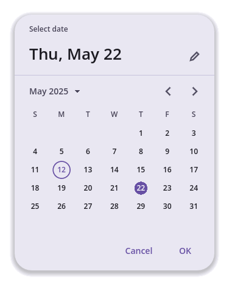

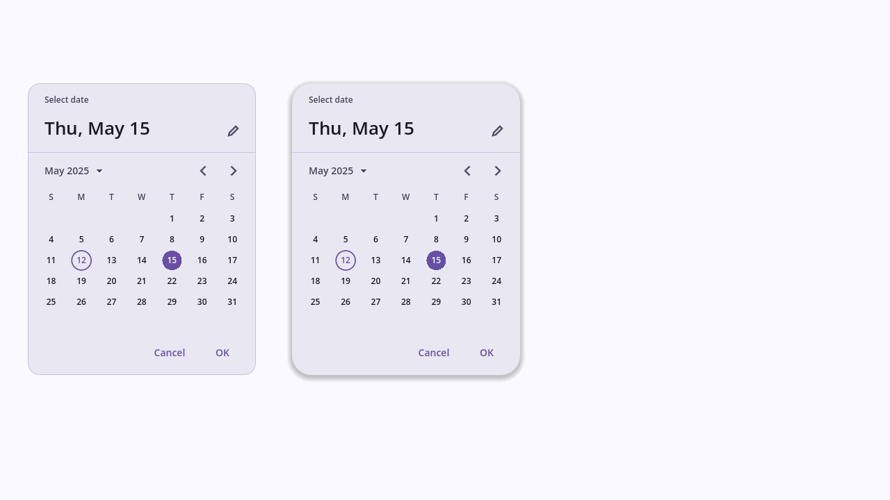

Frame breakdown (`selection.date_picker__select_day_and_next_month.filmstrip.png`):

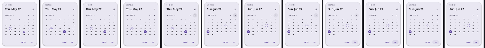

#### Day selection circle and month transition animations
Test: `tests/gss/test_gss_inputs.gd::test_date_picker_variants_and_interaction` | [HTML Snapshot](../artifacts/gss/selection/selection.date_picker__select_day_and_next_month.gss.live.html) | [JSON Data](../artifacts/gss/selection/selection.date_picker__select_day_and_next_month.gss.live.json)

#### Modal input and date range variants in dark mode
Test: `tests/gss/test_gss_inputs.gd::test_date_picker_variants_and_interaction` | [HTML Snapshot](../artifacts/gss/selection/selection.date_picker__input_and_range_dark.gss.html) | [JSON Data](../artifacts/gss/selection/selection.date_picker__input_and_range_dark.gss.json)

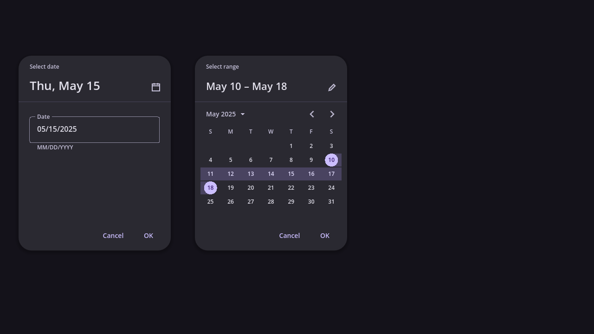

---

<a id="selectionmenu"></a>
## Menus (`selection.menu`)

- **Material 3 Spec**: [https://m3.material.io/components/menus/overview](https://m3.material.io/components/menus/overview)
- **Supported Variants**: `items with icons`, `trailing shortcut`, `divider`, `disabled item`

### Example
```gdscript
var menu := M3Menu.new()
menu.add_item(1, "Cut", "⌘X", false, "edit")
menu.add_item(2, "Copy", "⌘C", false, "bookmark")
menu.add_separator()
menu.add_item(3, "Delete", "⌫", false, "delete")
```

### Screenshots and Animations

#### Menu open scale/fade open_progress transition
Test: `tests/gss/test_gss_selection.gd::test_selection_menu` | [HTML Snapshot](../artifacts/gss/selection/selection.menu__open_transition.gss.live.html) | [JSON Data](../artifacts/gss/selection/selection.menu__open_transition.gss.live.json)


Frame breakdown (`selection.menu__open_transition.filmstrip.png`):

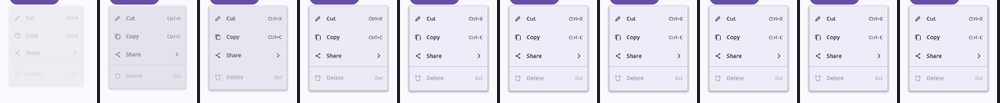

#### Items with leading/trailing icons, shortcut, divider, disabled item
Test: `tests/gss/test_gss_selection.gd::test_selection_menu` | [HTML Snapshot](../artifacts/gss/selection/selection.menu__variants_open_light.gss.html) | [JSON Data](../artifacts/gss/selection/selection.menu__variants_open_light.gss.json)

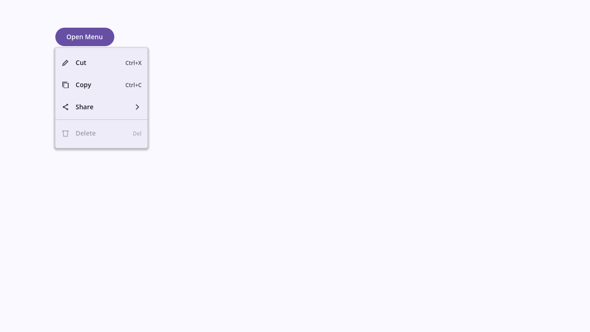

#### Click menu item emits selection and closes menu
Test: `tests/gss/test_gss_selection.gd::test_selection_menu` | [HTML Snapshot](../artifacts/gss/selection/selection.menu__select_item.gss.live.html) | [JSON Data](../artifacts/gss/selection/selection.menu__select_item.gss.live.json)

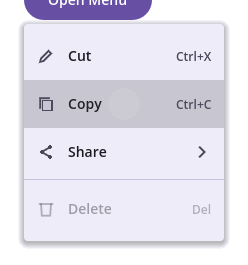


Frame breakdown (`selection.menu__select_item.filmstrip.png`):

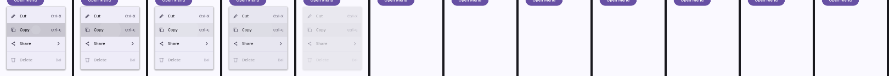

---

<a id="selectionradio"></a>
## Radio button (`selection.radio`)

- **Material 3 Spec**: [https://m3.material.io/components/radio-button/overview](https://m3.material.io/components/radio-button/overview)
- **Supported Variants**: `selected`, `unselected`, `group exclusivity`

### Example
```gdscript
var group := M3RadioGroup.new()
var r1 := M3Radio.new()
var r2 := M3Radio.new()
group.add_child(r1)
group.add_child(r2)
```

### Screenshots and Animations

#### Selected, unselected, disabled, group
Test: `tests/gss/test_gss_selection.gd::test_selection_radio` | [HTML Snapshot](../artifacts/gss/selection/selection.radio__variants_light.gss.html) | [JSON Data](../artifacts/gss/selection/selection.radio__variants_light.gss.json)


#### Click unselected radio selects it and deselects previous
Test: `tests/gss/test_gss_selection.gd::test_selection_radio` | [HTML Snapshot](../artifacts/gss/selection/selection.radio__group_select_second.gss.live.html) | [JSON Data](../artifacts/gss/selection/selection.radio__group_select_second.gss.live.json)

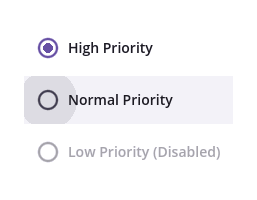


Frame breakdown (`selection.radio__group_select_second.filmstrip.png`):

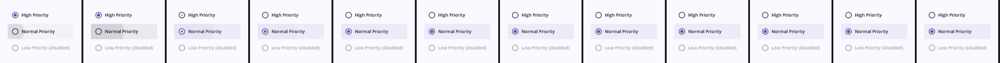

#### Inner dot _dot_scale tween
Test: `tests/gss/test_gss_selection.gd::test_selection_radio` | [HTML Snapshot](../artifacts/gss/selection/selection.radio__group_select_second.gss.live.html) | [JSON Data](../artifacts/gss/selection/selection.radio__group_select_second.gss.live.json)

---

<a id="selectionslider"></a>
## Sliders (`selection.slider`)

- **Material 3 Spec**: [https://m3.material.io/components/sliders/overview](https://m3.material.io/components/sliders/overview)
- **Supported Variants**: `continuous`, `discrete with ticks`, `range`, `value indicator`

### Example
```gdscript
var slider := M3Slider.new()
slider.slider_type = M3Slider.SliderType.DISCRETE
slider.step = 10.0
slider.value = 60.0
```

### Screenshots and Animations

#### Continuous, discrete with ticks, range
Test: `tests/gss/test_gss_selection.gd::test_selection_slider` | [HTML Snapshot](../artifacts/gss/selection/selection.slider__variants_light.gss.html) | [JSON Data](../artifacts/gss/selection/selection.slider__variants_light.gss.json)

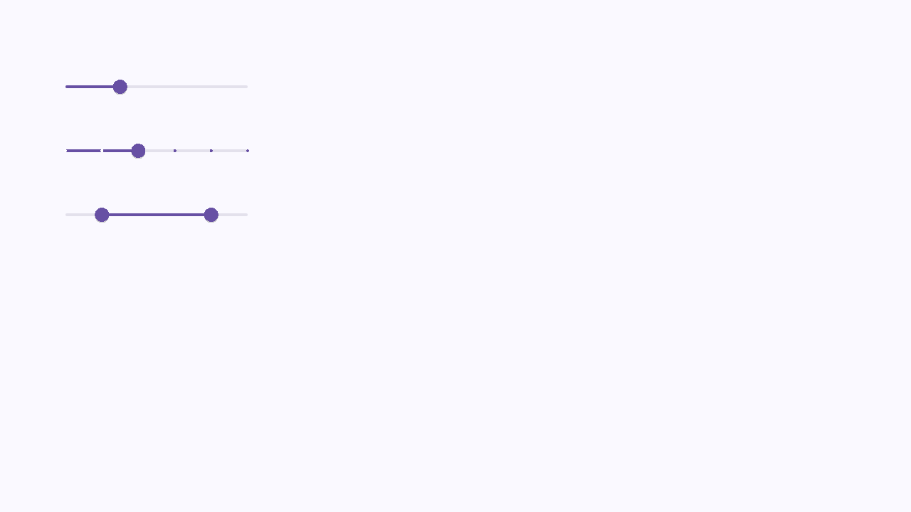

#### Drag discrete slider snaps to step 80
Test: `tests/gss/test_gss_selection.gd::test_selection_slider` | [HTML Snapshot](../artifacts/gss/selection/selection.slider__drag_discrete_with_bubble.gss.live.html) | [JSON Data](../artifacts/gss/selection/selection.slider__drag_discrete_with_bubble.gss.live.json)

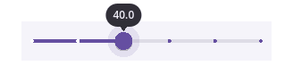


Frame breakdown (`selection.slider__drag_discrete_with_bubble.filmstrip.png`):

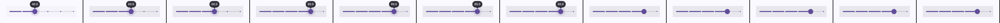

#### Value indicator _indicator_scale & _active_progress tween
Test: `tests/gss/test_gss_selection.gd::test_selection_slider` | [HTML Snapshot](../artifacts/gss/selection/selection.slider__drag_discrete_with_bubble.gss.live.html) | [JSON Data](../artifacts/gss/selection/selection.slider__drag_discrete_with_bubble.gss.live.json)

---

<a id="selectionswitch"></a>
## Switch (`selection.switch`)

- **Material 3 Spec**: [https://m3.material.io/components/switch/overview](https://m3.material.io/components/switch/overview)
- **Supported Variants**: `off`, `on`, `with icons`, `disabled`

### Example
```gdscript
var sw := M3Switch.new()
sw.show_icons = true
sw.selected = true
```

### Screenshots and Animations

#### Off, on, with icons, disabled (light)
Test: `tests/gss/test_gss_selection.gd::test_selection_switch` | [HTML Snapshot](../artifacts/gss/selection/selection.switch__variants_light.gss.html) | [JSON Data](../artifacts/gss/selection/selection.switch__variants_light.gss.json)


#### Click switch toggles selected -> true
Test: `tests/gss/test_gss_selection.gd::test_selection_switch` | [HTML Snapshot](../artifacts/gss/selection/selection.switch__toggle_on_glide.gss.live.html) | [JSON Data](../artifacts/gss/selection/selection.switch__toggle_on_glide.gss.live.json)

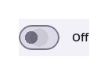

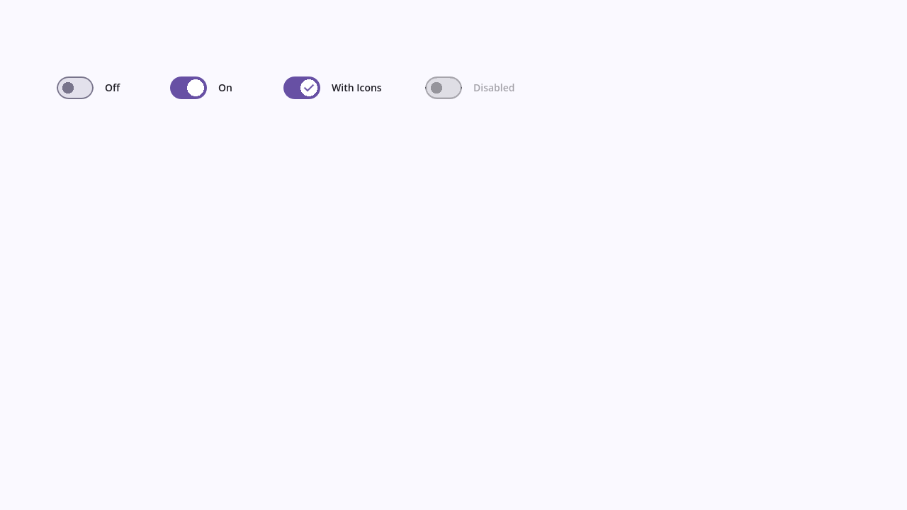

Frame breakdown (`selection.switch__toggle_on_glide.filmstrip.png`):

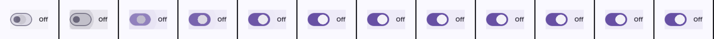

#### Thumb glide _progress & _thumb_size morph
Test: `tests/gss/test_gss_selection.gd::test_selection_switch` | [HTML Snapshot](../artifacts/gss/selection/selection.switch__toggle_on_glide.gss.live.html) | [JSON Data](../artifacts/gss/selection/selection.switch__toggle_on_glide.gss.live.json)

#### Dark mode switch snapshot
Test: `tests/gss/test_gss_selection.gd::test_selection_switch` | [HTML Snapshot](../artifacts/gss/selection/selection.switch__variants_dark.gss.html) | [JSON Data](../artifacts/gss/selection/selection.switch__variants_dark.gss.json)


---

<a id="selectiontime_picker"></a>
## Time pickers (`selection.time_picker`)

- **Material 3 Spec**: [https://m3.material.io/components/time-pickers/overview](https://m3.material.io/components/time-pickers/overview)
- **Supported Variants**: `dial`, `input`, `AM/PM selector`, `hour/minute modes`

### Example
```gdscript
var time_picker := M3TimePicker.new()
time_picker.time_mode = M3TimePicker.TimeMode.DIAL
time_picker.selected_hour = 7
time_picker.selected_minute = 30
```

### Screenshots and Animations

#### Dial hour, dial minute, AM/PM, and input time picker variants
Test: `tests/gss/test_gss_inputs.gd::test_time_picker_variants_and_interaction` | [HTML Snapshot](../artifacts/gss/selection/selection.time_picker__variants_light.gss.html) | [JSON Data](../artifacts/gss/selection/selection.time_picker__variants_light.gss.json)

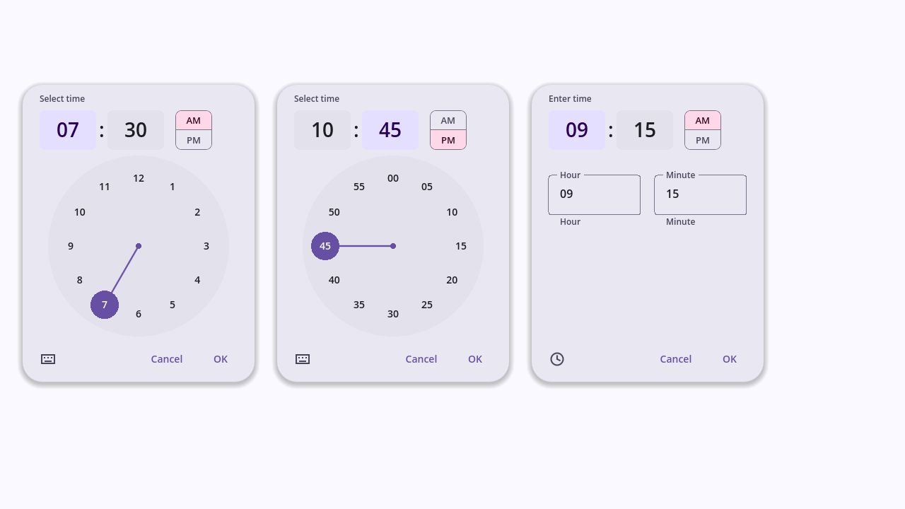

#### Clock dial hour click, AM/PM toggle, minute chip, and OK confirm
Test: `tests/gss/test_gss_inputs.gd::test_time_picker_variants_and_interaction` | [HTML Snapshot](../artifacts/gss/selection/selection.time_picker__dial_select_and_confirm.gss.live.html) | [JSON Data](../artifacts/gss/selection/selection.time_picker__dial_select_and_confirm.gss.live.json)

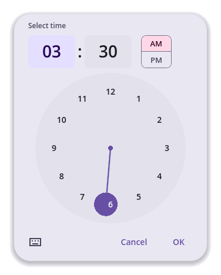


Frame breakdown (`selection.time_picker__dial_select_and_confirm.filmstrip.png`):

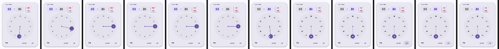

#### Animated clock hand dial_angle tween
Test: `tests/gss/test_gss_inputs.gd::test_time_picker_variants_and_interaction` | [HTML Snapshot](../artifacts/gss/selection/selection.time_picker__dial_select_and_confirm.gss.live.html) | [JSON Data](../artifacts/gss/selection/selection.time_picker__dial_select_and_confirm.gss.live.json)

---

<a id="selectionsliderexpressive"></a>
## Sliders — Vertical, centered-zero & Expressive sizes (`selection.slider.expressive`)

- **Material 3 Spec**: [https://m3.material.io/components/sliders/specs](https://m3.material.io/components/sliders/specs)
- **Supported Variants**: `vertical orientation`, `centered-zero bipolar (-100..+100)`, `Expressive XS/S/M/L/XL track heights`

### Example
```gdscript
var exp_slider := M3Slider.new()
exp_slider.orientation = M3Slider.Orientation.VERTICAL
exp_slider.centered_zero = true # Bipolar -100..+100 active fill from 0.0
exp_slider.slider_size = M3Slider.SliderSize.LARGE # 40dp Expressive track
```

### Screenshots and Animations

#### Expressive thick tracks, centered-zero bidirectional, and vertical slider
Test: `tests/gss/test_gss_selection.gd::test_selection_slider_expressive` | [HTML Snapshot](../artifacts/gss/selection/selection.slider.expressive__expressive_vertical_centered_light.gss.html) | [JSON Data](../artifacts/gss/selection/selection.slider.expressive__expressive_vertical_centered_light.gss.json)

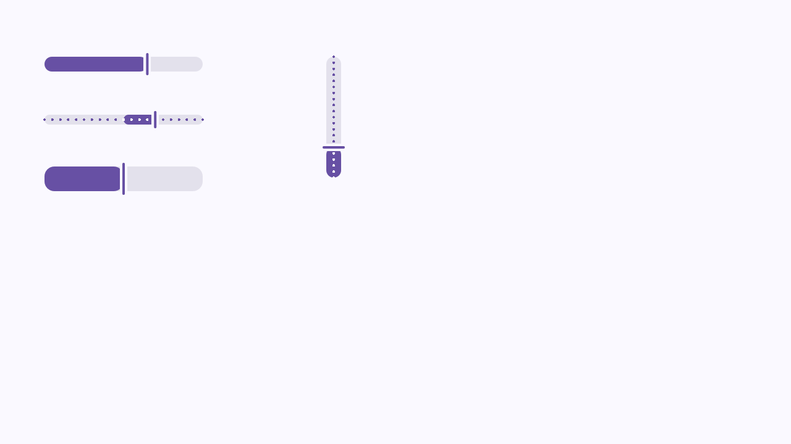

#### Vertical upward drag and centered-zero negative selection
Test: `tests/gss/test_gss_selection.gd::test_selection_slider_expressive` | [HTML Snapshot](../artifacts/gss/selection/selection.slider.expressive__drag_vertical_and_centered.gss.live.html) | [JSON Data](../artifacts/gss/selection/selection.slider.expressive__drag_vertical_and_centered.gss.live.json)

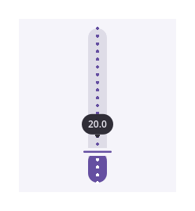


Frame breakdown (`selection.slider.expressive__drag_vertical_and_centered.filmstrip.png`):

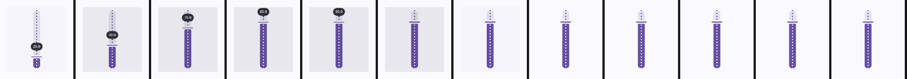

#### Vertical handle active progress and indicator scale tween
Test: `tests/gss/test_gss_selection.gd::test_selection_slider_expressive` | [HTML Snapshot](../artifacts/gss/selection/selection.slider.expressive__drag_vertical_and_centered.gss.live.html) | [JSON Data](../artifacts/gss/selection/selection.slider.expressive__drag_vertical_and_centered.gss.live.json)

---

<a id="selectionmenucascading_grouped"></a>
## Menus — Cascading submenus & Expressive groups (`selection.menu.cascading_grouped`)

- **Material 3 Spec**: [https://m3.material.io/components/menus/specs](https://m3.material.io/components/menus/specs)
- **Supported Variants**: `nested cascading flyout submenu`, `Expressive detached rounded menu groups`, `keyboard shortcut labels`

### Example
```gdscript
var root_menu := M3Menu.new()
root_menu.expressive_grouped = true
var export_submenu := M3Menu.new()
export_submenu.add_item(10, "Export PNG", "")
export_submenu.add_item(11, "Export GSS JSON", "")
root_menu.add_submenu_item(1, "Export Artifact", export_submenu, "share")
```

### Screenshots and Animations

#### Cascading submenu scale/fade and submenu_open_progress tween
Test: `tests/gss/test_gss_selection.gd::test_selection_menu_cascading_grouped` | [HTML Snapshot](../artifacts/gss/selection/selection.menu.cascading_grouped__open_cascading_submenu.gss.live.html) | [JSON Data](../artifacts/gss/selection/selection.menu.cascading_grouped__open_cascading_submenu.gss.live.json)

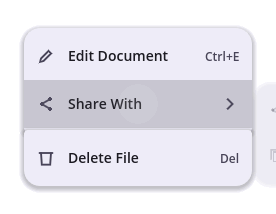


Frame breakdown (`selection.menu.cascading_grouped__open_cascading_submenu.filmstrip.png`):

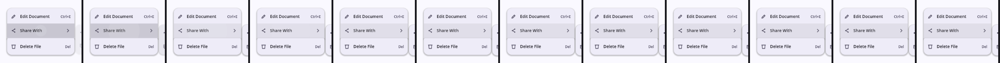

#### Expressive grouped menu containers and open cascading submenu
Test: `tests/gss/test_gss_selection.gd::test_selection_menu_cascading_grouped` | [HTML Snapshot](../artifacts/gss/selection/selection.menu.cascading_grouped__grouped_and_submenu_open_light.gss.html) | [JSON Data](../artifacts/gss/selection/selection.menu.cascading_grouped__grouped_and_submenu_open_light.gss.json)


#### Click cascading submenu item selects action and closes hierarchy
Test: `tests/gss/test_gss_selection.gd::test_selection_menu_cascading_grouped` | [HTML Snapshot](../artifacts/gss/selection/selection.menu.cascading_grouped__select_submenu_item.gss.live.html) | [JSON Data](../artifacts/gss/selection/selection.menu.cascading_grouped__select_submenu_item.gss.live.json)


Frame breakdown (`selection.menu.cascading_grouped__select_submenu_item.filmstrip.png`):


---

<a id="selectionpickersextended"></a>
## Pickers — 24h dual-ring Time Picker & Year-grid Date Picker (`selection.pickers.extended`)

- **Material 3 Spec**: [https://m3.material.io/components/date-pickers/specs](https://m3.material.io/components/date-pickers/specs)
- **Supported Variants**: `24-hour inner/outer concentric clock dial (00-12 / 13-23)`, `interactive multi-year grid selector in Date Picker`

### Example
```gdscript
var tp_24h := M3TimePicker.new()
tp_24h.use_24_hour = true # Concentric 00-12 outer & 13-23 inner clock rings
var dp := M3DatePicker.new()
dp.set_year_picker_open(true) # Opens interactive 3x5 multi-year grid
```

### Screenshots and Animations

#### 24h inner-ring dial_hand_length tween and year_picker_progress transition
Test: `tests/gss/test_gss_inputs.gd::test_pickers_extended_24h_and_year_grid` | [HTML Snapshot](../artifacts/gss/selection/selection.pickers.extended__select_inner_ring_and_open_year_grid.gss.live.html) | [JSON Data](../artifacts/gss/selection/selection.pickers.extended__select_inner_ring_and_open_year_grid.gss.live.json)

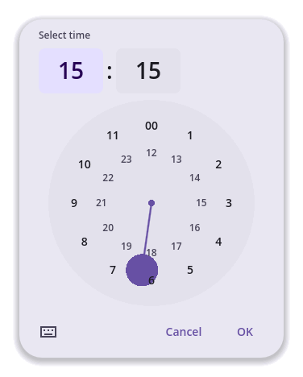

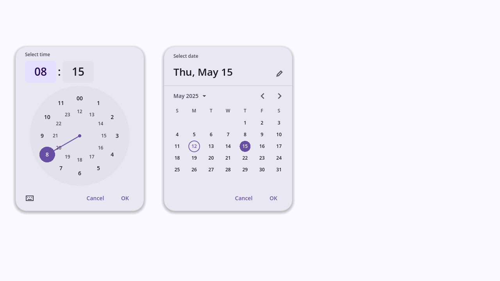

Frame breakdown (`selection.pickers.extended__select_inner_ring_and_open_year_grid.filmstrip.png`):

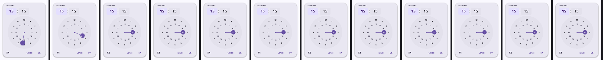

#### 24-hour concentric dual-ring clock face and 3x5 Multi-Year Grid
Test: `tests/gss/test_gss_inputs.gd::test_pickers_extended_24h_and_year_grid` | [HTML Snapshot](../artifacts/gss/selection/selection.pickers.extended__dual_ring_24h_and_year_grid_light.gss.html) | [JSON Data](../artifacts/gss/selection/selection.pickers.extended__dual_ring_24h_and_year_grid_light.gss.json)

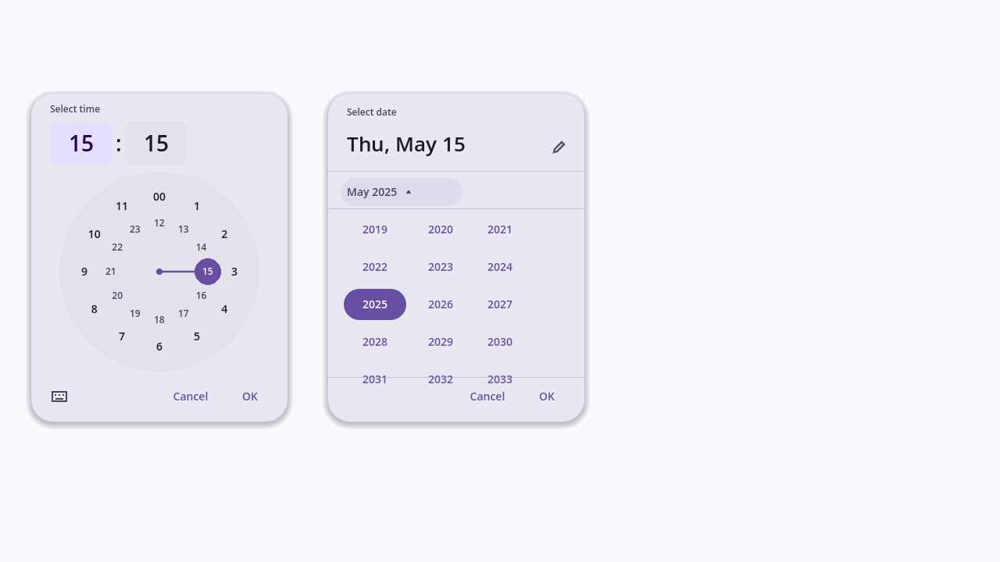

#### 24h inner/outer ring selection and multi-year pill click
Test: `tests/gss/test_gss_inputs.gd::test_pickers_extended_24h_and_year_grid` | [HTML Snapshot](../artifacts/gss/selection/selection.pickers.extended__pick_year_pill.gss.live.html) | [JSON Data](../artifacts/gss/selection/selection.pickers.extended__pick_year_pill.gss.live.json)

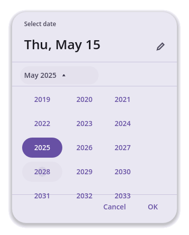


Frame breakdown (`selection.pickers.extended__pick_year_pill.filmstrip.png`):

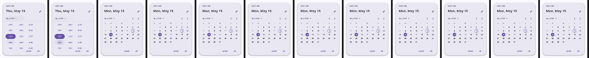

---
