# Text inputs

[Back to Wiki Home](Home.md) | [Godot 4 Editor Guide](IDE-Integration-and-Editor-Guide.md) | 3 components

Text entry controls: filled and outlined text fields with floating labels, icons, validation errors, multiline text areas, and dropdown select fields.

## Contents

- [Text fields (`inputs.text_field`)](#inputstext_field)
- [Text fields — Multiline textarea & prefix/suffix affixes (`inputs.text_field.extended`)](#inputstext_fieldextended)
- [Exposed dropdown menu (select) (`inputs.select`)](#inputsselect)

---

<a id="inputstext_field"></a>
## Text fields (`inputs.text_field`)

- **Material 3 Spec**: [https://m3.material.io/components/text-fields/overview](https://m3.material.io/components/text-fields/overview)
- **Supported Variants**: `filled`, `outlined`, `error`, `supporting text`, `counter`, `leading/trailing icons`

### Example
```gdscript
var tf := M3TextField.new()
tf.variant = M3TextField.Variant.OUTLINED
tf.label_text = "Email Address"
tf.supporting_text = "We'll never share your email."
tf.leading_icon = &"mail"
tf.trailing_icon = &"close"
```

### Screenshots and Animations

#### All text field variants in light mode
Test: `tests/gss/test_gss_inputs.gd::test_text_field_variants_and_interaction` | [HTML Snapshot](../artifacts/gss/inputs/inputs.text_field__variants_light.gss.html) | [JSON Data](../artifacts/gss/inputs/inputs.text_field__variants_light.gss.json)


#### Click focus, keyboard typing, clear & password toggle
Test: `tests/gss/test_gss_inputs.gd::test_text_field_variants_and_interaction` | [HTML Snapshot](../artifacts/gss/inputs/inputs.text_field__focus_and_type.gss.live.html) | [JSON Data](../artifacts/gss/inputs/inputs.text_field__focus_and_type.gss.live.json)

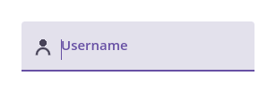

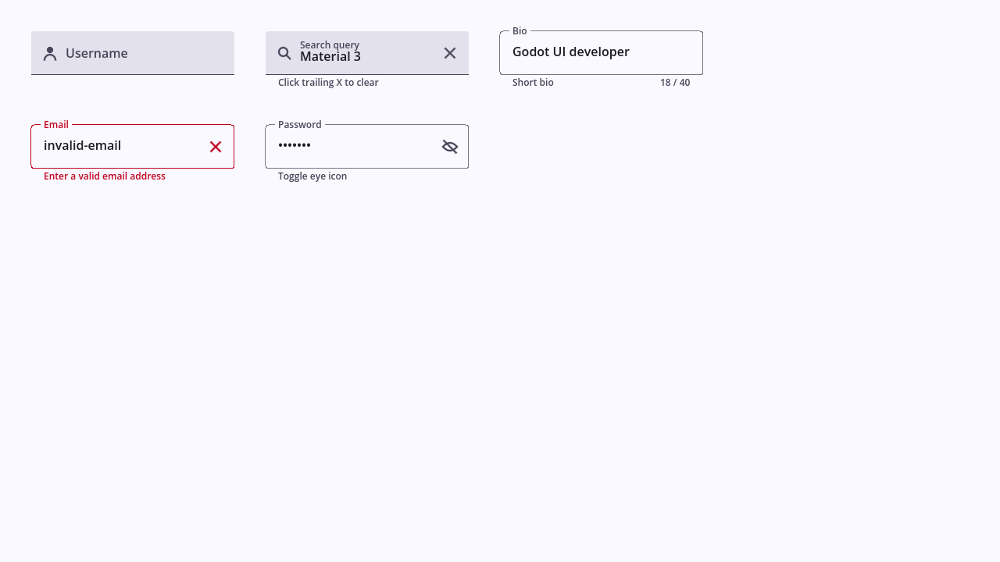

Frame breakdown (`inputs.text_field__focus_and_type.filmstrip.png`):

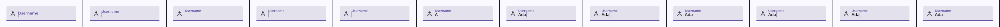

#### Floating label and focus indicator tween
Test: `tests/gss/test_gss_inputs.gd::test_text_field_variants_and_interaction` | [HTML Snapshot](../artifacts/gss/inputs/inputs.text_field__focus_and_type.gss.live.html) | [JSON Data](../artifacts/gss/inputs/inputs.text_field__focus_and_type.gss.live.json)

---

<a id="inputstext_fieldextended"></a>
## Text fields — Multiline textarea & prefix/suffix affixes (`inputs.text_field.extended`)

- **Material 3 Spec**: [https://m3.material.io/components/text-fields/specs](https://m3.material.io/components/text-fields/specs)
- **Supported Variants**: `multiline wrapping textarea mode`, `prefix text ($)`, `suffix text (kg / .com)`

### Example
```gdscript
var notes := M3TextField.new()
notes.variant = M3TextField.Variant.FILLED
notes.label_text = "Release Notes"
notes.multiline = true
notes.min_lines = 3
notes.max_lines = 6
notes.prefix_text = "$"
notes.suffix_text = "USD"
```

### Screenshots and Animations

#### Prefix/suffix affixes and multiline auto-expanding textarea
Test: `tests/gss/test_gss_inputs.gd::test_text_field_extended_multiline_and_affixes` | [HTML Snapshot](../artifacts/gss/inputs/inputs.text_field.extended__affixes_and_multiline_light.gss.html) | [JSON Data](../artifacts/gss/inputs/inputs.text_field.extended__affixes_and_multiline_light.gss.json)


#### Focus/type into prefix/suffix field and add lines to multiline field
Test: `tests/gss/test_gss_inputs.gd::test_text_field_extended_multiline_and_affixes` | [HTML Snapshot](../artifacts/gss/inputs/inputs.text_field.extended__focus_affix_and_expand_multiline.gss.live.html) | [JSON Data](../artifacts/gss/inputs/inputs.text_field.extended__focus_affix_and_expand_multiline.gss.live.json)

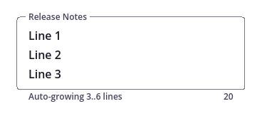

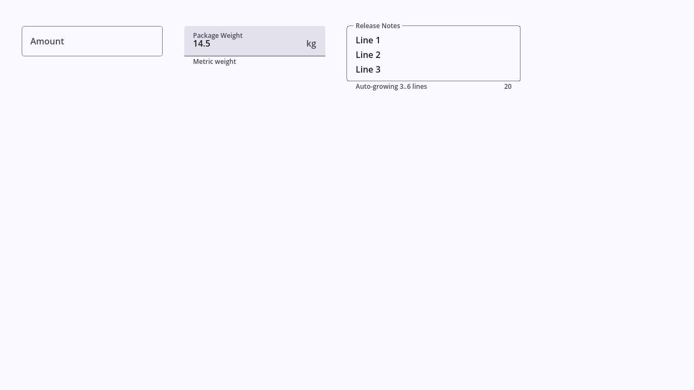

Frame breakdown (`inputs.text_field.extended__focus_affix_and_expand_multiline.filmstrip.png`):

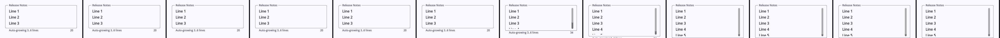

#### Affix fade-in with _label_float_progress and multiline _active_height growth tween
Test: `tests/gss/test_gss_inputs.gd::test_text_field_extended_multiline_and_affixes` | [HTML Snapshot](../artifacts/gss/inputs/inputs.text_field.extended__focus_affix_and_expand_multiline.gss.live.html) | [JSON Data](../artifacts/gss/inputs/inputs.text_field.extended__focus_affix_and_expand_multiline.gss.live.json)

---

<a id="inputsselect"></a>
## Exposed dropdown menu (select) (`inputs.select`)

- **Material 3 Spec**: [https://m3.material.io/components/menus/overview](https://m3.material.io/components/menus/overview)
- **Supported Variants**: `filled`, `outlined`, `open menu`, `selected value`

### Example
```gdscript
var select := M3Select.new()
select.variant = M3Select.Variant.OUTLINED
select.label_text = "Color Preset"
select.options = PackedStringArray(["Indigo", "Emerald", "Coral", "Teal"])
```

### Screenshots and Animations

#### Filled, outlined, open menu, and M3SelectDropdown variants
Test: `tests/gss/test_gss_inputs.gd::test_select_variants_and_dropdown_interaction` | [HTML Snapshot](../artifacts/gss/inputs/inputs.select__variants_light.gss.html) | [JSON Data](../artifacts/gss/inputs/inputs.select__variants_light.gss.json)

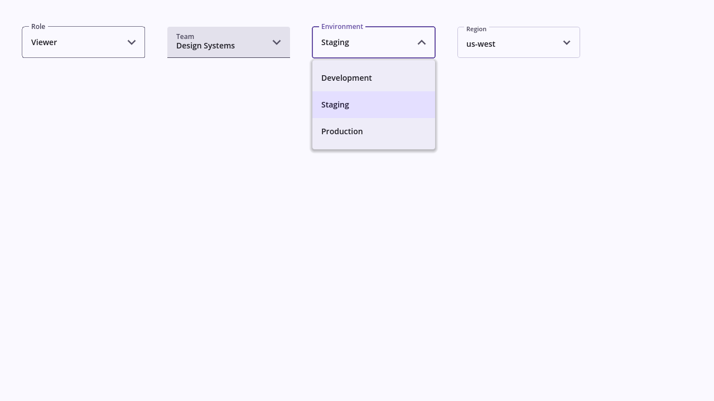

#### Open dropdown and click option item
Test: `tests/gss/test_gss_inputs.gd::test_select_variants_and_dropdown_interaction` | [HTML Snapshot](../artifacts/gss/inputs/inputs.select__pick_option.gss.live.html) | [JSON Data](../artifacts/gss/inputs/inputs.select__pick_option.gss.live.json)

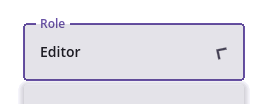

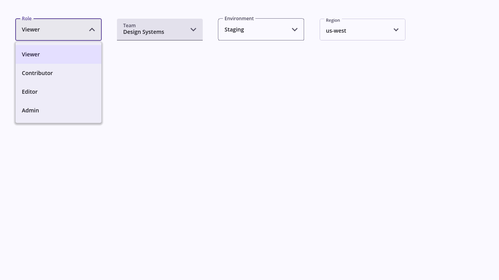

Frame breakdown (`inputs.select__pick_option.filmstrip.png`):

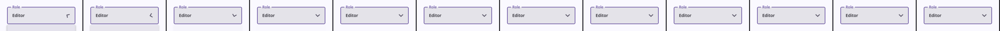

#### Chevron rotation and menu open_progress animation
Test: `tests/gss/test_gss_inputs.gd::test_select_variants_and_dropdown_interaction` | [HTML Snapshot](../artifacts/gss/inputs/inputs.select__open_dropdown.gss.live.html) | [JSON Data](../artifacts/gss/inputs/inputs.select__open_dropdown.gss.live.json)

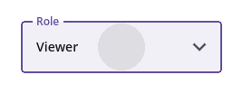

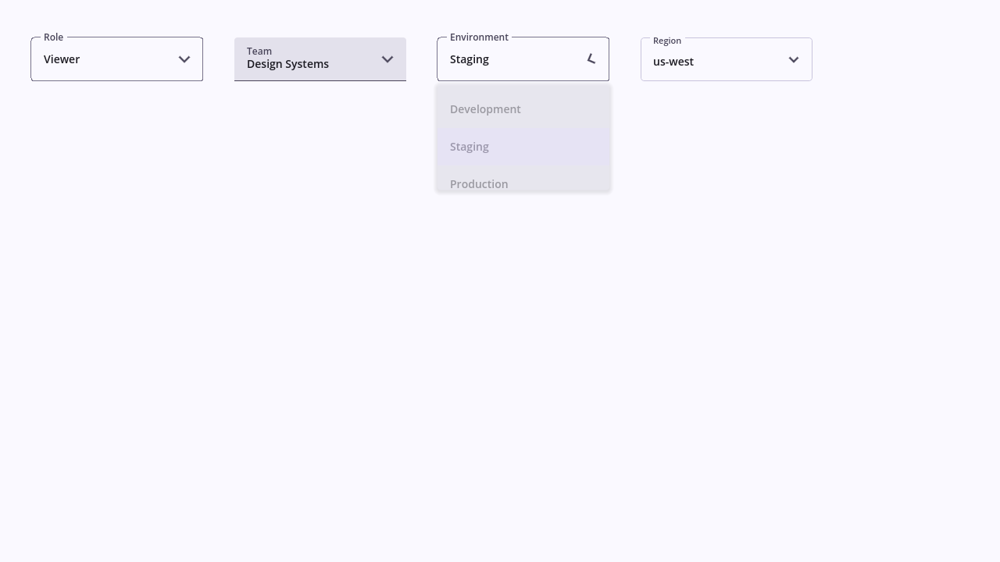

Frame breakdown (`inputs.select__open_dropdown.filmstrip.png`):

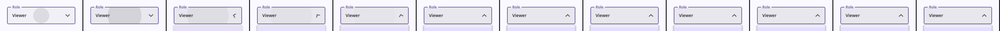

---
